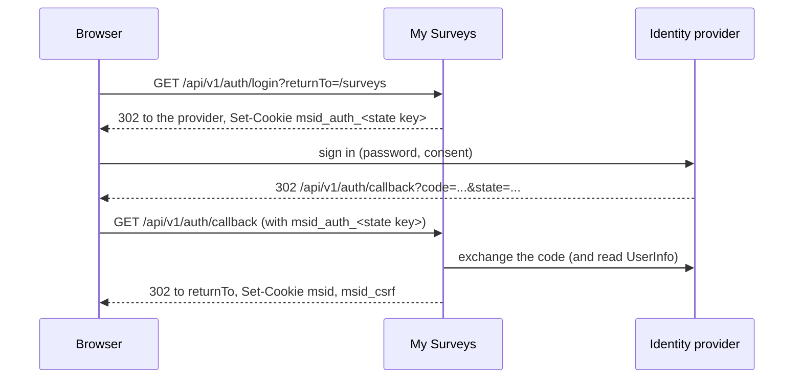

# Authentication, sessions and CSRF

How a client signs in to the API, how the session cookie works, and what the server checks on each
request. The contract is [`contract/openapi.yaml`](../../contract/openapi.yaml); the operations are
`login`, `loginCallback`, `logout`, `getCurrentUser`, `passwordLogin`, `changeOwnPassword` and
`setPasswordWithLink` (tag Session). How the server
builds the session: [Architecture](../architecture.md#identity-and-session).

## Summary

- Sign-in is a **browser redirect flow** through an identity provider. A self-hosted instance with
  its own accounts (`USER_DIRECTORY=local`, `AUTH_METHODS=password`) also signs in with
  **`passwordLogin`**, an email and a password ([Password sign-in](#password-sign-in)). Without
  `password` in `AUTH_METHODS`, `passwordLogin` answers `501 not-implemented`.
- The result is a **session cookie** `msid`. It is encrypted and signed. The server keeps no session
  state.
- A request that changes data also needs the **CSRF header** `X-CSRF-Token`.
- API tokens (`Authorization: Bearer ...`) are P1. In Phase 1 they never authenticate a request.
- Operations marked `security: []` in the contract (`login`, `loginCallback`, `getConfig`,
  `passwordLogin`, `setPasswordWithLink` and `/public/*`) need no session. `logout` works with or without one.

## The sign-in flow



1. **`GET /auth/login?returnTo=<path>`** checks `returnTo`, creates a sign-in transaction (random
   `state`, a PKCE verifier and `returnTo`), and seals it into a cookie named after the state,
   `msid_auth_<state key>` (the state key is the first 16 characters of `state`). It answers `302`
   with the identity provider's authorization URL.
2. The user signs in at the identity provider. On the hosted edition this is `auth.surveyjs.io`.
   In a local demo it is the dev "Sign in as…" page or the mock OIDC server.
3. The provider redirects the browser to **`GET /auth/callback?code=...&state=...`**. The server
   opens the transaction cookie of that `state`, compares the full `state` in constant time,
   exchanges the code (PKCE, and the client secret), and reads the user's identity (`sub`, `email`,
   `name`, optional `picture`).
4. The directory is asked for the user `sub`. If it has the user, its display name and email win over
   the provider's. A **blocked** user gets `403 forbidden` and no session. An identity without an
   email address gets `400 bad-request` and no session. A `picture` that is not an absolute http(s)
   URL is dropped.
5. The server sets `msid` and `msid_csrf`, clears that transaction cookie, and answers `302` to
   `PUBLIC_BASE_URL + returnTo`.

A transaction cookie is single use: the callback clears it whatever the outcome. Open `login` again to
retry. A transaction is valid for 10 minutes. Each sign-in has its own cookie, so sign-ins started in
several tabs at once all finish. When the callback finds no matching transaction (or the `state`
differs) but the browser is already signed in, for example because the callback was opened again, it
answers `302` to `PUBLIC_BASE_URL/` instead of `400`.

### Outcomes of the two sign-in operations

| Operation       | Status | Code             | When                                                                                                                                    |
| --------------- | ------ | ---------------- | --------------------------------------------------------------------------------------------------------------------------------------- |
| `login`         | 302    |                  | Redirect to the identity provider                                                                                                       |
| `login`         | 400    | `bad-request`    | `returnTo` is not a path on this site                                                                                                   |
| `login`         | 429    | `rate-limited`   | Too many requests (below)                                                                                                               |
| `login`         | 500    | `internal-error` | The identity provider cannot be reached for discovery                                                                                   |
| `loginCallback` | 302    |                  | Signed in; cookies are set. Or: no valid transaction, but already signed in (to `/`)                                                    |
| `loginCallback` | 400    | `bad-request`    | No valid transaction cookie (missing, expired, tampered), `state` mismatch, the provider refuses the code, or the identity has no email |
| `loginCallback` | 403    | `forbidden`      | The account is blocked. No session is created                                                                                           |
| `loginCallback` | 429    | `rate-limited`   | Too many requests                                                                                                                       |
| `loginCallback` | 500    | `internal-error` | The identity provider could not be reached, or rejected the server's client credentials                                                 |

Every error is a [Problem Details](conventions.md#errors) body. The browser shows it as it is, because
both operations are navigations, not `fetch` calls.

## Password sign-in

With `AUTH_METHODS=password` (self-hosted, `USER_DIRECTORY=local`) the instance keeps its own
accounts and signs them in without an identity provider.

```sh
curl -c cookies.txt -X POST -H "Content-Type: application/json"   -d '{"email":"owner@example.com","password":"my long password"}'   http://localhost:3000/api/v1/auth/password/login
```

`204` sets `msid` and `msid_csrf`, as the callback does. The email is not case-sensitive.

| Operation             | Request                                                         | Success                     |
| --------------------- | --------------------------------------------------------------- | --------------------------- |
| `passwordLogin`       | `POST /auth/password/login` with `email`, `password`            | `204`, Set-Cookie (session) |
| `changeOwnPassword`   | `POST /me/password` with `currentPassword`, `newPassword`; CSRF | `204`, Set-Cookie (session) |
| `setPasswordWithLink` | `POST /auth/password-link` with `token`, `password`             | `204`                       |

| Status | Code                       | When                                                                                                                                                                        |
| ------ | -------------------------- | --------------------------------------------------------------------------------------------------------------------------------------------------------------------------- |
| 401    | `invalid-credentials`      | `passwordLogin`: the email or the password is wrong. The answer is the same for an unknown email and for a disabled account                                                 |
| 403    | `invalid-credentials`      | `changeOwnPassword`: the current password is wrong                                                                                                                          |
| 422    | `password-too-weak`        | The new password is shorter than 12 characters, on the list of common passwords, or (`changeOwnPassword`) the current one; `detail` says which. A link is not used up by it |
| 429    | `account-locked`           | Five failures in a row for this email. `Retry-After` gives the seconds; the wait doubles with each further failure, up to an hour                                           |
| 410    | `link-invalid`             | `setPasswordWithLink`: the link was used, has expired, or was never issued                                                                                                  |
| 401    | `password-change-required` | Any session operation but `getCurrentUser`, `changeOwnPassword` and `logout`, while the account must change its password                                                    |
| 501    | `not-implemented`          | `password` is not in `AUTH_METHODS`                                                                                                                                         |
| 503    | `read-only`                | `changeOwnPassword` and `setPasswordWithLink` under `READ_ONLY=true`. `passwordLogin` still works there                                                                     |

- **The forced change.** `getCurrentUser` answers `instanceRole` (`admin` or `user`) and
  `mustChangePassword` for a local account. The first admin made from `ADMIN_PASSWORD` must change
  it first; meanwhile the other operations answer `401 password-change-required`. The web app sends
  such a user to `/change-password`.
- **A password change ends the user's other sessions.** `changeOwnPassword` answers with a new
  session for this browser; every older session of the user answers `401 unauthenticated` on its
  next request (on the same server at once, on another instance within a minute). See
  [ADR 0026](../adr/0026-revoking-stateless-sessions-with-an-epoch.md).
- **The first admin's setup link.** A server with no admin and no `ADMIN_EMAIL` writes a one-time
  link `PUBLIC_BASE_URL/set-password?setup=<token>` to its log. Its `setPasswordWithLink` call also
  sends `email` and `displayName` (without them, or with an email that already has an account: `400 bad-request`, and
  the link still works), and creates that admin.
- **`login`** sends the browser to the app's own page `PUBLIC_BASE_URL/sign-in?returnTo=<path>` when
  `AUTH_METHODS` has no `surveyjs` (and `IDENTITY_PROVIDER` is not `dev`). `logout` answers `redirectUrl` `PUBLIC_BASE_URL/`.

## `returnTo`

`returnTo` says where to land after sign-in. It is accepted only when it is a **path on this site**:

- it starts with exactly one `/` (so not `//host` and not `/\host`);
- it has no control characters;
- it is at most 2048 characters;
- resolved against `PUBLIC_BASE_URL`, it keeps the same origin;
- after the URL parser has normalised it (dot segments removed), it does not start with `//`.

Anything else answers `400 bad-request`. A missing `returnTo` means `/`. The server redirects to the
normalised form (percent-encoded). Query and fragment are kept: `returnTo=/?project=personal` returns
to `/?project=personal`.

```sh
curl -i "http://localhost:3000/api/v1/auth/login?returnTo=//evil.example"
# HTTP/1.1 400 Bad Request
```

## Cookies

| Cookie                  | Holds                                                                                     | Attributes                                                                              |
| ----------------------- | ----------------------------------------------------------------------------------------- | --------------------------------------------------------------------------------------- |
| `msid`                  | The sealed session: user id, name, email, avatar, CSRF token, expiry                      | `HttpOnly; SameSite=Lax; Path=/; Max-Age=SESSION_MAX_AGE_SECONDS` (default 43200, 12 h) |
| `msid_csrf`             | The CSRF token: 32 random bytes, base64url                                                | Same, but **not** HttpOnly: a script must read it                                       |
| `msid_auth_<state key>` | One sealed sign-in transaction; the name ends with the first 16 characters of its `state` | `HttpOnly; SameSite=Lax; Path=/api/v1/auth; Max-Age=600`; cleared by its callback       |

All of them get `Secure` when `PUBLIC_BASE_URL` is `https:`. A production server must be reached over
HTTPS.

- The session is **stateless**: the server stores nothing. It cannot end one session from the
  server side. A session ends by expiry (12 hours after sign-in, no renewal), by `logout` in
  that browser, or when `SESSION_SECRET` changes (that ends every session at once). On a local
  user directory a password change also ends all of the user's sessions
  ([Password sign-in](#password-sign-in)).
- The tokens of the identity provider are discarded after the callback. They are never in a
  cookie.
- The values are opaque to clients. The format, for implementers of another server, is in
  [Architecture](../architecture.md#the-sealed-cookie-format).

## Authenticated requests

The contract's `security` says what an operation needs. In Phase 1:

| Contract `security`                   | The server requires                               | Examples                          |
| ------------------------------------- | ------------------------------------------------- | --------------------------------- |
| `[]`                                  | Nothing                                           | `getConfig`, `login`, `/public/*` |
| `cookieAuth` (reads)                  | A valid `msid`                                    | `getCurrentUser`, `listSurveys`   |
| `cookieAuth` and `csrfToken` (writes) | A valid `msid`, and the CSRF header               | `createSurvey`                    |
| `cookieAuth` and `csrfToken`, or `{}` | Nothing; with a valid `msid`, the CSRF header too | `logout`                          |
| `bearerAuth` alone                    | Not satisfiable (P1)                              |                                   |

Checks run in this order, before the body is read:

1. **Authentication.** No `msid`, or one that is expired, tampered with or sealed with another secret:
   `401 unauthenticated`. For `logout` such a call is anonymous instead, and step 2 is skipped.
2. **CSRF**, for operations that ask for it: `403 csrf-token-invalid`.
3. Request validation: `400` or `422`.
4. The handler. An operation without a handler answers `501 not-implemented`.

So an anonymous call to an operation that is not built yet answers `401`, not `501`, and a signed-in
call without the CSRF header answers `403` before the body is checked.

`getCurrentUser` (`GET /me`) returns the signed-in user:

```json
{
  "id": "11111111-0000-4000-8000-a00000000001",
  "displayName": "Olivia Owner",
  "email": "owner@example.com",
  "avatarUrl": null,
  "notices": []
}
```

`notices` holds the account notices of the shell, such as an expired licence (`code`, `message`,
`actionUrl`, `actionLabel`). The list is empty when there is none, **and also when the notice store
fails**: the failure is logged on the server and `/me` still answers `200`.

## CSRF: the double-submit rule

A browser sends cookies with any request to the site, also one started by another site. For
requests that change data, the server therefore asks for proof that the code that sent the request
could read the `msid_csrf` cookie, which another site cannot.

- Send `X-CSRF-Token` on `POST`, `PUT`, `PATCH` and `DELETE` (that is, every operation whose
  `security` has `csrfToken`).
- Its value is the `msid_csrf` cookie.
- The server accepts the request only when the header, the `msid_csrf` cookie **and** the token
  inside the sealed `msid` are all present and equal. They are compared in constant time.

Example (the cookie jar holds `msid` and `msid_csrf` from a sign-in):

```sh
CSRF=$(awk '$6=="msid_csrf"{print $7}' cookies.txt)
curl -b cookies.txt -X POST -H "X-CSRF-Token: $CSRF" http://localhost:3000/api/v1/auth/logout
```

Without the header:

```text
HTTP/1.1 403 Forbidden
{"type":"https://studio.surveyjs.io/problems/csrf-token-invalid","title":"Invalid CSRF token","status":403,"code":"csrf-token-invalid","detail":"Send the value of the msid_csrf cookie in the X-CSRF-Token header."}
```

| Status | Code                 | Means                                           | The client should                                            |
| ------ | -------------------- | ----------------------------------------------- | ------------------------------------------------------------ |
| 401    | `unauthenticated`    | There is no valid session                       | Send the user to `login` (the web app does, with `returnTo`) |
| 403    | `csrf-token-invalid` | A session exists, but the header does not match | Read the cookie again and retry. Do not sign in again        |
| 403    | `forbidden`          | The user may not do this                        | Show it. A new token does not help                           |

The web app adds the header itself to every unsafe request (`web/src/api/csrf.ts`).

## Sign out

`POST /auth/logout` clears `msid`, `msid_csrf` and every `msid_auth_*` cookie it receives with
`Max-Age=0` and answers `200`:

```json
{
  "redirectUrl": "http://127.0.0.1:18080/surveyjs/endsession?post_logout_redirect_uri=...&client_id=..."
}
```

`redirectUrl` is where the client navigates next:

- **OIDC / auth.surveyjs.io:** the provider's `end_session_endpoint` with `client_id` and
  `post_logout_redirect_uri=PUBLIC_BASE_URL/`, so the provider session ends too. When the provider
  cannot be reached, or offers no end-session endpoint, the URL is `PUBLIC_BASE_URL/`: the local
  sign-out has already happened.
- **Dev provider:** `PUBLIC_BASE_URL/`.

`logout` works **without a session** too: with no `msid`, or one that has expired or is invalid, it
answers `200` with the same `redirectUrl` and clears the cookies. So a user whose session expired while
the page stayed open still ends the provider's session (otherwise the provider would sign them straight
back in). With a valid session the CSRF header is required as usual (`403 csrf-token-invalid`
otherwise). The web app always navigates to `redirectUrl`.

## Rate limiting

`login`, `loginCallback`, `passwordLogin`, `changeOwnPassword` and `setPasswordWithLink` allow
`SIGN_IN_RATE_LIMIT` requests per minute (default 30). The counter is **per operation and per client**. Above it:

```text
HTTP/1.1 429 Too Many Requests
retry-after: 60
{"type":"https://studio.surveyjs.io/problems/rate-limited","title":"Too many requests","status":429,"code":"rate-limited","detail":"Too many sign-in attempts. Try again in 1 minute."}
```

**The client is the address of the connection**, unless the server was told to believe a reverse proxy.
`TRUST_PROXY` is a comma-separated list of the proxies' IP addresses or CIDR ranges. For a request from a
listed proxy the client is the address in `X-Forwarded-For`; from any other peer the header is ignored.
Without `TRUST_PROXY`, a server behind a proxy sees one address for all users, and they share one counter.
Set it to the proxy's address (see [Public endpoints](public-endpoints.md#the-respondents-ip-address)).
The public respondent operations use the same address and their own, higher limit
([Rate limits](public-endpoints.md#rate-limits)).

## Edition and provider

| Setting                                     | Effect                                                                                                                                        |
| ------------------------------------------- | --------------------------------------------------------------------------------------------------------------------------------------------- |
| `IDENTITY_PROVIDER=surveyjs-oidc` (default) | Sign in at `OIDC_ISSUER_URL`: `auth.surveyjs.io`, or the local mock OIDC server                                                               |
| `IDENTITY_PROVIDER=dev`                     | A "Sign in as…" page at `/__dev/sign-in`. Memory storage, self-hosted, development only. See [ADR 0007](../adr/0007-dev-identity-provider.md) |

`GET /config` lists `authMethods`. The values are `surveyjs` (surveyjs.io accounts), `password`, `google`, `github` and `facebook`. `password` needs `USER_DIRECTORY=local` ([Password sign-in](#password-sign-in)). `google`, `github` and `facebook` come with self-hosted Step 8; until then a server configured with one of them refuses to start ([ADR 0018](../adr/0018-accounts-by-deployment-mode.md)). With `password` and no `surveyjs`, the server needs no `OIDC_*` settings.
