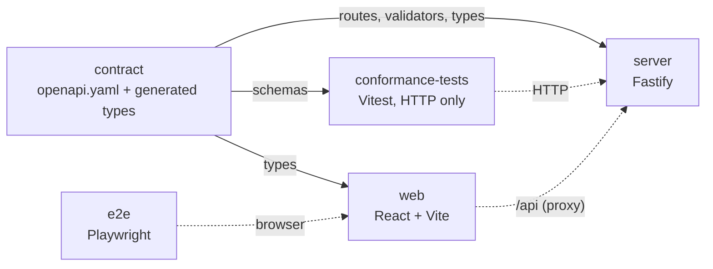
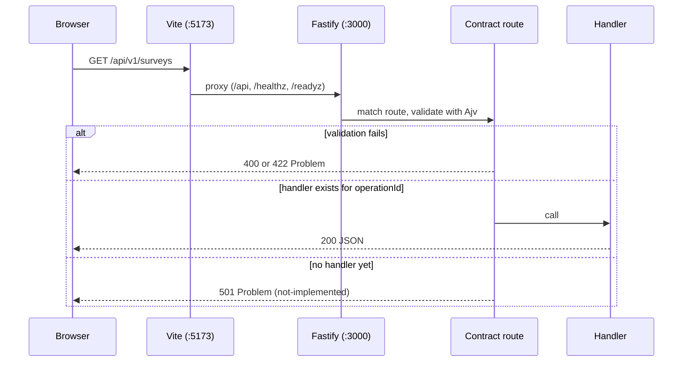

# Architecture

This page describes what is built now (Step 1). The final design is in `spec.md`; the later steps
are listed at the end.

## Principles

- **The contract is the source of truth.** `contract/openapi.yaml` defines every route, parameter,
  body and error. The server builds its routes and validators from it, the web app takes its types
  from it, and the conformance suite checks servers against it.
- **Replaceable back end.** Anything that passes the conformance suite can replace the Node.js
  server. Storage sits behind provider interfaces.
- **Configuration from the environment.** Everything is read and validated at start-up.

## Packages

| Package             | Role                                                                                                                           |
| ------------------- | ------------------------------------------------------------------------------------------------------------------------------ |
| `contract`          | The OpenAPI file, `openapiPath`, generated types (`paths`, `components`, `operations`), and `build:docs` for the API reference |
| `server`            | Reference back end                                                                                                             |
| `web`               | Front end                                                                                                                      |
| `conformance-tests` | Checks every response of a running server against the contract; can target any server                                          |
| `e2e`               | Starts the server and the built web app and drives them in three browsers                                                      |

## Server modules (`server/src`)

| File          | Role                                                                                                                                                                                                              |
| ------------- | ----------------------------------------------------------------------------------------------------------------------------------------------------------------------------------------------------------------- |
| `main.ts`     | Loads configuration, creates providers, listens, shuts down on SIGINT and SIGTERM. A bad configuration prints every problem and exits with code 1                                                                 |
| `config.ts`   | `loadConfig(env)`: validates environment variables with zod, returns a frozen `AppConfig`, or throws `ConfigError` listing all problems                                                                           |
| `app.ts`      | `buildApp(config, providers)`: creates the Fastify instance, error handling, `/healthz`, `/readyz`, the API routes and (when enabled) `/api/docs`                                                                 |
| `contract.ts` | Reads the contract and builds, for each operation, a Fastify route (`/api/v1/...`) and Ajv (JSON Schema 2020-12) validators for path, query, headers and body. See [ADR 0003](adr/0003-custom-contract-loader.md) |
| `api.ts`      | Registers one route per operation. The handler is looked up by `operationId`; if there is none, the route answers `501`                                                                                           |
| `handlers.ts` | The implemented operations, keyed by `operationId`. Only `getConfig` exists in Step 1                                                                                                                             |
| `errors.ts`   | Error mapper: turns any error into a Problem Details body. Body validation errors become `422`; path, query and header errors `400`; an unknown error becomes `500 internal-error` with no internal detail        |
| `docs.ts`     | `GET /api/docs`: serves `contract/dist/reference.html`; answers `404` with the hint "Run pnpm build:docs" if it was not built                                                                                     |
| `providers/`  | Provider registry. `ProviderSet` has `name`, `ready()` and `close()`. The `memory` provider is empty; the store interfaces arrive in Step 2                                                                       |

Rules that hold everywhere:

- Every API path is under `/api/v1`. The only other routes are `/healthz`, `/readyz` and
  `/api/docs` (off in production unless `API_DOCS=true`).
- Every error body is `application/problem+json` with `type`, `title`, `status` and a stable
  `code`. Unknown URLs give `404 not-found`.
- Every response carries `x-request-id`. An incoming `x-request-id` (up to 128 characters) is reused.
- The request body limit is `LIMIT_MAX_RESPONSE_BYTES` ([ADR 0004](adr/0004-body-limit.md)).
- `/readyz` returns `503` when the provider's `ready()` is false.

## Request flow

In production the web bundle is static files and a reverse proxy sends `/api` to the server.
The server does not serve the web app.

## Web modules (`web/src`)

| Path                            | Role                                                                                                                                                 |
| ------------------------------- | ---------------------------------------------------------------------------------------------------------------------------------------------------- |
| `main.tsx`                      | Creates the TanStack Query client and the router, renders the app                                                                                    |
| `router.ts`, `routeTree.gen.ts` | TanStack Router. The route tree is generated by the Vite plugin from `routes/`                                                                       |
| `routes/__root.tsx`             | Root route. Its loader fetches `/config` and applies the SurveyJS licence key; an error component shows a retry button                               |
| `routes/index.lazy.tsx`         | Home page, a lazy route. Shows `edition:` and `shell:`                                                                                               |
| `shell/PlaceholderShell.tsx`    | Replaceable shell with a narrow interface: `user`, `notices`, `links`, `children`                                                                    |
| `api/client.ts`                 | openapi-fetch client typed by the contract. Base URL is `VITE_API_BASE_URL`, default `/api/v1`; cookies are sent (`credentials: "include"`)          |
| `api/config.ts`                 | Query options for `GET /config` (cached 5 minutes)                                                                                                   |
| `surveyjs/license.ts`           | `applySurveyJSLicense(key)`: imports `survey-core` lazily and calls `setLicenseKey`. With no key it does nothing and `survey-core` is not downloaded |

The licence key travels: `SURVEYJS_LICENSE_KEY` (server) -> `GET /api/v1/config` ->
`applySurveyJSLicense` (browser). It is never in the code.

## Build and run

- `server` runs TypeScript directly with `tsx`; there is no server build.
- `web` is built by Vite (`pnpm build`). `survey-core` is one large lazy chunk.
- `pnpm demo` builds the API reference once, then runs `tsx watch` (server) and `vite` (web) together.

## What later steps add

- Step 2: store interfaces and the in-memory provider (surveys, content, results, files, views),
  a provider test suite, and Azurite.
- Later: the Azure legacy provider, sign-in with `auth.surveyjs.io` (session cookie and CSRF),
  application services, the `surveyjs-site` shell, survey list, editor, results and run page,
  Docker packaging. The contract already describes all of these.
