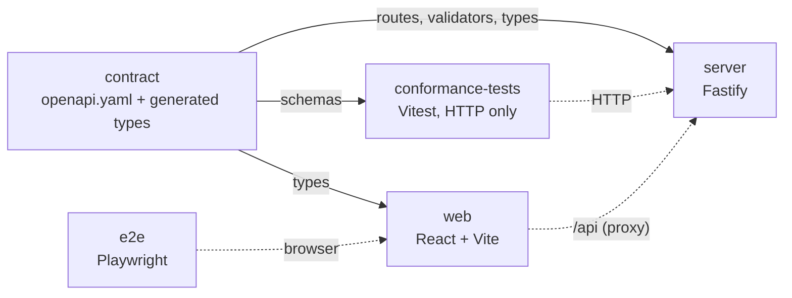
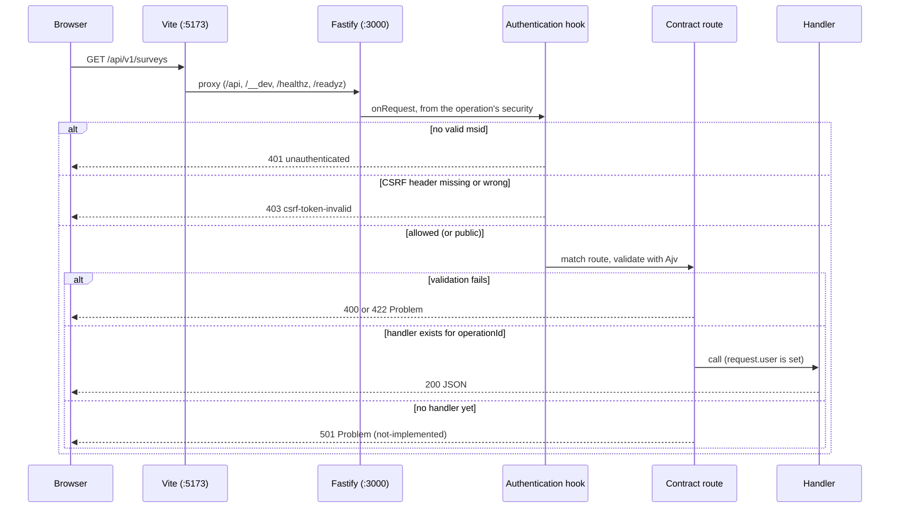

# Architecture

This page describes what is built now (Steps 1 to 4). The final design is in `spec.md`; the later steps
are listed at the end.

## Principles

- **The contract is the source of truth.** `contract/openapi.yaml` defines every route, parameter,
  body and error. The server builds its routes and validators from it, the web app takes its types
  from it, and the conformance suite checks servers against it.
- **Replaceable back end.** Anything that passes the conformance suite can replace the Node.js
  server. Storage sits behind provider interfaces.
- **Configuration from the environment.** Everything is read and validated at start-up.

## Packages



| Package             | Role                                                                                                                           |
| ------------------- | ------------------------------------------------------------------------------------------------------------------------------ |
| `contract`          | The OpenAPI file, `openapiPath`, generated types (`paths`, `components`, `operations`), and `build:docs` for the API reference |
| `server`            | Reference back end                                                                                                             |
| `web`               | Front end                                                                                                                      |
| `conformance-tests` | Checks every response of a running server against the contract; can target any server                                          |
| `e2e`               | Starts the server and the built web app and drives them in three browsers                                                      |

## Server modules (`server/src`)

| File             | Role                                                                                                                                                                                                                                                                       |
| ---------------- | -------------------------------------------------------------------------------------------------------------------------------------------------------------------------------------------------------------------------------------------------------------------------- |
| `main.ts`        | Loads configuration, creates providers, listens, shuts down on SIGINT and SIGTERM. A bad configuration prints every problem and exits with code 1                                                                                                                          |
| `config.ts`      | `loadConfig(env)`: validates environment variables with zod, returns a frozen `AppConfig`, or throws `ConfigError` listing all problems                                                                                                                                    |
| `app.ts`         | `buildApp(config, providers)`: creates the Fastify instance, error handling, `/healthz`, `/readyz`, the API routes and (when enabled) `/api/docs`                                                                                                                          |
| `contract.ts`    | Reads the contract and builds, for each operation, a Fastify route (`/api/v1/...`) and Ajv (JSON Schema 2020-12) validators for path, query, headers and body. See [ADR 0003](adr/0003-custom-contract-loader.md)                                                          |
| `api.ts`         | Registers one route per operation, with the authentication hook for its `security` and the sign-in rate limit. The handler is looked up by `operationId`; if there is none, the route answers `501`                                                                        |
| `handlers.ts`    | The implemented operations that need no session, keyed by `operationId`: `getConfig` (including `links`)                                                                                                                                                                   |
| `errors.ts`      | Error mapper: turns any error into a Problem Details body. Body validation errors become `422`; path, query and header errors `400`; an unknown error becomes `500 internal-error` with no internal detail                                                                 |
| `docs.ts`        | `GET /api/docs`: serves `contract/dist/reference.html`; answers `404` with the hint "Run pnpm build:docs" if it was not built                                                                                                                                              |
| `providers/`     | Provider registry (`createProviders`), the store interfaces, the `memory` and `azure-legacy` providers and the shared list order. See [Storage providers](#storage-providers)                                                                                              |
| `domain/`        | Domain types shared by every provider (`types.ts`). See [Domain types](#domain-types)                                                                                                                                                                                      |
| `auth/`          | Identity and session: the `IdentityProvider` interface and its two providers, the sealed cookies, CSRF, `returnTo`, the authentication hook and the handlers of `login`, `loginCallback`, `logout` and `getCurrentUser`. See [Identity and session](#identity-and-session) |
| `surveys/`       | `listSurveys`, `createSurvey` and `getSurvey`: the service (scopes, paging, creation), the pure rules (`permissions.ts`, `naming.ts` for "New Survey N") and the JSON mapping. See [Surveys and projects](#surveys-and-projects)                                           |
| `projects/`      | `listProjects` and `getProject`: the service, the handlers and the JSON mapping                                                                                                                                                                                            |
| `paging/`        | `cursor.ts`: the opaque cursors of both lists (pure). See [Paging](api/paging.md)                                                                                                                                                                                          |
| `notices/`       | `AccountNotices` (`CurrentUser.notices`): the demo settings, and the surveyjs.io licence-expiry rule used by the `azure-legacy` provider                                                                                                                                   |
| `shell-links.ts` | The built-in surveyjs.io account links and their merge with `SHELL_LINKS` (`/config.links`)                                                                                                                                                                                |
| `legacy/`        | Tools for the offline replica of the legacy stores: the fixture loader, its endpoint safety guard and Edm validation. Not used by the server at run time                                                                                                                   |
| `cli/`           | `inspect-legacy.ts`, a read-only command-line inspector (`pnpm inspect:legacy`)                                                                                                                                                                                            |

Rules that hold everywhere:

- Every API path is under `/api/v1`. The only other routes are `/healthz`, `/readyz`,
  `/api/docs` (off in production unless `API_DOCS=true`) and, with the dev identity provider only,
  `/__dev/sign-in`.
- Every error body is `application/problem+json` with `type`, `title`, `status` and a stable
  `code`. Unknown URLs give `404 not-found`.
- Every response carries `x-request-id`. An incoming `x-request-id` (up to 128 characters) is reused.
- Request logs never show the values of the `code` and `state` query parameters (the sign-in
  callback): they are written as `[redacted]` (`server/src/logging.ts`).
- The request body limit is `LIMIT_MAX_RESPONSE_BYTES` ([ADR 0004](adr/0004-body-limit.md)).
- `/readyz` returns `503` when the provider's `ready()` is false.

## Storage providers

Storage sits behind three interfaces in `server/src/providers/types.ts`. Nothing outside
`providers/` knows which implementation runs.

| Interface     | Methods                                                                                                                  | Rules                                                                                                                                                                                                                                                                                                                                                                                                                                                                       |
| ------------- | ------------------------------------------------------------------------------------------------------------------------ | --------------------------------------------------------------------------------------------------------------------------------------------------------------------------------------------------------------------------------------------------------------------------------------------------------------------------------------------------------------------------------------------------------------------------------------------------------------------------- |
| `SurveyStore` | `getSurvey(id)`, `listSurveys(owner)`, `listSurveyPage(query)`, `createSurvey(survey, definition?)`, `getDefinition(id)` | `null` when not found. `listSurveys` includes archived surveys, ordered by `updatedAt` descending, then `id`. `listSurveyPage` returns the rows of that list that match `archived`, after a position, at most `limit` of them, with the position of the last row when more follow. `createSurvey` stores the legacy defaults and returns the record as stored; it throws on a duplicate id. `getDefinition` returns `{}` when the survey has none, `null` for an unknown id |
| `Directory`   | `getUser(id)`, `findUserByEmail(email)`, `listUserProjects(userId)`, `getUserProject(userId, projectId)`                 | Email match ignores case. Projects are ordered by project name ignoring case, then project id. `getUserProject` returns `null` when the user is not a member or the project does not exist                                                                                                                                                                                                                                                                                  |
| `ProviderSet` | `name`, `surveys`, `directory`, `notices`, `ready()`, `close()`                                                          | What the server holds. `ready()` feeds `/readyz`. `notices` is `AccountNotices` (see below)                                                                                                                                                                                                                                                                                                                                                                                 |

Ids are GUIDs. Stores match them case-insensitively and return them in lower case. The list orders
live in `providers/ordering.ts`, so every provider sorts the same way. The only writes in the interfaces are
`createSurvey` (Step 4); the other writes arrive with the steps that need them.

| Provider       | `STORAGE_PROVIDER` | What it is                                                                                                                                                                                                                                                                                                                                                                                                                                           |
| -------------- | ------------------ | ---------------------------------------------------------------------------------------------------------------------------------------------------------------------------------------------------------------------------------------------------------------------------------------------------------------------------------------------------------------------------------------------------------------------------------------------------- |
| `memory`       | `memory` (default) | Holds records in memory and returns copies. Empty unless `MEMORY_SEED=legacy-fixtures`, which loads the golden fixtures in `server/fixtures/legacy/` through the same mapping as the legacy provider                                                                                                                                                                                                                                                 |
| `azure-legacy` | `azure-legacy`     | Works on the real surveyjs.io stores: SQL for users, surveys, projects and memberships, through a lazily created pool. `ready()` checks SQL and both storage accounts. A skipped row is reported as a warning with ids only. It reads everything and writes **only survey creation**, in `providers/azure-legacy/writes.ts`; ESLint forbids write calls in the rest of the folder. See [Writing to the legacy stores](#writing-to-the-legacy-stores) |

`createProviders` picks the provider from `STORAGE_PROVIDER`. The settings are described in
[Development](development.md#environment-variables-server): `STORAGE_PROVIDER`, `MEMORY_SEED`
(`empty` or `legacy-fixtures`) and, for `azure-legacy`, all three of
`LEGACY_SQL_CONNECTION_STRING`, `LEGACY_SURVEYS_STORAGE_CONNECTION_STRING` and
`LEGACY_RESULTS_STORAGE_CONNECTION_STRING`. The connection strings are secrets: no error message or
log line includes one.

`legacy/` and the `docker/` folder build an offline replica of the legacy stores (Azurite for tables
and blobs, SQL Server for the directory) that the `azure-legacy` provider can run against. Why SQL
Server, and what is not emulated: [ADR 0006](adr/0006-legacy-replica.md).

## Domain types

`server/src/domain/types.ts` holds what the providers return.

| Type                | Holds                                                                                                                                                                        |
| ------------------- | ---------------------------------------------------------------------------------------------------------------------------------------------------------------------------- |
| `SurveyOwner`       | A user (`kind: "personal"`, `userId`) or a project (`kind: "project"`, `projectId`)                                                                                          |
| `SurveyRecord`      | Survey metadata: `id`, `name`, `owner`, `creatorId`, `postId`, `resultId`, `published`, `archived`, `createdAt` and `updatedAt` (ISO 8601 UTC), `settings`                   |
| `User`              | `id`, `email`, `displayName` (the email when the legacy name is blank), `blocked`                                                                                            |
| `ProjectRecord`     | A project as the Directory returns it: `id`, `name`, `ownerId`, `createdAt` (ISO 8601 UTC), `memberCount` (at least 1)                                                       |
| `ProjectMembership` | A `ProjectRecord` and the user's `role` (`admin` or `user`)                                                                                                                  |
| `NewSurvey`         | What the service decides for a new survey: `id`, `name`, `owner`, `creatorId`, `postId`, `resultId`, `createdAt` and `updatedAt` (equal). The store adds the legacy defaults |
| `SurveyDefinition`  | The survey definition, a JSON object (`Record<string, unknown>`)                                                                                                             |
| `SurveyResponse`    | Declared for the results steps: `id`, `submittedAt`, `data`, optional `clientId` and `respondentIp`, `partial`                                                               |

## Surveys and projects

Step 4 builds `listSurveys`, `createSurvey`, `getSurvey`, `listProjects` and `getProject`. The routes come
from the contract like every other; the handlers are in `surveys/handlers.ts` and
`projects/handlers.ts` and call a service that holds the rules. The client view is
[API: What is implemented](api/README.md#what-is-implemented) and [Paging](api/paging.md).

### Permissions

`surveys/permissions.ts` (pure) follows the legacy rule; the reason and what changes if the product
owner chooses otherwise are in [ADR 0009](adr/0009-survey-permissions-follow-legacy.md).

| Question                | Personal survey                 | Project survey                                         |
| ----------------------- | ------------------------------- | ------------------------------------------------------ |
| Can see (list, get)     | The user is the owner           | The user is a member of the project, in any role       |
| `permissions.canModify` | `true` (only the owner sees it) | The user's role is `admin`, **or** the user created it |
| Can create in the scope | Always                          | Any member                                             |

A survey the user cannot see answers `404 not-found`, like an unknown id.

### Listing

`listSurveys` takes `project` (`personal` or a project id). Any other value must be the id of a project
the user belongs to (`Directory.getUserProject`); an unknown id, text that is no id and a project of
others all answer `404 not-found`. The service cuts the page with `SurveyStore.listSurveyPage`, using the
position decoded from the cursor, and turns the store's `next` position into `nextCursor`.
`listProjects` asks the Directory for the whole list (it is short) and cuts the page itself. Cursors are
in `paging/cursor.ts`: the format is a reference, not part of the contract, and is written down for ports in
[Paging](api/paging.md#for-ports-the-reference-cursor-format). A cursor belongs to one list (scope and
`archived`), so a mismatch is `400 bad-request`.

### Creation

`createSurvey` checks, in this order: a given name is not blank and fits (`422`, see below); the
`projectId`, if any, is a project of the user (`403 forbidden` otherwise). Without a name the service
reads the **active** surveys of the scope and calls `nextNewSurveyName` (`surveys/naming.ts`, pure), which
reproduces the legacy rule: start at 1; for each name that starts with the exact text `New Survey` and
whose rest is a number (optional sign, surrounding white space allowed, at most `2147483647`), take the
highest; answer `New Survey <highest + 1>`. Gaps are not filled and archived names are ignored. The ids
come from `crypto.randomUUID()`, the time from `BuildOptions.now` (default `Date.now`), and the answer is
`201` with `Location`.

**Name length.** The contract says `maxLength: 200`. JSON Schema counts characters (code points); the
legacy column holds 200 UTF-16 code units. The service therefore also refuses a name longer than 200
UTF-16 code units with `422` at `/name`. ([ADR 0010](adr/0010-writing-to-the-legacy-stores.md))

### Writing to the legacy stores

The `azure-legacy` provider was read-only until Step 4. Its first write is survey creation, and the
rule is: **every write lives in `providers/azure-legacy/writes.ts`**. ESLint keeps the read-only rule
for the rest of the folder and lists that one file in the rule block's `ignores`. Details and reasons:
[ADR 0010](adr/0010-writing-to-the-legacy-stores.md). In short, `createSurvey`:

1. checks that the id is free (one `SELECT`);
2. when a definition is given, writes the append blobs `surveyjson/{id}`, `surveytext/{id}` and
   `surveyjsonhistory/{id}/{newGuid}`;
3. inserts the `Surveys` row with exactly the legacy create columns (all others stay `NULL`);
4. appends the `SURVEY_CREATE` audit row to table `surveys`, **best effort**: a failure is a warning
   with the survey id and the create still succeeds;
5. reads the survey back and returns it.

Blobs come before the row, so a failure leaves invisible orphan blobs and never a survey without its
definition. A store failure is a `LegacyStoreError` (`providers/azure-legacy/errors.ts`, re-exported from
`index.ts`), whose message reads "Legacy store <operation> failed" plus driver codes and never a
connection string or row content. The layout reference is
[section 5.3](architecture/legacy-data-layout.md#53-what-a-writer-must-do-so-legacy-readers-see-a-change).

### Projects

`ProjectRecord` has `ownerId`, `createdAt` and `memberCount`, which legacy does not store. The read side
infers them in `projectFromLegacy` (`providers/azure-legacy/mapping.ts`,
[layout, 9.3](architecture/legacy-data-layout.md#93-project-project)): the owner is the user of the
membership row whose id equals the project id (the creator's row), else the earliest admin, else the
earliest member; `createdAt` is that row's `happendat` (else the project's, else
`1970-01-01T00:00:00.000Z`), read as UTC; `memberCount` is the number of membership rows. Step 11 only adds
the writes.

## Legacy mapping

The current surveyjs.io site keeps its data in SQL, Azure Tables, Blobs and Files. How, and how
each field maps to the domain, is written in
[legacy-data-layout.md](architecture/legacy-data-layout.md) (mapping: section 9). This section only
summarises it.

| Legacy                                   | Domain                                                                   |
| ---------------------------------------- | ------------------------------------------------------------------------ |
| `Surveys.userid`                         | A project id when it is an organization id, otherwise the personal owner |
| `Surveys.ispublished` (`NULL`)           | `published = false`                                                      |
| `Surveys.creatorid` (all zeros)          | `creatorId = null`                                                       |
| `Surveys.createdat`, `Surveys.timestamp` | `createdAt`, `updatedAt`, read as UTC                                    |
| `OrganizationUsers.role`                 | `admin` or `user` (case is ignored)                                      |
| `Users.displayname` (NULL or blank)      | The email                                                                |

Rules decided in Step 2:

- **NULL columns map with defaults.** A NULL name becomes `""`. A NULL `createdat` takes the
  `timestamp` value and the other way round; if both are NULL, both become
  `1970-01-01T00:00:00.000Z`. A NULL email becomes `""`, and `findUserByEmail` with a blank email
  finds no user. A NULL project name becomes `""`.
- **Rows the domain cannot represent are skipped and reported.** A survey with a NULL `postid`,
  `resultid` or `userid`, and a membership with a NULL or unknown role, are left out. Each one is
  reported as a warning that carries ids only.
- **Ids are case-insensitive**, and returned in lower case.

D11 (respondent files stored as URLs in place of inline content) has the verdict "Yes, with
conditions": [ADR 0005](adr/0005-respondent-files-as-urls.md).

### Open for later steps

Steps 2 and 3 leave these points open. The first group are differences between the legacy system and the
contract; the last rows come from Step 3.

| Point                                                                                                                                                                                                                             | To settle in                        |
| --------------------------------------------------------------------------------------------------------------------------------------------------------------------------------------------------------------------------------- | ----------------------------------- |
| ~~`canModify`: legacy allows a project admin or the survey's creator; the spec allows any member~~ Settled in Step 4: the legacy rule ([ADR 0009](adr/0009-survey-permissions-follow-legacy.md)); the product owner is to confirm | Step 4 (done)                       |
| ~~Survey name length: 200 in SQL, 256 in the contract~~ Settled in Step 4: the contract says 200, plus a server check in UTF-16 code units ([ADR 0010](adr/0010-writing-to-the-legacy-stores.md))                                 | Step 4 (done)                       |
| Results layouts: legacy keeps them per survey, the contract per user                                                                                                                                                              | Step 9 or 10                        |
| Project `ownerId` and `createdAt`: legacy has no columns; they are inferred from the creator's membership row. The read side is settled in Step 4 ([Projects](#projects)); the writes remain                                      | Step 11 (writes)                    |
| Fixtures are synthetic; the spec wants them copied from storage. Check them on a read-only copy (site team)                                                                                                                       | Step 14                             |
| `azure-legacy` readiness makes account-level calls; a container SAS keeps `/readyz` at 503. Narrow the probe                                                                                                                      | Step 14                             |
| Sign-in rate limit keys on the socket IP and does not trust `X-Forwarded-For`; behind a reverse proxy all users share one counter                                                                                                 | Step 14 (trusted proxy)             |
| Keyboard and ARIA polish of the copied surveyjs.io header; the Open Sans font is not self-hosted (the text falls back to Helvetica)                                                                                               | Step 13                             |
| The copied cookie banner mentions advertising partners (Google, Reddit, X) that My Surveys does not use; the hosted deployment needs reviewed text                                                                                | Step 13 or before the hosted launch |
| Session revocation: the session is a stateless sealed cookie (12 h, no renewal), so a session cannot be ended on the server. Changing `SESSION_SECRET` ends all of them                                                           | Not planned; stateless by design    |

## Request flow



In production the web bundle is static files and a reverse proxy sends `/api` to the server.
The server does not serve the web app.

## Identity and session

Step 3 adds sign-in. The client-facing description (flow, cookies, errors, CSRF example) is in
[Authentication, sessions and CSRF](api/authentication.md). This section is for implementers.

### `IdentityProvider`

`server/src/auth/identity.ts`. The caller (the `login` and `loginCallback` handlers) makes the random
sign-in parameters and keeps them in a sealed transaction cookie, `msid_auth_<state key>`. A
provider only talks to the identity service.

| Member                              | Does                                                                                              |
| ----------------------------------- | ------------------------------------------------------------------------------------------------- |
| `authorizationUrl(params)`          | The URL to send the browser to. `params` are `state`, `nonce` and the PKCE `codeVerifier`         |
| `finishSignIn(callbackUrl, params)` | Checks what came back and returns `{ sub, email?, name?, picture? }`. A bad code is a `400` error |
| `endSessionUrl()`                   | Where the browser goes after local sign-out                                                       |
| `routes` (optional)                 | Fastify routes the provider serves itself, outside `/api/v1`                                      |

`IDENTITY_PROVIDER` selects the implementation (`auth/providers/index.ts`).

| Provider                              | What it does                                                                                                                                                                                                                                                                                                                                                                                               |
| ------------------------------------- | ---------------------------------------------------------------------------------------------------------------------------------------------------------------------------------------------------------------------------------------------------------------------------------------------------------------------------------------------------------------------------------------------------------- |
| `dev` (`providers/dev.ts`)            | A "Sign in as…" page at `GET /__dev/sign-in` lists the users of the memory seed. A choice goes to the regular callback with the user id as `code`. See [ADR 0007](adr/0007-dev-identity-provider.md). Refused with `NODE_ENV=production`, `APP_EDITION=hosted` and any storage other than `memory`                                                                                                         |
| `surveyjs-oidc` (`providers/oidc.ts`) | Authorization code flow with PKCE (S256) and `state`, through `openid-client`, with `client_secret_post`. The identity always comes from the UserInfo endpoint ([ADR 0008](adr/0008-surveyjs-auth-oauth2-userinfo.md)). Discovery is **lazy**: done at the first sign-in, cached, and retried after a failure, so start-up and `/readyz` never depend on the issuer. Tokens are dropped after the callback |

`surveyjs-oidc` has two modes (`OIDC_DISCOVERY`):

| Mode                                   | For                                                                                                                                                           | Metadata                                                                                                          | ID token                                                                                                                                         |
| -------------------------------------- | ------------------------------------------------------------------------------------------------------------------------------------------------------------- | ----------------------------------------------------------------------------------------------------------------- | ------------------------------------------------------------------------------------------------------------------------------------------------ |
| `oauth-authorization-server` (default) | `auth.surveyjs.io` and the mock OIDC server. It is OAuth 2.0, not OpenID ([layout, 6.1](architecture/legacy-data-layout.md#61-sign-in-server-authsurveyjsio)) | RFC 8414. When the issuer has a path, the metadata is also tried under the issuer path (the mock serves it there) | None is expected. If one comes back, it is validated and its `sub` must equal the UserInfo `sub`                                                 |
| `openid-configuration`                 | A real OpenID provider                                                                                                                                        | `/.well-known/openid-configuration`                                                                               | Required, and a `nonce` is sent, **only when** `OIDC_SCOPES` also holds `openid`. Without `openid`, no nonce is sent and no ID token is expected |

Other rules:

- A token or UserInfo failure that means "this sign-in is not valid" (bad or reused code, an error
  sent back by the provider, an ID token that fails validation) is `400 bad-request`. Network
  failures and a rejected client secret are `500 internal-error`, logged with the cause.
- `endSessionUrl` is the provider's `end_session_endpoint` with `client_id` and
  `post_logout_redirect_uri=PUBLIC_BASE_URL/`. If that cannot be built (unreachable, or no
  end-session endpoint), it is `PUBLIC_BASE_URL/`.
- `OIDC_ISSUER_URL` must be https unless its host is `localhost`, `127.0.0.1` or `[::1]` (the mock
  OIDC server): the server refuses to start otherwise.
- The redirect URI is `PUBLIC_BASE_URL + /api/v1/auth/callback`. `PUBLIC_BASE_URL` must be an
  **origin** (no path, query or fragment): the server refuses to start otherwise. In local
  development it is the Vite origin (`http://localhost:5173`), so the browser stays on one origin and
  the cookies are first-party.

### The sealed cookie format

`msid` and the `msid_auth_*` cookies hold **sealed** values (`auth/seal.ts`). The format is fixed so that a server
in another language can read the cookies of this one (and so that a sign-in can move between them).

```text
v1.<iv>.<ciphertext+tag>
```

| Part             | Definition                                                                                                                                                                          |
| ---------------- | ----------------------------------------------------------------------------------------------------------------------------------------------------------------------------------- |
| Algorithm        | AES-256-GCM                                                                                                                                                                         |
| Key              | HKDF-SHA256 with the secret (`SESSION_SECRET`, UTF-8 bytes) as input key material, **no salt** (RFC 5869 zero-length salt), `info` = the purpose string (UTF-8), 32 bytes of output |
| Purpose          | `msid-session-v1` for `msid`; `msid-auth-v1` for `msid_auth_*`. It is the `info` of the key **and** the GCM additional authenticated data, so one cookie never opens as the other   |
| `iv`             | 12 random bytes per value                                                                                                                                                           |
| `ciphertext+tag` | The ciphertext, then the 16-byte GCM tag                                                                                                                                            |
| Encoding         | `iv` and `ciphertext+tag` in base64url **without padding**. Only the canonical form is accepted: a value that does not re-encode to itself is rejected                              |
| Plaintext        | UTF-8 JSON (below)                                                                                                                                                                  |

Any failure reads as "no value": a bad shape, another version, a wrong purpose or secret, tampering,
a payload with a wrong field type, or an expired `exp`. The reader never tells which.

`msid` payload (`auth/session.ts`):

```json
{
  "sub": "11111111-0000-4000-8000-a00000000001",
  "name": "Olivia Owner",
  "email": "owner@example.com",
  "avatarUrl": null,
  "csrf": "<base64url, 32 random bytes>",
  "exp": 1791998762
}
```

`exp` is epoch **seconds**; the session is expired when `now >= exp`. `csrf` equals the `msid_csrf` cookie
issued with it. A transaction cookie holds `{ state, nonce, codeVerifier, returnTo, exp }` with `exp`
ten minutes ahead. Its name is `msid_auth_` plus the first 16 characters of `state` (base64url), so
each sign-in has its own cookie and sign-ins in several tabs do not overwrite each other. The callback
reads the cookie named by its `state` query parameter and still compares the full `state`. `Secure` is set on the cookies when `PUBLIC_BASE_URL` is https; the other attributes are in
[the API guide](api/authentication.md#cookies). When a `Cookie` header repeats a name, the first
value wins.

What this means, honestly:

- The session is **stateless**. Nothing is stored on the server, so a session **cannot be revoked**
  before its 12 hours end (absolute; it does not slide). Changing `SESSION_SECRET` ends all of them.
- The secret must be shared by every instance behind a load balancer. `SESSION_SECRET` is required
  when `NODE_ENV=production`, and also when `PUBLIC_BASE_URL` is https or its host is not
  `localhost`, `127.0.0.1` or `[::1]`, so a deployment that forgets `NODE_ENV` cannot run with the
  public development constant. Otherwise, when it is unset, that constant is used and a warning is
  logged at start-up.
- A user's name or email changes only at the next sign-in.

### The authentication hook

`auth/authenticate.ts`. For each contract operation, `api.ts` turns its effective `security`
(operation-level, else the document's top level) into an access rule:

| `security`                                                 | Rule                                                                                    |
| ---------------------------------------------------------- | --------------------------------------------------------------------------------------- |
| `[]`, or an empty requirement and no session one           | Public: no hook                                                                         |
| A session requirement and an empty one (`logout`)          | Optional session: without a valid `msid` the call is anonymous; with one, CSRF as below |
| Only `bearerAuth` (P1)                                     | Never satisfied: `401`                                                                  |
| `cookieAuth`, with `csrfToken` in every usable requirement | Session and CSRF                                                                        |
| `cookieAuth` alone                                         | Session                                                                                 |

The hook runs in `onRequest`, before body parsing and validation. The order is therefore
authentication (`401`), CSRF (`403`), validation (`400`/`422`), handler (or `501`). On success it sets
`request.user` (`{ id, displayName, email, avatarUrl }`). CSRF means: `X-CSRF-Token`, the `msid_csrf`
cookie and the session's `csrf` are all present and equal (`auth/csrf.ts`, constant time).

The sign-in operations are public and rate limited (`@fastify/rate-limit`, registered with
`global: false`, so only routes that ask for a limit have one): `SIGN_IN_RATE_LIMIT` per minute, per
operation, keyed by the socket IP. A limited request answers `429 rate-limited` with `Retry-After`.

### Handlers (`auth/session-handlers.ts`)

| Operation        | Does                                                                                                                                                                                                                                                                                                                                                                                                                                                                                                                                                                                                                                                    |
| ---------------- | ------------------------------------------------------------------------------------------------------------------------------------------------------------------------------------------------------------------------------------------------------------------------------------------------------------------------------------------------------------------------------------------------------------------------------------------------------------------------------------------------------------------------------------------------------------------------------------------------------------------------------------------------------- |
| `login`          | Validates `returnTo` (`auth/return-to.ts`), creates the transaction, sets its `msid_auth_<state key>` cookie, redirects to `authorizationUrl`                                                                                                                                                                                                                                                                                                                                                                                                                                                                                                           |
| `loginCallback`  | Clears the transaction cookie named by `state` whatever happens (other sign-ins' cookies stay). Opens it, compares the full `state`; when that fails but the request has a valid `msid`, redirects to `PUBLIC_BASE_URL/` instead of `400`. Calls `finishSignIn`, then `Directory.getUser(sub)`: when found, its `displayName` and `email` win over the claims; otherwise the claims are used (`name`, else `email`). A blocked user is `403 forbidden`; no email at all is `400 bad-request`. Sets `msid` and `msid_csrf`, redirects to `PUBLIC_BASE_URL + returnTo`. The avatar is the `picture` claim when it is an absolute http(s) URL, else `null` |
| `logout`         | With or without a session: clears `msid`, `msid_csrf` and every `msid_auth_*` cookie received, returns `{ redirectUrl }` from `endSessionUrl()`                                                                                                                                                                                                                                                                                                                                                                                                                                                                                                         |
| `getCurrentUser` | `request.user` plus `notices`. If the notice store fails, `notices` is `[]`, the error is logged, and the answer is still `200`                                                                                                                                                                                                                                                                                                                                                                                                                                                                                                                         |

### Account notices

`AccountNotices.noticesFor(userId)` (`notices/account-notices.ts`) is the fourth member of the provider
set. `ACCOUNT_NOTICES` selects it:

| Value                                      | Notices                                                                                                                                                                                                                                                                                                                                               |
| ------------------------------------------ | ----------------------------------------------------------------------------------------------------------------------------------------------------------------------------------------------------------------------------------------------------------------------------------------------------------------------------------------------------- |
| `none` (default)                           | None                                                                                                                                                                                                                                                                                                                                                  |
| `license-expired`, `license-expires-soon`  | Every user gets that notice. A demo setting, for any provider                                                                                                                                                                                                                                                                                         |
| `surveyjs-licenses` (needs `azure-legacy`) | Read from the legacy licence tables with the legacy rule (`notices/licence-rule.ts`; [layout, 3.15](architecture/legacy-data-layout.md#315-licences-and-the-licence-expiry-dialogs)): a licence is expired when its expiry is past, "expires soon" when fewer than 15 whole days are left, and "expired" wins. A licence without an expiry is ignored |

A notice has `code`, `message`, `actionUrl` and `actionLabel`. `linkNotices` points the action of the two
licence notices at the `settings` link of `/config.links`, so `SHELL_LINKS` moves the Settings menu item
and the Renew button together. My Surveys cannot see the dismissals that surveyjs.io keeps, so a user who
has dismissed the dialog on surveyjs.io still gets the notice here; the browser keeps its own dismissal.

### Shell selection (web)

`/config.shell` names the shell and `/config.links` its links. `web/src/shell/registry.tsx` maps the name
to a component: `surveyjs-site`, or `plain` for any other name (and for tests). Every shell takes the same
props: `user`, `notices`, `links`, `onSignOut` (plus `signingOut` and `signOutError`) and `children`.

| Shell            | What it is                                                                                                                                                                                                                                                          |
| ---------------- | ------------------------------------------------------------------------------------------------------------------------------------------------------------------------------------------------------------------------------------------------------------------- |
| `PlainShell`     | A minimal header with the links, the user's name and a Sign Out button, the notices as plain lines. The fallback, and the shell of unit tests                                                                                                                       |
| `AnonymousShell` | The plain frame without account controls, for when no user is known: the root error page ("Could not load the application") uses it. It lives in `PlainShell.tsx`                                                                                                   |
| `surveyjs-site`  | The surveyjs.io header, footer, cookie banner and licence dialogs, copied from the site on purpose (D14). Loaded lazily, so its styles reach the browser only when it is chosen. Origins and licences of the copies: `web/src/shell/surveyjs-site/assets/README.md` |

The private routes sit under the pathless layout route `routes/_private.tsx`. Its `beforeLoad` ensures
`GET /me`; on `401` it navigates (a full page load) to `/api/v1/auth/login?returnTo=<path, query and
hash>`. The route never settles while the browser leaves, so no private page flashes. `/` is private.
`api/csrf.ts` adds `X-CSRF-Token` (from `msid_csrf`) to every unsafe request. Sign-out posts to
`logout`, clears the query cache, and navigates to `redirectUrl`. `logout` answers also without a
session, so an expired session still leaves the provider's session.

## Web modules (`web/src`)

| Path                                                          | Role                                                                                                                                                                                                                                                                          |
| ------------------------------------------------------------- | ----------------------------------------------------------------------------------------------------------------------------------------------------------------------------------------------------------------------------------------------------------------------------- |
| `main.tsx`                                                    | Creates the TanStack Query client and the router, renders the app                                                                                                                                                                                                             |
| `router.ts`, `routeTree.gen.ts`                               | TanStack Router. The route tree is generated by the Vite plugin from `routes/`                                                                                                                                                                                                |
| `routes/__root.tsx`                                           | Root route. Its loader fetches `/config` and starts applying the SurveyJS licence key in the background (not awaited; a failure is logged with `console.warn` and does not affect the page); an error component shows a retry button                                          |
| `shell/`                                                      | Replaceable shells with a narrow interface (`ShellProps` in `types.ts`: `user`, `notices`, `links`, `onSignOut`, `children`). `registry.tsx` picks one by `/config.shell`; `PlainShell.tsx` holds `PlainShell` and `AnonymousShell`; `surveyjs-site/` is the surveyjs.io look |
| `routes/_private.tsx`                                         | Pathless layout of the private pages: ensures the current user, redirects to sign-in on `401`, renders the shell                                                                                                                                                              |
| `routes/_private/index.tsx`, `index.lazy.tsx`                 | The survey list at `/` (private). The route validates `project` and `archived` (`surveyList/search.ts`) and its loader fetches the first page, the archived check and the projects; a `404` for the project redirects to `/`. The lazy file renders `SurveyListPage`          |
| `routes/_private/surveys/$surveyId/edit.tsx`, `edit.lazy.tsx` | The editor **stub**: loads the survey, shows its name, "The survey editor arrives in a later version." and a Back to My Surveys link to the survey's own list; a `404` shows "This survey is not available.". Step 6 replaces it                                              |
| `surveyList/`                                                 | The list page in the surveyjs.io markup (D14): `SurveyListPage`, `SurveyRow`, `ProjectSelector`, `ActiveArchivedSwitch`, the pure `search.ts` (URL search, with defaults omitted in links) and `formatDate.ts` (`4/14/2026`)                                                  |
| `api/session.ts`, `api/csrf.ts`                               | The `GET /me` query and the sign-out hook; the middleware that adds `X-CSRF-Token` on unsafe methods                                                                                                                                                                          |
| `api/client.ts`                                               | openapi-fetch client typed by the contract. Base URL is `VITE_API_BASE_URL`, default `/api/v1`; cookies are sent (`credentials: "include"`)                                                                                                                                   |
| `api/surveys.ts`, `api/projects.ts`                           | The query modules (`queryOptions`/`infiniteQueryOptions` on the typed client) and the key builders `surveyKeys` and `projectKeys`; `useCreateSurvey` and `addCreatedSurvey` (below)                                                                                           |
| `api/config.ts`                                               | Query options for `GET /config` (cached 5 minutes)                                                                                                                                                                                                                            |
| `surveyjs/license.ts`                                         | `applySurveyJSLicense(key)`: imports `survey-core` lazily and calls `setLicenseKey`; concurrent calls share one in-flight promise. With no key it does nothing and `survey-core` is not downloaded                                                                            |

### Query keys and the cache rule for creation

| Key                                      | Data                                                                                          |
| ---------------------------------------- | --------------------------------------------------------------------------------------------- |
| `["surveys", "list", project, archived]` | Infinite query of `GET /surveys` with `limit=50` (`SURVEY_PAGE_SIZE`), following `nextCursor` |
| `["surveys", "has-archived", project]`   | `GET /surveys?archived=true&limit=1`: whether to show the Active/Archived switch              |
| `["surveys", "detail", surveyId]`        | `GET /surveys/{surveyId}`                                                                     |
| `["projects", "list"]`                   | Every page of `GET /projects` as one array                                                    |
| `["projects", "detail", projectId]`      | `GET /projects/{projectId}`                                                                   |

`addCreatedSurvey` runs when a creation succeeds: it stores the survey as `detail`, puts it at the top of
the scope's cached **active** list (unless a page already holds it), and marks the scope's lists stale
without refetching (`refetchType: "none"`), so the list shows the new survey at once and refetches the next
time it is shown. Other scopes, `has-archived` and the projects are left alone. The list shows a **Load
more** button only when the infinite query has a next page.

**Retry policy** (`shouldRetryQuery` in `api/client.ts`): a query does not retry a `4xx` error, except `408` and
`429`, so a page can react at once to an answer such as the `404` of an unknown project. Server and network
errors retry up to 3 times.

The licence key travels: `SURVEYJS_LICENSE_KEY` (server) -> `GET /api/v1/config` ->
`applySurveyJSLicense` (browser). It is never in the code.

## Build and run

- `server` runs TypeScript directly with `tsx`; there is no server build.
- `web` is built by Vite (`pnpm build`). `survey-core` is one large lazy chunk.
- `pnpm demo` builds the API reference once, then runs the server with `node --watch --import tsx` and `vite` (web) together. (`tsx watch` hangs on Windows under `concurrently`, so it is not used.)

## What later steps add

- Done in Step 2: the store interfaces and domain types, the in-memory provider with an optional
  seed, the read-only `azure-legacy` provider, the golden fixtures, the shared provider suite, the
  Azurite and SQL Server replica, and the inspector CLI.
- Done in Step 3: sign-in with the dev provider and the surveyjs.io (OAuth 2.0 and UserInfo) provider,
  the mock OIDC server, sealed session and CSRF cookies, `/me` with account notices, the
  `surveyjs-site` shell, and end-to-end tests in memory and Azurite modes.
- Done in Step 4: the survey list and survey creation: `listSurveys`, `createSurvey`, `getSurvey`,
  `listProjects` and `getProject`, paging cursors, permissions, "New Survey N", the first legacy write
  (survey creation in `writes.ts`), the list page and the editor stub.
- Later: the other write methods and services (rename, archive, move, clone and delete in Step 5;
  definitions, themes and history in Step 6; project and member writes in Step 11), stores for
  content, results, files and views, the editor, results and run page, and Docker packaging. The
  contract already describes all of these.
