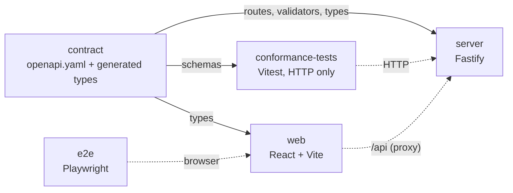
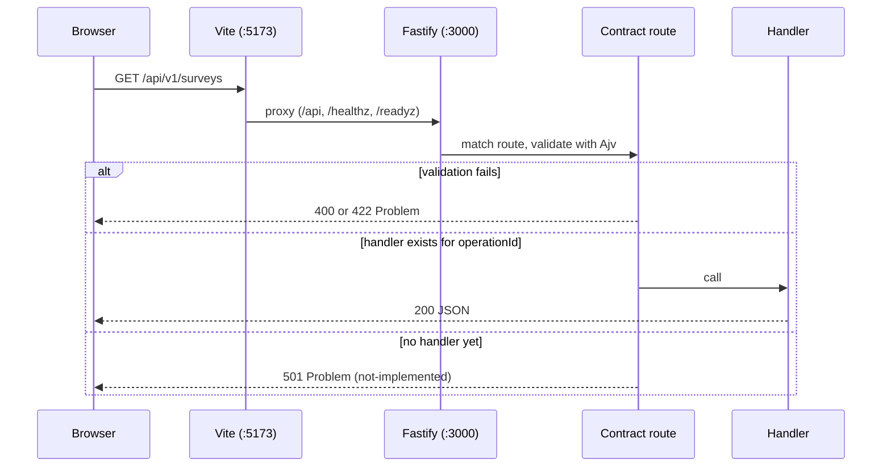

# Architecture

This page describes what is built now (Steps 1 and 2). The final design is in `spec.md`; the later steps
are listed at the end.

## Principles

- **The contract is the source of truth.** `contract/openapi.yaml` defines every route, parameter,
  body and error. The server builds its routes and validators from it, the web app takes its types
  from it, and the conformance suite checks servers against it.
- **Replaceable back end.** Anything that passes the conformance suite can replace the Node.js
  server. Storage sits behind provider interfaces.
- **Configuration from the environment.** Everything is read and validated at start-up.

## Packages

| Package             | Role                                                                                                                           |
| ------------------- | ------------------------------------------------------------------------------------------------------------------------------ |
| `contract`          | The OpenAPI file, `openapiPath`, generated types (`paths`, `components`, `operations`), and `build:docs` for the API reference |
| `server`            | Reference back end                                                                                                             |
| `web`               | Front end                                                                                                                      |
| `conformance-tests` | Checks every response of a running server against the contract; can target any server                                          |
| `e2e`               | Starts the server and the built web app and drives them in three browsers                                                      |

## Server modules (`server/src`)

| File          | Role                                                                                                                                                                                                              |
| ------------- | ----------------------------------------------------------------------------------------------------------------------------------------------------------------------------------------------------------------- |
| `main.ts`     | Loads configuration, creates providers, listens, shuts down on SIGINT and SIGTERM. A bad configuration prints every problem and exits with code 1                                                                 |
| `config.ts`   | `loadConfig(env)`: validates environment variables with zod, returns a frozen `AppConfig`, or throws `ConfigError` listing all problems                                                                           |
| `app.ts`      | `buildApp(config, providers)`: creates the Fastify instance, error handling, `/healthz`, `/readyz`, the API routes and (when enabled) `/api/docs`                                                                 |
| `contract.ts` | Reads the contract and builds, for each operation, a Fastify route (`/api/v1/...`) and Ajv (JSON Schema 2020-12) validators for path, query, headers and body. See [ADR 0003](adr/0003-custom-contract-loader.md) |
| `api.ts`      | Registers one route per operation. The handler is looked up by `operationId`; if there is none, the route answers `501`                                                                                           |
| `handlers.ts` | The implemented operations, keyed by `operationId`. Only `getConfig` exists in Step 1                                                                                                                             |
| `errors.ts`   | Error mapper: turns any error into a Problem Details body. Body validation errors become `422`; path, query and header errors `400`; an unknown error becomes `500 internal-error` with no internal detail        |
| `docs.ts`     | `GET /api/docs`: serves `contract/dist/reference.html`; answers `404` with the hint "Run pnpm build:docs" if it was not built                                                                                     |
| `providers/`  | Provider registry (`createProviders`), the store interfaces, the `memory` and `azure-legacy` providers and the shared list order. See [Storage providers](#storage-providers)                                     |
| `domain/`     | Domain types shared by every provider (`types.ts`). See [Domain types](#domain-types)                                                                                                                             |
| `legacy/`     | Tools for the offline replica of the legacy stores: the fixture loader, its endpoint safety guard and Edm validation. Not used by the server at run time                                                          |
| `cli/`        | `inspect-legacy.ts`, a read-only command-line inspector (`pnpm inspect:legacy`)                                                                                                                                   |

Rules that hold everywhere:

- Every API path is under `/api/v1`. The only other routes are `/healthz`, `/readyz` and
  `/api/docs` (off in production unless `API_DOCS=true`).
- Every error body is `application/problem+json` with `type`, `title`, `status` and a stable
  `code`. Unknown URLs give `404 not-found`.
- Every response carries `x-request-id`. An incoming `x-request-id` (up to 128 characters) is reused.
- The request body limit is `LIMIT_MAX_RESPONSE_BYTES` ([ADR 0004](adr/0004-body-limit.md)).
- `/readyz` returns `503` when the provider's `ready()` is false.

## Storage providers

Storage sits behind three interfaces in `server/src/providers/types.ts`. Nothing outside
`providers/` knows which implementation runs.

| Interface     | Methods                                                             | Rules                                                                                               |
| ------------- | ------------------------------------------------------------------- | --------------------------------------------------------------------------------------------------- |
| `SurveyStore` | `getSurvey(id)`, `listSurveys(owner)`                               | `null` when not found. Lists include archived surveys, ordered by `updatedAt` descending, then `id` |
| `Directory`   | `getUser(id)`, `findUserByEmail(email)`, `listUserProjects(userId)` | Email match ignores case. Projects are ordered by project name ignoring case, then project id       |
| `ProviderSet` | `name`, `surveys`, `directory`, `ready()`, `close()`                | What the server holds. `ready()` feeds `/readyz`                                                    |

Ids are GUIDs. Stores match them case-insensitively and return them in lower case. The list orders
live in `providers/ordering.ts`, so every provider sorts the same way. The interfaces have read
methods only; writes arrive with the application services.

| Provider       | `STORAGE_PROVIDER` | What it is                                                                                                                                                                                                                                                                                       |
| -------------- | ------------------ | ------------------------------------------------------------------------------------------------------------------------------------------------------------------------------------------------------------------------------------------------------------------------------------------------ |
| `memory`       | `memory` (default) | Holds records in memory and returns copies. Empty unless `MEMORY_SEED=legacy-fixtures`, which loads the golden fixtures in `server/fixtures/legacy/` through the same mapping as the legacy provider                                                                                             |
| `azure-legacy` | `azure-legacy`     | Reads the real surveyjs.io stores, **read-only**: SQL for users, surveys, projects and memberships, through a lazily created pool. `ready()` checks SQL and both storage accounts. A skipped row is reported as a warning with ids only. ESLint forbids write calls in `providers/azure-legacy/` |

`createProviders` picks the provider from `STORAGE_PROVIDER`. The settings are described in
[Development](development.md#environment-variables-server): `STORAGE_PROVIDER`, `MEMORY_SEED`
(`empty` or `legacy-fixtures`) and, for `azure-legacy`, all three of
`LEGACY_SQL_CONNECTION_STRING`, `LEGACY_SURVEYS_STORAGE_CONNECTION_STRING` and
`LEGACY_RESULTS_STORAGE_CONNECTION_STRING`. The connection strings are secrets: no error message or
log line includes one.

`legacy/` and the `docker/` folder build an offline replica of the legacy stores (Azurite for tables
and blobs, SQL Server for the directory) that the `azure-legacy` provider can run against. Why SQL
Server, and what is not emulated: [ADR 0006](adr/0006-legacy-replica.md).

## Domain types

`server/src/domain/types.ts` holds what the providers return.

| Type                | Holds                                                                                                                                                      |
| ------------------- | ---------------------------------------------------------------------------------------------------------------------------------------------------------- |
| `SurveyOwner`       | A user (`kind: "personal"`, `userId`) or a project (`kind: "project"`, `projectId`)                                                                        |
| `SurveyRecord`      | Survey metadata: `id`, `name`, `owner`, `creatorId`, `postId`, `resultId`, `published`, `archived`, `createdAt` and `updatedAt` (ISO 8601 UTC), `settings` |
| `User`              | `id`, `email`, `displayName` (the email when the legacy name is blank), `blocked`                                                                          |
| `ProjectMembership` | A project (`id`, `name`) and the user's `role` (`admin` or `user`)                                                                                         |
| `SurveyResponse`    | Declared for the results steps: `id`, `submittedAt`, `data`, optional `clientId` and `respondentIp`, `partial`                                             |

## Legacy mapping

The current surveyjs.io site keeps its data in SQL, Azure Tables, Blobs and Files. How, and how
each field maps to the domain, is written in
[legacy-data-layout.md](architecture/legacy-data-layout.md) (mapping: section 9). This section only
summarises it.

| Legacy                                   | Domain                                                                   |
| ---------------------------------------- | ------------------------------------------------------------------------ |
| `Surveys.userid`                         | A project id when it is an organization id, otherwise the personal owner |
| `Surveys.ispublished` (`NULL`)           | `published = false`                                                      |
| `Surveys.creatorid` (all zeros)          | `creatorId = null`                                                       |
| `Surveys.createdat`, `Surveys.timestamp` | `createdAt`, `updatedAt`, read as UTC                                    |
| `OrganizationUsers.role`                 | `admin` or `user` (case is ignored)                                      |
| `Users.displayname` (NULL or blank)      | The email                                                                |

Rules decided in Step 2:

- **NULL columns map with defaults.** A NULL name becomes `""`. A NULL `createdat` takes the
  `timestamp` value and the other way round; if both are NULL, both become
  `1970-01-01T00:00:00.000Z`. A NULL email becomes `""`, and `findUserByEmail` with a blank email
  finds no user. A NULL project name becomes `""`.
- **Rows the domain cannot represent are skipped and reported.** A survey with a NULL `postid`,
  `resultid` or `userid`, and a membership with a NULL or unknown role, are left out. Each one is
  reported as a warning that carries ids only.
- **Ids are case-insensitive**, and returned in lower case.

D11 (respondent files stored as URLs in place of inline content) has the verdict "Yes, with
conditions": [ADR 0005](adr/0005-respondent-files-as-urls.md).

### Open for later steps

Step 2 leaves these points open: mostly differences between the legacy system and the contract.

| Point                                                                                                         | To settle in |
| ------------------------------------------------------------------------------------------------------------- | ------------ |
| `canModify`: legacy allows a project admin or the survey's creator; the spec allows any member                | Step 4 or 5  |
| Survey name length: 200 in SQL, 256 in the contract                                                           | Step 4 or 5  |
| Results layouts: legacy keeps them per survey, the contract per user                                          | Step 9 or 10 |
| Project `ownerId` and `createdAt`: legacy has no columns; they are inferred from the creator's membership row | Step 11      |
| Fixtures are synthetic; the spec wants them copied from storage. Check them on a read-only copy (site team)   | Step 14      |
| `azure-legacy` readiness makes account-level calls; a container SAS keeps `/readyz` at 503. Narrow the probe  | Step 14      |

## Request flow

In production the web bundle is static files and a reverse proxy sends `/api` to the server.
The server does not serve the web app.

## Web modules (`web/src`)

| Path                            | Role                                                                                                                                                                                                                                 |
| ------------------------------- | ------------------------------------------------------------------------------------------------------------------------------------------------------------------------------------------------------------------------------------ |
| `main.tsx`                      | Creates the TanStack Query client and the router, renders the app                                                                                                                                                                    |
| `router.ts`, `routeTree.gen.ts` | TanStack Router. The route tree is generated by the Vite plugin from `routes/`                                                                                                                                                       |
| `routes/__root.tsx`             | Root route. Its loader fetches `/config` and starts applying the SurveyJS licence key in the background (not awaited; a failure is logged with `console.warn` and does not affect the page); an error component shows a retry button |
| `routes/index.lazy.tsx`         | Home page, a lazy route. Shows `edition:` and `shell:`                                                                                                                                                                               |
| `shell/PlaceholderShell.tsx`    | Replaceable shell with a narrow interface: `user`, `notices`, `links`, `children`                                                                                                                                                    |
| `api/client.ts`                 | openapi-fetch client typed by the contract. Base URL is `VITE_API_BASE_URL`, default `/api/v1`; cookies are sent (`credentials: "include"`)                                                                                          |
| `api/config.ts`                 | Query options for `GET /config` (cached 5 minutes)                                                                                                                                                                                   |
| `surveyjs/license.ts`           | `applySurveyJSLicense(key)`: imports `survey-core` lazily and calls `setLicenseKey`; concurrent calls share one in-flight promise. With no key it does nothing and `survey-core` is not downloaded                                   |

The licence key travels: `SURVEYJS_LICENSE_KEY` (server) -> `GET /api/v1/config` ->
`applySurveyJSLicense` (browser). It is never in the code.

## Build and run

- `server` runs TypeScript directly with `tsx`; there is no server build.
- `web` is built by Vite (`pnpm build`). `survey-core` is one large lazy chunk.
- `pnpm demo` builds the API reference once, then runs the server with `node --watch --import tsx` and `vite` (web) together. (`tsx watch` hangs on Windows under `concurrently`, so it is not used.)

## What later steps add

- Done in Step 2: the store interfaces and domain types, the in-memory provider with an optional
  seed, the read-only `azure-legacy` provider, the golden fixtures, the shared provider suite, the
  Azurite and SQL Server replica, and the inspector CLI.
- Step 3: sign-in with a mock OIDC server. End-to-end tests against Azurite arrive with it.
- Later: write methods and application services, stores for content, results, files and views,
  the `surveyjs-site` shell, survey list, editor, results and run page, and Docker packaging.
  The contract already describes all of these.
