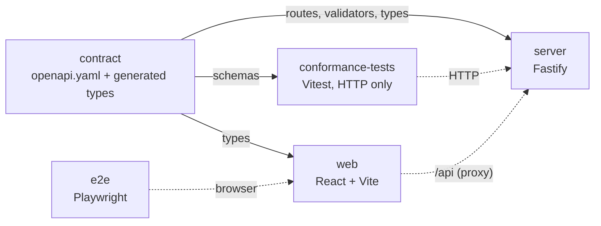
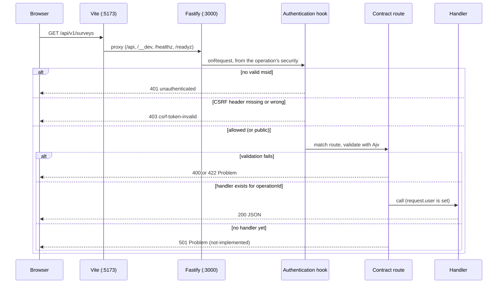

# Architecture

This page describes what is built now (Steps 1 to 10). The final design is in `spec.md`; the later steps
are listed at the end.

## Principles

- **The contract is the source of truth.** `contract/openapi.yaml` defines every route, parameter,
  body and error. The server builds its routes and validators from it, the web app takes its types
  from it, and the conformance suite checks servers against it.
- **Replaceable back end.** Anything that passes the conformance suite can replace the Node.js
  server. Storage sits behind provider interfaces.
- **Configuration from the environment.** Everything is read and validated at start-up.

## Packages



| Package             | Role                                                                                                                           |
| ------------------- | ------------------------------------------------------------------------------------------------------------------------------ |
| `contract`          | The OpenAPI file, `openapiPath`, generated types (`paths`, `components`, `operations`), and `build:docs` for the API reference |
| `server`            | Reference back end                                                                                                             |
| `web`               | Front end                                                                                                                      |
| `conformance-tests` | Checks every response of a running server against the contract; can target any server                                          |
| `e2e`               | Starts the server and the built web app and drives them in three browsers                                                      |

## Server modules (`server/src`)

| File                  | Role                                                                                                                                                                                                                                                                                                                                                                                                                                                                                                                                                                                                                                                                                                 |
| --------------------- | ---------------------------------------------------------------------------------------------------------------------------------------------------------------------------------------------------------------------------------------------------------------------------------------------------------------------------------------------------------------------------------------------------------------------------------------------------------------------------------------------------------------------------------------------------------------------------------------------------------------------------------------------------------------------------------------------------- |
| `main.ts`             | Loads configuration, creates providers, listens, shuts down on SIGINT and SIGTERM. A bad configuration prints every problem and exits with code 1                                                                                                                                                                                                                                                                                                                                                                                                                                                                                                                                                    |
| `config.ts`           | `loadConfig(env)`: validates environment variables with zod, returns a frozen `AppConfig`, or throws `ConfigError` listing all problems                                                                                                                                                                                                                                                                                                                                                                                                                                                                                                                                                              |
| `app.ts`              | `buildApp(config, providers)`: creates the Fastify instance, error handling, `/healthz`, `/readyz`, the API routes and (when enabled) `/api/docs` Its `onSend` hook adds the security headers (Step 12)                                                                                                                                                                                                                                                                                                                                                                                                                                                                                              |
| `contract.ts`         | Reads the contract and builds, for each operation, a Fastify route (`/api/v1/...`) and Ajv (JSON Schema 2020-12) validators for path, query, headers and body. See [ADR 0003](adr/0003-custom-contract-loader.md)                                                                                                                                                                                                                                                                                                                                                                                                                                                                                    |
| `api.ts`              | Registers one route per operation, with the authentication hook for its `security` and the sign-in rate limit. The handler is looked up by `operationId`; if there is none, the route answers `501` An operation named in `ApiOptions.rawBodyOperations` (Step 12: `receiveAccountDeleted`) is registered in its own plugin scope: no body or header schema, no media-type guard, and a catch-all parser that keeps the body as text, so a signature can be checked on the exact bytes before anything is parsed                                                                                                                                                                                     |
| `handlers.ts`         | The implemented operations that need no session, keyed by `operationId`: `getConfig` (including `links`)                                                                                                                                                                                                                                                                                                                                                                                                                                                                                                                                                                                             |
| `errors.ts`           | Error mapper: turns any error into a Problem Details body. Body validation errors become `422`; path, query and header errors `400`; an unknown error becomes `500 internal-error` with no internal detail                                                                                                                                                                                                                                                                                                                                                                                                                                                                                           |
| `docs.ts`             | `GET /api/docs`: serves `contract/dist/reference.html`; answers `404` with the hint "Run pnpm build:docs" if it was not built                                                                                                                                                                                                                                                                                                                                                                                                                                                                                                                                                                        |
| `providers/`          | Provider registry (`createProviders`), the store interfaces (the user directory and the project store among them), the `memory` and `azure-legacy` providers and the shared list order. See [Storage providers](#storage-providers)                                                                                                                                                                                                                                                                                                                                                                                                                                                                  |
| `domain/`             | Domain types shared by every provider (`types.ts`), `survey-changes.ts` (the pure `applySurveyChanges`) and `response-id.ts` (the pure UUID v5 of a response id). See [Domain types](#domain-types)                                                                                                                                                                                                                                                                                                                                                                                                                                                                                                  |
| `auth/`               | Identity and session: the `IdentityProvider` interface and its two providers, the sealed cookies, CSRF, `returnTo`, the authentication hook and the handlers of `login`, `loginCallback`, `logout` and `getCurrentUser`. See [Identity and session](#identity-and-session)                                                                                                                                                                                                                                                                                                                                                                                                                           |
| `files/`              | `uploadSurveyAsset`, `uploadResponseFile` and `downloadFile`: the service, the handlers and the pure helpers (`file-type.ts`, `quota.ts`, `rewrite.ts`). See [Files](#files)                                                                                                                                                                                                                                                                                                                                                                                                                                                                                                                         |
| `results/`            | `getPublishedSurvey`, `submitResponse`, `getResultStats`, (Step 9) `listResults` and (Step 10) `exportResults`, `deleteResults` and `getPublicResults`: `service.ts` (the rules), `handlers.ts`, `availability.ts` (`availableSurvey`, the one `404` of the public operations), `one-response.ts` (pure: `publishedDefinition`, `limitCookieOf`) and the pure Step 10 modules `definition.ts` (`questionsOf`, `privateKeysOf`, `withoutKeys`), `csv.ts`, `export-format.ts` (`negotiateExportFormat`, `exportFileName`) and `export.ts` (`storedResponses`, `jsonExport`, `csvExport`). See [Responses](#responses) and [Exports, deleting and public results](#exports-deleting-and-public-results) |
| `ip.ts`               | Pure: `respondentIp` (an IPv4-mapped IPv6 address becomes IPv4) and `truncatedIp` (the address as it may appear in a log)                                                                                                                                                                                                                                                                                                                                                                                                                                                                                                                                                                            |
| `surveys/`            | `access.ts` (the shared 404 and 403 rules of the surveys and content services), `listSurveys`, `createSurvey`, `getSurvey`, `updateSurvey`, `deleteSurvey` and `cloneSurvey`: the service (scopes, paging, creation, the survey actions), the pure rules (`permissions.ts`, `naming.ts` for "New Survey N" and "Copy of ...", `patch.ts` for the record changes of a patch) and the JSON mapping. See [Surveys and projects](#surveys-and-projects)                                                                                                                                                                                                                                                  |
| `content/`            | `getSurveyDefinition`, `saveSurveyDefinition`, `getSurveyTheme`, `saveSurveyTheme` and `listSurveyHistory`: the service, the handlers and `etag.ts` (pure: `formatEtag`, `ifMatchAllows`). See [Survey content and history](#survey-content-and-history)                                                                                                                                                                                                                                                                                                                                                                                                                                             |
| `views/`              | `getResultsView`, `saveResultsView` and `resetResultsView` (Step 9): `service.ts` (`createViewsService`: the `404` rules and the calls to `ViewStore`) and `handlers.ts`. See [Results and saved layouts](#results-and-saved-layouts)                                                                                                                                                                                                                                                                                                                                                                                                                                                                |
| `projects/`           | The project and member operations (Steps 4 and 11): `service.ts` (the rules and the check order), `rules.ts` (pure: the last-admin and receiver rules), `handlers.ts` and `json.ts`. See [Projects](#projects)                                                                                                                                                                                                                                                                                                                                                                                                                                                                                       |
| `paging/`             | `cursor.ts`: the opaque cursors of the survey, project, member, history and result lists (pure). See [Paging](api/paging.md)                                                                                                                                                                                                                                                                                                                                                                                                                                                                                                                                                                         |
| `notices/`            | `AccountNotices` (`CurrentUser.notices`): the demo settings, and the surveyjs.io licence-expiry rule used by the `surveyjs-sql` and `surveyjs-api` user directories                                                                                                                                                                                                                                                                                                                                                                                                                                                                                                                                  |
| `accounts/`           | (Step 12) Erasing an account: `erasure.ts` (`eraseAccount`, `previewErasure`), `reconcile.ts`, the webhook's `webhook.ts` (the signature check), `webhook-secret.ts` and `handlers.ts` (`receiveAccountDeleted`). See [Accounts](#accounts-erasure-and-the-webhook-step-12)                                                                                                                                                                                                                                                                                                                                                                                                                          |
| `users/`              | (Step 12) `surveyjs-api/`: the client of the surveyjs.io user API (`client.ts`, the pure `mapping.ts`) and its local stand-in (`stub.ts`, `stub-cli.ts`). See [The user API client and stub](#the-user-api-client-and-the-stub)                                                                                                                                                                                                                                                                                                                                                                                                                                                                      |
| `security-headers.ts` | (Step 12) The headers every server answer gets (`serverSecurityHeaders`). See [Security and data protection](#security-and-data-protection)                                                                                                                                                                                                                                                                                                                                                                                                                                                                                                                                                          |
| `shell-links.ts`      | The built-in surveyjs.io account links and their merge with `SHELL_LINKS` (`/config.links`)                                                                                                                                                                                                                                                                                                                                                                                                                                                                                                                                                                                                          |
| `legacy/`             | Tools for the offline replica of the legacy stores: the fixture loader, its endpoint safety guard and Edm validation. Not used by the server at run time                                                                                                                                                                                                                                                                                                                                                                                                                                                                                                                                             |
| `cli/`                | The operator commands: `inspect-legacy.ts` (read only, `pnpm inspect:legacy`), `account-erase.ts`, `account-reconcile.ts` and `send-account-deleted.ts` (Step 12), and `common.ts`, their shared parts. See [Accounts](#accounts-erasure-and-the-webhook-step-12)                                                                                                                                                                                                                                                                                                                                                                                                                                    |

Rules that hold everywhere:

- Every API path is under `/api/v1`. The only other routes are `/healthz`, `/readyz`,
  `/api/docs` (off in production unless `API_DOCS=true`) and, with the dev identity provider only,
  `/__dev/sign-in`.
- Every error body is `application/problem+json` with `type`, `title`, `status` and a stable
  `code`. Unknown URLs give `404 not-found`.
- Every response carries `x-request-id`. An incoming `x-request-id` (up to 128 characters) is reused.
- Request logs never show the values of the `code`, `state` and `clientId` query parameters (the sign-in
  callback and the respondent's client id): they are written as `[redacted]`. The client address in a
  request log is **truncated** (IPv4: the last number is 0; IPv6: the first three groups, then `::`)
  (`server/src/logging.ts`, `ip.ts`). No log line holds answers, file names, file content or client ids:
  logs about responses and files carry survey ids, response ids, file ids, sizes and types only.
- The request body limit is `LIMIT_MAX_RESPONSE_BYTES` ([ADR 0004](adr/0004-body-limit.md)), except for the
  definition and theme saves, which use `LIMIT_MAX_DOCUMENT_BYTES` (see [Body limits](#body-limits)).
- `/readyz` returns `503` when the provider's `ready()` is false.
- (Step 12) Every server answer carries the headers of `serverSecurityHeaders`, and the server redirects no old surveyjs.io address: `/published`, `/Service/*` and `/Results/*` are unknown paths. See [Security and data protection](#security-and-data-protection).

## Storage providers

Storage sits behind seven interfaces in `server/src/providers/types.ts`. Nothing outside
`providers/` knows which implementation runs.

| Interface       | Methods                                                                                                                                                                                                                                                                                                                                                                                                                                                                                                                                                   | Rules                                                                                                                                                                                                                                                                                                                                                                                                                                                                                                                                                                                                                                                                                                                                                                                                                                                                                                                                                                                                                                                                                                                                                                                                                                                                                                                                                                                                                                                                                                                                                                                                                                                                                                                                                                         |
| --------------- | --------------------------------------------------------------------------------------------------------------------------------------------------------------------------------------------------------------------------------------------------------------------------------------------------------------------------------------------------------------------------------------------------------------------------------------------------------------------------------------------------------------------------------------------------------- | ----------------------------------------------------------------------------------------------------------------------------------------------------------------------------------------------------------------------------------------------------------------------------------------------------------------------------------------------------------------------------------------------------------------------------------------------------------------------------------------------------------------------------------------------------------------------------------------------------------------------------------------------------------------------------------------------------------------------------------------------------------------------------------------------------------------------------------------------------------------------------------------------------------------------------------------------------------------------------------------------------------------------------------------------------------------------------------------------------------------------------------------------------------------------------------------------------------------------------------------------------------------------------------------------------------------------------------------------------------------------------------------------------------------------------------------------------------------------------------------------------------------------------------------------------------------------------------------------------------------------------------------------------------------------------------------------------------------------------------------------------------------------------- |
| `SurveyStore`   | `getSurvey(id)`, `listSurveys(owner)`, `listSurveyPage(query)`, `createSurvey(survey, definition?)`, `getDefinition(id)`, `getTheme(id)`, `saveDefinition(id, definition, save)`, `saveTheme(id, theme, save)`, `listHistory(query)`, `getHistorySnapshot(surveyId, entryId)`, `updateSurvey(id, changes)`, `cloneSurvey(sourceId, copy, options?)`, `deleteSurvey(id)`, `listPersonalOwnerIds()` (Step 12: every owner id of a personal survey, archived ones included; distinct, lower-case, ascending; NULL, the all-zero GUID and non-GUIDs left out) | `null` when not found. `listSurveys` includes archived surveys, ordered by `updatedAt` descending, then `id`. `listSurveyPage` returns the rows of that list that match `archived`, after a position, at most `limit` of them, with the position of the last row when more follow. `createSurvey` stores the legacy defaults and returns the record as stored; it throws on a duplicate id. `getDefinition` returns the definition (`{}` when the survey has none) with its version token as a `Versioned`, `null` for an unknown id. `getTheme` is the same for the theme (`SurveyTheme`). `saveDefinition` and `saveTheme` write only when the current version equals `save.ifVersion` and answer a `SaveOutcome` (`saved` with the new version, `conflict`, or `not-found`); a definition save also adds a history entry. `listHistory` returns a page of `HistoryEntryRecord`s, newest first, and an empty page for an unknown survey. `getHistorySnapshot` returns the definition stored with an entry, or `null`. `updateSurvey` applies a `SurveyChanges` in one write and returns the record as stored, `null` for an unknown id. `cloneSurvey` creates `copy` with the source's definition and theme (`null` for an unknown source; it throws on a duplicate id). `options.rewriteText`, when given, is applied to the stored definition text and theme text before they are stored for the copy. Saved views are not copied. `deleteSurvey` removes the survey and everything stored for it, every user's saved views included, except its files, which the service deletes first (see [Files](#files)); `false` for an unknown id                                                                                                                                  |
| `FileStore`     | `putFile(file, content)`, `getFile(id)`, `usage(surveyId, kind)`, `deleteFile(id)`, `deleteSurveyFiles(surveyId, kind?)`, `copySurveyAssets(fromSurveyId, toSurveyId, copiedAt)`                                                                                                                                                                                                                                                                                                                                                                          | `putFile` rejects an existing id and changes nothing. `getFile` returns the record and the bytes as a stream, `null` for an unknown or malformed id (ids match in any case). `usage` is the sum of the sizes of one kind (`asset` or `response`), `0` for none. `deleteFile` is `false` when there was none. `deleteSurveyFiles` deletes the files of a survey and returns the count: every kind, or only `kind` when given (Step 10 deletes `response` files and keeps the editor's assets). `copySurveyAssets` copies each asset under a new id of the target survey and returns old id to new id; on a failure part-way it deletes its copies and rejects. See [Files](#files)                                                                                                                                                                                                                                                                                                                                                                                                                                                                                                                                                                                                                                                                                                                                                                                                                                                                                                                                                                                                                                                                                             |
| `UserDirectory` | `kind` (`external` or `local`), `getUser(id)`, `findUserByEmail(email)`, `signInUser(claims)`, `missingUsers(ids)`                                                                                                                                                                                                                                                                                                                                                                                                                                        | Step 12 ([ADR 0018](adr/0018-accounts-by-deployment-mode.md)). Users are matched by id and by email ignoring case. A blank email matches nobody. `signInUser` returns the user of the identity claims and never creates one in an `external` directory (`null` for an unknown user). `missingUsers` returns the ids, lower-case, each once, in order of first occurrence, that the directory **positively** does not know; an id that is not a GUID is never reported; it rejects on any failure, because a failure is never read as "missing"                                                                                                                                                                                                                                                                                                                                                                                                                                                                                                                                                                                                                                                                                                                                                                                                                                                                                                                                                                                                                                                                                                                                                                                                                                |
| `ProjectStore`  | `listUserProjects(userId)`, `getUserProject(userId, projectId)`, `listMembers(projectId)`, the writes `createProject`, `renameProject`, `deleteProject`, `addMember`, `setMemberRole`, `removeMember` and, since Step 12, `eraseMember(projectId, userId, { now })` and `listMemberUserIds()`                                                                                                                                                                                                                                                             | Projects are ordered by project name ignoring case, then project id. `getUserProject` returns `null` when the user is not a member or the project does not exist. `listMembers` returns the visible members (a row whose user is missing is skipped) ordered by display name ignoring case, then user id, and `[]` for an unknown project. The writes return string-union outcomes (`added`, `already-member`, `changed`, `unchanged`, `last-admin`, `removed`, `not-found`); the stores enforce the last-admin rule again, atomically (memory is synchronous, Azure uses a transaction). `deleteProject` takes the receiver chosen by the service and returns the moved survey ids, sorted, or `null` for an unknown project. `eraseMember` decides with the pure rule `decideMemberErasure` and writes the decision in one step: `promote` and `remove` delete every row of the user (orphan rows too), `promote` also makes the successor an admin; `not-member` and `last-member` write nothing. It does not check the last-admin rule and does not ask whether the user still exists. `listMemberUserIds` lists every user id with a membership row, orphans included                                                                                                                                                                                                                                                                                                                                                                                                                                                                                                                                                                                                    |
| `ResultStore`   | `appendResponse(survey, response)`, `hasResponse(survey, id)`, `listResponses(survey)`, `listResponsePage(survey, query)`, `stats(survey)`, `completion(survey, clientId)`, `deleteAll(survey)`                                                                                                                                                                                                                                                                                                                                                           | `appendResponse` stores the response unless one with that id exists for the survey (`"stored"` or `"exists"`; an existing one is never changed), and when the response has a `clientId` it writes or overwrites that client's completion marker as complete, also for `"exists"` (a store-level guarantee; the service answers a keyed retry from `hasResponse` before it gets here). It rejects a `id` that is not a GUID, and `azure-legacy` rejects with `ResponseTooLargeError` (lengths only, nothing written) when the answers as JSON are longer than 32,768 UTF-16 code units. `hasResponse` is the replay check (`false` for a non-GUID id). `listResponses` returns every stored response, fixture rows included, by `submittedAt` and then `id`. `listResponsePage` returns at most `limit` of them in that order, strictly after a position `{ submittedAt, id }` (`responseOrder` and `isAfterResponse` in `providers/ordering.ts`), with the position of the last row covered when more follow and `null` on the last page; a page can be shorter than `limit` when the provider skips a row it cannot represent; rows of one client are not merged. `stats` counts rows (no merging by client) with the first and last `submittedAt`, or `0`, `null`, `null`. `completion` is `"none"`, `"partial"` or `"completed"`; client ids match exactly. `deleteAll` (Step 10) deletes every stored response, fixture rows included, and every completion marker, so `completion` answers `"none"` afterwards; it resolves for a survey without responses, keeps the survey record, the saved views and the private-question list, and a response appended right after is stored normally (on `azure-legacy` the tables are never dropped). See [Responses](#responses) |
| `ViewStore`     | `getView(surveyId, userId, view)`, `saveView(surveyId, userId, view, state)`, `resetView(surveyId, userId, view)`, `getPrivateQuestions(surveyId)`, `savePrivateQuestions(surveyId, names)`                                                                                                                                                                                                                                                                                                                                                               | A saved results layout of one user and survey; `view` is `summary` or `table`, the state any JSON object. `getView` returns the user's own state; when there is none and the user has not reset it, the survey's legacy per-survey layout as stored; otherwise `null` (also after a reset, for a stored value that is not a JSON object and for ids that are not GUIDs). `saveView` replaces an earlier state or a reset marker. `resetView` deletes the state and leaves a reset marker, so `getView` answers `null` even where a legacy layout exists, until the next save; it is idempotent. Neither checks that the survey or the user exists, neither touches the survey record, and both reject ids that are not GUIDs. Step 10 adds the survey's **private-question list** (the names of the questions hidden from public results, `settings.privateResultQuestions`): `getPrivateQuestions` returns it in stored order without duplicates, `[]` for none, for an unknown survey and for a non-GUID id; `savePrivateQuestions` replaces it (`[]` makes every question public), rejects a non-GUID id and does not touch the survey record. It is deleted with the survey, not copied by a clone, and kept by `ResultStore.deleteAll`. It lives on this store, not on the survey record, so a list page needs no read of it See [Results and saved layouts](#results-and-saved-layouts)                                                                                                                                                                                                                                                                                                                                                                                 |
| `ProviderSet`   | `name`, `surveys`, `users`, `projects`, `files`, `results`, `views`, `notices`, `ready()`, `close()`                                                                                                                                                                                                                                                                                                                                                                                                                                                      | What the server holds. `ready()` feeds `/readyz` (the storage provider's: the user API is not part of it yet). `notices` is `AccountNotices` (see below), chosen together with the user directory                                                                                                                                                                                                                                                                                                                                                                                                                                                                                                                                                                                                                                                                                                                                                                                                                                                                                                                                                                                                                                                                                                                                                                                                                                                                                                                                                                                                                                                                                                                                                                             |

Ids are GUIDs. Stores match them case-insensitively and return them in lower case. The list orders
live in `providers/ordering.ts`, so every provider sorts the same way. The writes in the interfaces are
`createSurvey` (Step 4), `updateSurvey`, `cloneSurvey` and `deleteSurvey` (Step 5) and `saveDefinition`
and `saveTheme` (Step 6), the file writes of the `FileStore` (Step 7) `appendResponse` of the `ResultStore` (Step 8) and `saveView` and `resetView` of the `ViewStore` (Step 9), and `deleteAll` of the `ResultStore`, the kind-limited `deleteSurveyFiles` and `savePrivateQuestions` (Step 10), the six project and member writes of the `ProjectStore` (Step 11), and `eraseMember` (Step 12).

| Provider       | `STORAGE_PROVIDER` | What it is                                                                                                                                                                                                                                                                                                                                                                                                                                                                                                                                                                                                                                                                                                                                                                                                                                      |
| -------------- | ------------------ | ----------------------------------------------------------------------------------------------------------------------------------------------------------------------------------------------------------------------------------------------------------------------------------------------------------------------------------------------------------------------------------------------------------------------------------------------------------------------------------------------------------------------------------------------------------------------------------------------------------------------------------------------------------------------------------------------------------------------------------------------------------------------------------------------------------------------------------------------- |
| `memory`       | `memory` (default) | Holds records in memory and returns copies. Empty unless `MEMORY_SEED=legacy-fixtures`, which loads the golden fixtures in `server/fixtures/legacy/` through the same mapping as the legacy provider                                                                                                                                                                                                                                                                                                                                                                                                                                                                                                                                                                                                                                            |
| `azure-legacy` | `azure-legacy`     | Works on the real surveyjs.io stores: SQL for users, surveys, projects and memberships, through a lazily created pool. `ready()` checks SQL and both storage accounts. A skipped row is reported as a warning with ids only. It reads everything and writes only survey creation, update, clone, delete, the definition and theme saves, the editor and respondent files, result rows with their completion markers, the users' saved results layouts in a container of its own, the deletion of all results of a survey and the survey's private-question list, and (Step 11) the creation, rename and deletion of projects and the adding, role change and removal of members, in `providers/azure-legacy/writes.ts`; ESLint forbids write calls in the rest of the folder. See [Writing to the legacy stores](#writing-to-the-legacy-stores) |

`createProviders` picks the provider from `STORAGE_PROVIDER`. The settings are described in
[Development](development.md#environment-variables-server): `STORAGE_PROVIDER`, `MEMORY_SEED`
(`empty` or `legacy-fixtures`) and, for `azure-legacy`, all three of
`LEGACY_SQL_CONNECTION_STRING`, `LEGACY_SURVEYS_STORAGE_CONNECTION_STRING` and
`LEGACY_RESULTS_STORAGE_CONNECTION_STRING`. The connection strings are secrets: no error message or
log line includes one.

`legacy/` and the `docker/` folder build an offline replica of the legacy stores (Azurite for tables
and blobs, SQL Server for the directory) that the `azure-legacy` provider can run against. Why SQL
Server, and what is not emulated: [ADR 0006](adr/0006-legacy-replica.md).

## Domain types

`server/src/domain/types.ts` holds what the providers return.

| Type                 | Holds                                                                                                                                                                                                                                                            |
| -------------------- | ---------------------------------------------------------------------------------------------------------------------------------------------------------------------------------------------------------------------------------------------------------------- |
| `SurveyOwner`        | A user (`kind: "personal"`, `userId`) or a project (`kind: "project"`, `projectId`)                                                                                                                                                                              |
| `SurveyRecord`       | Survey metadata: `id`, `name`, `owner`, `creatorId`, `postId`, `resultId`, `published`, `archived`, `createdAt` and `updatedAt` (ISO 8601 UTC), `settings`                                                                                                       |
| `User`               | `id`, `email`, `displayName` (the email when the legacy name is blank), `blocked`                                                                                                                                                                                |
| `ProjectRecord`      | A project as the project store returns it: `id`, `name`, `ownerId` (the creator while still a member, else `null`), `createdAt` (ISO 8601 UTC), `memberCount` (at least 1)                                                                                       |
| `ProjectMembership`  | A `ProjectRecord` and the user's `role` (`admin` or `user`)                                                                                                                                                                                                      |
| `NewProject`         | What the service decides for a new project: `id` (a new GUID), `name`, `creatorId` (the signed-in user, the first member, as admin) and `createdAt`                                                                                                              |
| `ProjectMember`      | A visible member of a project: the `User` and the `role`                                                                                                                                                                                                         |
| `NewSurvey`          | What the service decides for a new survey: `id`, `name`, `owner`, `creatorId`, `postId`, `resultId`, `createdAt` and `updatedAt` (equal). The store adds the legacy defaults                                                                                     |
| `SurveyDefinition`   | The survey definition, a JSON object (`Record<string, unknown>`)                                                                                                                                                                                                 |
| `SurveyTheme`        | The survey theme, a JSON object (`Record<string, unknown>`); `{}` when a survey has none                                                                                                                                                                         |
| `Versioned<T>`       | A stored document (`content`) and its opaque version token (`version`, never contains `"`)                                                                                                                                                                       |
| `HistoryEntryRecord` | One saved version of a definition: `id` (lower-case GUID), `at` (ISO 8601 UTC) and `userId` (`null` for legacy entries). The snapshot is read with `getHistorySnapshot`                                                                                          |
| `SaveOutcome`        | The result of a compare-and-set save: `{ kind: "saved", version }`, `{ kind: "conflict" }` or `{ kind: "not-found" }`                                                                                                                                            |
| `SurveyChanges`      | A change of a survey record: optional `name`, `move` (`owner` and `creatorId`), `published`, `archived` and `settings`, and always `updatedAt`. `applySurveyChanges` applies it                                                                                  |
| `StoredFileRecord`   | One stored file: `id` (64 hex digits), `surveyId`, `kind` (`asset` for the editor, `response` for a respondent's file), `name`, `contentType`, `size` (bytes) and `createdAt` (ISO 8601 UTC). `domain/file-id.ts` has the id rules                               |
| `SurveyResponse`     | One stored response (the read shape): `id`, `submittedAt`, `data`, optional `clientId` and `respondentIp`, `partial`                                                                                                                                             |
| `NewResponse`        | A response to store: `id` (a GUID: `responseIdFor(surveyId, key)` for an `Idempotency-Key`, else random), `submittedAt` (the server clock, ISO 8601 UTC with milliseconds), `data`, optional `clientId`, and `respondentIp` only when the survey keeps addresses |
| `CompletionState`    | A client's marker: `none`, `partial` (a marker an old API client wrote) or `completed`                                                                                                                                                                           |
| `ResultStatsRecord`  | `count`, `firstSubmittedAt` and `lastSubmittedAt` (`null` when there are no responses)                                                                                                                                                                           |

## Surveys and projects

Step 4 builds `listSurveys`, `createSurvey`, `getSurvey`, `listProjects` and `getProject`; Step 11 adds the project and member operations ([Projects](#projects)); Step 5 adds
`updateSurvey`, `deleteSurvey` and `cloneSurvey` ([Survey actions](#survey-actions)). The routes come
from the contract like every other; the handlers are in `surveys/handlers.ts` and
`projects/handlers.ts` and call a service that holds the rules. The client view is
[API: What is implemented](api/README.md#what-is-implemented) and [Paging](api/paging.md).

### Permissions

`surveys/permissions.ts` (pure) follows the legacy rule; the reason and what changes if the product
owner chooses otherwise are in [ADR 0009](adr/0009-survey-permissions-follow-legacy.md).

| Question                | Personal survey                 | Project survey                                         |
| ----------------------- | ------------------------------- | ------------------------------------------------------ |
| Can see (list, get)     | The user is the owner           | The user is a member of the project, in any role       |
| `permissions.canModify` | `true` (only the owner sees it) | The user's role is `admin`, **or** the user created it |
| Can create in the scope | Always                          | Any member                                             |

A survey the user cannot see answers `404 not-found`, like an unknown id.

### Listing

`listSurveys` takes `project` (`personal` or a project id). Any other value must be the id of a project
the user belongs to (`ProjectStore.getUserProject`); an unknown id, text that is no id and a project of
others all answer `404 not-found`. The service cuts the page with `SurveyStore.listSurveyPage`, using the
position decoded from the cursor, and turns the store's `next` position into `nextCursor`.
`listProjects` asks the project store for the whole list (it is short) and cuts the page itself. Cursors are
in `paging/cursor.ts`: the format is a reference, not part of the contract, and is written down for ports in
[Paging](api/paging.md#for-ports-the-reference-cursor-format). A cursor belongs to one list (scope and
`archived`), so a mismatch is `400 bad-request`.

### Creation

`createSurvey` checks, in this order: a given name is not blank and fits (`422`, see below); the
`projectId`, if any, is a project of the user (`403 forbidden` otherwise). Without a name the service
reads the **active** surveys of the scope and calls `nextNewSurveyName` (`surveys/naming.ts`, pure), which
reproduces the legacy rule: start at 1; for each name that starts with the exact text `New Survey` and
whose rest is a number (optional sign, surrounding white space allowed, at most `2147483647`), take the
highest; answer `New Survey <highest + 1>`. Gaps are not filled and archived names are ignored. The ids
come from `crypto.randomUUID()`, the time from `BuildOptions.now` (default `Date.now`), and the answer is
`201` with `Location`.

**Name length.** The contract says `maxLength: 200`. JSON Schema counts characters (code points); the
legacy column holds 200 UTF-16 code units. The service therefore also refuses a name longer than 200
UTF-16 code units with `422` at `/name`. ([ADR 0010](adr/0010-writing-to-the-legacy-stores.md))

### Survey actions

Step 5 builds `updateSurvey`, `deleteSurvey` and `cloneSurvey` in `surveys/service.ts`. The client view
(rules and examples) is in [API: Step 5](api/README.md#step-5-survey-actions); the reasons for each
ruling are in [ADR 0011](adr/0011-survey-actions.md). The service checks, in this order:

| Operation      | Checks and effect                                                                                                                                                                                                                                      |
| -------------- | ------------------------------------------------------------------------------------------------------------------------------------------------------------------------------------------------------------------------------------------------------ |
| `updateSurvey` | A given `name` (`422`); the survey is visible (`404`); the user can modify it (`403`); `projectId`, if present, resolves to a scope (`null` is the caller's Personal scope; a project needs membership, `403`); one `SurveyStore.updateSurvey`; `200`  |
| `deleteSurvey` | Visible (`404`); can modify (`403`); archived (`409 survey-not-archived`); `SurveyStore.deleteSurvey`; `204`                                                                                                                                           |
| `cloneSurvey`  | A given `name` (`422`); the source is visible (`404`); the target scope (the source's, the caller's Personal scope or a project the caller belongs to, `403`); new ids and `Copy of ...` name, the caller as creator; `SurveyStore.cloneSurvey`; `201` |

Two pure helpers hold the rules. `surveys/patch.ts` (`surveyChangesFromPatch`) turns a validated patch
and the resolved target scope into a `SurveyChanges`: it copies `name`, `published`, `archived` and the
given `settings` keys, makes a `move` only when the target differs from the current scope (with the
caller as `creatorId`), and always sets `updatedAt` to the clock. `domain/survey-changes.ts`
(`applySurveyChanges`) applies a `SurveyChanges` to a record; the memory provider uses it. `naming.ts`
gains `cloneName` (`Copy of {name}`, cut to 200 UTF-16 code units without splitting a surrogate pair).

`canModify` in every answer is worked out again for the stored survey, so a move shows the rights the
user has in the new scope.

### Survey content and history

Step 6 builds `getSurveyDefinition`, `saveSurveyDefinition`, `getSurveyTheme`, `saveSurveyTheme` and
`listSurveyHistory` in `content/` (`service.ts`, `handlers.ts`, `etag.ts`). The handlers are added to the
handler map in `app.ts` next to the surveys' ones. The client view is
[API: Step 6](api/README.md#step-6-definition-theme-and-history) and
[Concurrent editing with ETags](api/concurrency.md); the reasons for each ruling are in
[ADR 0012](adr/0012-editor-content-and-history.md). The `404` and `403` checks are the same as those of
the surveys service. They live in `surveys/access.ts` (`visible`, `modifiable`), and both services call
them.

| Operation                           | Checks and effect                                                                                                                                                                                                                                    |
| ----------------------------------- | ---------------------------------------------------------------------------------------------------------------------------------------------------------------------------------------------------------------------------------------------------- |
| `getSurveyDefinition`               | Visible (`404`); `SurveyStore.getDefinition`; `200`, the content, header `ETag: "<version>"`                                                                                                                                                         |
| `saveSurveyDefinition`              | Visible (`404`), can modify (`403`), `If-Match` present (`428`), read the current version and compare (`412`), `SurveyStore.saveDefinition` with `ifVersion`, the caller and the clock (`conflict` is `412`, `not-found` is `404`), `204` and `ETag` |
| `getSurveyTheme`, `saveSurveyTheme` | The same, with the theme and `saveTheme` (no user, no history entry)                                                                                                                                                                                 |
| `listSurveyHistory`                 | Visible (`404`); the cursor (`400` when invalid); `SurveyStore.listHistory`; the user of each entry from `UserDirectory.getUser` (one lookup for each distinct user on the page); `200`                                                              |

`etag.ts` is pure. `formatEtag(version)` gives the strong tag `"<version>"`, and
`ifMatchAllows(header, version)` implements the `If-Match` rules (a list of tags, `*`, no weak tags, a
malformed header matches nothing).

**Version tokens.** A document read returns a `version`. The service never looks inside it.

| Provider       | Version of the definition                                                                                                        | Version of the theme                                                     |
| -------------- | -------------------------------------------------------------------------------------------------------------------------------- | ------------------------------------------------------------------------ |
| `memory`       | `contentVersion` of the stored compact JSON, or of the empty text when none                                                      | The same                                                                 |
| `azure-legacy` | The `surveyjson/{id}` blob's own ETag without quotes, from the same `download()` that returned the text; `"none"` without a blob | `contentVersion` of the raw `theme` column text (`NULL` counts as empty) |

`contentVersion(text)` (`domain/content-version.ts`, pure) is the SHA-256 of the UTF-8 text in base64url
without padding (43 characters). The azure theme is hashed because a SQL column has no version.

**Compare-and-set.** The store does the comparison itself, so there is no gap between the check and the
write. `memory` compares and replaces in one synchronous step. `azure-legacy` replaces `surveyjson` with
the blob condition `ifMatch` (or `ifNoneMatch: "*"` when there was no blob), and updates the theme with
`WHERE ... theme = @expected` (an exact comparison). The service also reads the current version first, to
answer `412` early; the store's check is what guarantees the result. The version returned after a save
is computed from what is stored (the blob's last ETag; the theme's `OUTPUT` text).

**History storage.** `memory` keeps an array of `{ id, at, userId, snapshot }` for each survey (a seed
can carry entries; `legacyFixtureSeed()` loads the fixture points with `at` = the survey's `updatedAt`
and no user). `azure-legacy` keeps each entry as a point `surveyjsonhistory/{surveyId}/{pointId}` with the
metadata `userid` and `savedat`
([layout, 3.4](architecture/legacy-data-layout.md#34-survey-history-blob-container-surveyjsonhistory)).
`listHistory` lists the blobs with the prefix `{surveyId}/` and their metadata, orders them with the shared
`historyOrder` (`providers/ordering.ts`: `at` descending as instants, then id descending), and cuts the
page after a position. Create and clone add an entry too, and delete removes the history.

#### Body limits

`apiRoutes` takes a `bodyLimits` option, a map from `operationId` to a limit. `app.ts` fills it with
`LIMIT_MAX_DOCUMENT_BYTES` for `saveSurveyDefinition` and `saveSurveyTheme`. A route without an entry keeps
the global limit.

### Files

Step 7 builds `uploadSurveyAsset` and `downloadFile` in `server/src/files/`, and Step 8 adds
`uploadResponseFile` there. The client view is [Uploads and files](api/uploads.md) and, for respondent
files, [Public endpoints](api/public-endpoints.md#respondent-files); the reasons are in
[ADR 0013](adr/0013-editor-uploads-and-files.md) and [ADR 0014](adr/0014-run-page-and-response-collection.md).

| File           | Role                                                                                                                                         |
| -------------- | -------------------------------------------------------------------------------------------------------------------------------------------- |
| `file-type.ts` | Pure: `detectFileType` (the allowed types from the bytes), `contentDisposition`, `fileNameOf` and the `415` text                             |
| `quota.ts`     | Pure: `remainingQuota` and `formatBytes` (`52428800` is `50 MB`; the web has the same function)                                              |
| `rewrite.ts`   | Pure: `rewriteFileIds`, the text replace that a clone applies to the definition and the theme                                                |
| `service.ts`   | `createFilesService`: `uploadAsset` (the checks and the quota), `uploadResponse` (a respondent file) and `download`                          |
| `handlers.ts`  | `createFileHandlers`: reads the multipart body (`request.file()`), maps multipart errors to `413` and `400`, and writes the download headers |

`domain/file-id.ts` holds the id rules and `domain/types.ts` the `StoredFileRecord` (`id`, `surveyId`,
`kind`, `name`, `contentType`, `size`, `createdAt`).

- **Ids.** A file id is 64 hex digits: the survey's GUID without dashes, then 128 random bits
  (`newFileId`). `surveyIdOfFile` gets the survey back from an id, so a provider finds a file, and a
  survey's files, without an index. Ids in any letter case are accepted; a malformed id is "no file".
- **Detection.** The type comes from the bytes (PNG, JPEG, GIF, WebP, AVIF, BMP, SVG, MP4, WebM, Ogg),
  never from the part's `Content-Type` or the file name. For an editor upload anything else is `415`; for a
  respondent file it is stored as `application/octet-stream`.
- **Headers.** A download is `200` with the stored type, `Content-Disposition` (`inline` for images, else
  `attachment`), `Cache-Control: public, max-age=3600`, `nosniff`, a sandboxing
  `Content-Security-Policy` and `Cross-Origin-Resource-Policy: cross-origin`. The same for every caller.
- **Respondent files (Step 8).** `FileKind` is `"asset"` or `"response"`; a respondent file has the kind
  `response`, so it never counts towards the editor quota. `uploadResponse` checks, in this order: the
  survey is available (`availableSurvey`, `404 survey-not-available`); the first part is read with the
  busboy `fileSize` limit `LIMIT_MAX_FILE_BYTES` (over: `413 payload-too-large`, "File too large"); the
  part is named `file` and is not empty (`422`); then the type is the detected allow-list type, **else
  `application/octet-stream`** (any file is accepted); `putFile`; and the survey is checked again, so a
  file whose survey was unpublished or deleted meanwhile is removed and the answer is `404`. There is no
  quota; the rate limit is the only bound on the total. Respondent files are not copied by a clone and are
  deleted with the survey (`deleteSurveyFiles` deletes every kind). Download is the same route as for assets;
  an `application/octet-stream` file is an `attachment`.
- **Quota.** `uploadAsset` checks the survey's usage three times: before the body is read (nothing left is
  `413`), while it is read (busboy's `fileSize` is what is left) and after the file is stored (over the
  quota: delete it, `413`). So two uploads at the same time can never both stay over the quota.
  `LIMIT_MAX_FILE_BYTES` is not used by assets (it bounds respondent files, above); the multipart limits are `MULTIPART_LIMITS` in `api.ts`.
- **Multipart.** `api.ts` registers `@fastify/multipart` before the media-type loop. A body is read lazily
  by the handler, so Fastify's `bodyLimit` does not apply to it. The old pass-through body parser is gone,
  and a contract media type that has no parser now stops start-up. The handler also checks the part's
  `truncated` flag, because `toBuffer()` can miss the size limit when the extra bytes arrive in their own
  chunk.
- **Delete cascade.** `SurveysService.delete` calls `files.deleteSurveyFiles(id)` after the `409` check and
  before `surveys.deleteSurvey(id)` (children first). A failure of the file store is a `500` and the survey
  stays, so a retry finishes the delete.
- **Clone.** `SurveysService.clone` calls `files.copySurveyAssets(source, copy, createdAt)`, which returns
  old file id to new file id, then `surveys.cloneSurvey(source, copy, { rewriteText })`. `rewriteText`
  (`CloneOptions`) is applied to the stored definition text and theme text, so the copy's links name its
  own files; the copy's history entry holds the rewritten definition. When the file copy rejects, or the
  clone answers `null` or throws, the copied files are deleted, best effort.
- **Where files live.** `memory`: `createMemoryFileStore()` (`providers/memory-files.ts`), a map in the
  process; lost on restart. `azure-legacy`: `createAzureFileStore(blobs, { container })`
  (`providers/azure-legacy/files.ts`: the reads) with the writes in `writes.ts`. Block blobs in the
  container **`my-surveys-files`** of the surveys storage account, named `{surveyId}/{fileId}`, with the
  detected type as the content type and the metadata `kind` (`asset` or `response`), `name` (URI-encoded) and
  `createdat`. Usage is one listing of the prefix `{surveyId}/`. The legacy share `surveyfiles` is never
  read or written, and legacy code does not know the container.
- **The container is created on first use.** The first write that finds it missing calls
  `createIfNotExists` and tries once more. The credentials of a production deployment therefore need the
  right to create a container, or an operator creates `my-surveys-files` (private) first. Tests can set
  another name with the `filesContainer` option.
- **No audit rows.** The legacy audit log has no event types for files.

### Responses

Step 8 builds `getPublishedSurvey`, `submitResponse` and `getResultStats` in `server/src/results/`
(`service.ts`, `handlers.ts`, `availability.ts`, `one-response.ts`). `app.ts` spreads
`createResultHandlers({ surveys, projects, results, now })` into the handler map. The client view is
[Public endpoints](api/public-endpoints.md); the reasons for each ruling (S1 to S25) are in
[ADR 0014](adr/0014-run-page-and-response-collection.md).

| Operation            | Order of checks and effect                                                                                                                                                                                                                                                                                                                                        |
| -------------------- | ----------------------------------------------------------------------------------------------------------------------------------------------------------------------------------------------------------------------------------------------------------------------------------------------------------------------------------------------------------------- |
| `getPublishedSurvey` | Rate limit (`429`); the path id and `clientId` (`400`); `availableSurvey` (the survey exists and is published, else `404 survey-not-available`); the definition and the theme; `completed` from `ResultStore.completion` only when a `clientId` is given; `200` with `publishedDefinition(...)`                                                                   |
| `submitResponse`     | Rate limit; body size (`413`); JSON (`400`, `415`, `422`); the path and `Idempotency-Key` (`400`); `availableSurvey`; the response id; with a key, `ResultStore.hasResponse` (a replay answers `201`, nothing is written); the one-response check (`409`) when a `clientId` is sent; `ResultStore.appendResponse`; `ResponseTooLargeError` is `413`; `201 { id }` |
| `getResultStats`     | Session (`401`); the path (`400`); the survey is visible to the user (`404`, the rule of ADR 0009); `ResultStore.stats`; `200`                                                                                                                                                                                                                                    |

- **Available.** `availableSurvey` (`results/availability.ts`) is the one rule of the public operations: the
  survey exists and `published` is true. `archived` is not looked at. An unknown and an unpublished survey
  give the same `404`.
- **The one-response rule.** `one-response.ts` is pure. `limitCookieOf(definition)` is the non-empty string
  `cookieName`, else `null`. `publishedDefinition(survey, definition)` returns a copy with `cookieName` set to
  the survey id when `settings.useCookies` (the legacy flag) is on and the definition has none. "The limit is
  on" is therefore "the returned definition has a `cookieName`". The `409` is decided in `submit`: the limit
  is on (`useCookies` or `limitCookieOf`), a `clientId` is sent and `completion` is `completed`. It runs
  **after** the replay check.
- **The response id.** `domain/response-id.ts` (pure): `uuidV5(namespace, name)` (RFC 9562, SHA-1) and
  `responseIdFor(surveyId, key)` = `uuidV5(RESPONSE_ID_NAMESPACE, surveyId.toLowerCase() + ":" + key)`. The
  namespace `0a6f1e2c-5b7d-4c3a-9e81-6d2f4b8c1a73` never changes: stored ids depend on it. Without a key the
  id is `randomUUID()`. `appendResponse` inserts only if the id is absent, so a replay is `201` with the same
  id, and the data of the replay is dropped.
- **The address.** The service stores `respondentIp(request.ip)` only when `settings.storeRespondentIp` is
  on. `request.ip` already went through `TRUST_PROXY` (see [Request flow](#request-flow)).
- **Partial responses.** `partial` and `lastPageIndex` are read by nobody; the response is stored as
  complete.
- **Memory provider.** `createMemoryResultStore(seed)` (`providers/memory-results.ts`) keeps responses by
  survey id and markers by survey id and client id, and returns copies. `createMemoryProviders` hands out its
  `store` as `results` and calls its `dropSurvey(id)` from `surveys.deleteSurvey`. `MemorySeed` gained
  `responses` and `completions`, and `legacyFixtureSeed()` fills them from the fixture `post...` and
  `SurveyCompletion...` tables, so the memory and Azurite providers agree on the fixtures.
- **azure-legacy provider.** `createAzureResultStore` (`providers/azure-legacy/results.ts`) reads: `hasResponse`
  is `getEntity("*", id)` (`404` for a row or a table is `false`), `listResponses` lists `post{postId}` and
  maps each row with `responseFromLegacy` (rows the mapping refuses are skipped and reported by id), and
  `stats` selects only `happendat`. `completion` reads `SurveyCompletion{surveyId}` at the client id. Its
  append calls `writeResponse` in `writes.ts` (see [Writing to the legacy stores](#writing-to-the-legacy-stores)).
  `Surveys.publishid` is not in `SurveyRecord`: the store reads it with one `SELECT publishid FROM Surveys`
  for each submission that carries a `clientId`.

### Results and saved layouts

Step 9 builds `listResults` (in `server/src/results/`) and the three view operations (in
`server/src/views/`). The client view is [Paging](api/paging.md#results-oldest-first-one-survey) and the
[API guide](api/README.md#step-9-results-and-views); the reasons for each ruling (R1 to R25) are in
[ADR 0015](adr/0015-results-summary-table-and-views.md).

| Operation          | Order of checks and effect                                                                                                                                                                                                                                                                                          |
| ------------------ | ------------------------------------------------------------------------------------------------------------------------------------------------------------------------------------------------------------------------------------------------------------------------------------------------------------------- |
| `listResults`      | Session (`401`); the path, `limit` 1 to 1000 (default 500) and `cursor` (`400`); the survey is visible to the user (`404 not-found`); `decodeResultsCursor(cursor, survey.id)` (`400` "Invalid cursor." for a damaged cursor or one of another survey); `ResultStore.listResponsePage`; `200 { items, nextCursor }` |
| `getResultsView`   | Session; the path and `view` (`400`); visible (`404 not-found`); `ViewStore.getView`; `null` is `404 view-not-found` (title "View not found"); `200` the state                                                                                                                                                      |
| `saveResultsView`  | Session; CSRF (`403`); body size (`413`); JSON (`400`, `415`, `422`: not a JSON object); the path (`400`); visible; `ViewStore.saveView`; `204`                                                                                                                                                                     |
| `resetResultsView` | Session; CSRF; the path; visible; `ViewStore.resetView`; `204`                                                                                                                                                                                                                                                      |

- **The page.** `ResultsService.list` turns each `SurveyResponse` into `{ id, submittedAt, data }` plus
  `clientId` and `respondentIp` when present, as stored (no `partial`). `nextCursor` is
  `encodeResultsCursor(next, survey.id)` or `null`. The cursor (`paging/cursor.ts`) holds the kind, the
  survey id, the time and the id of the last row, and belongs to one survey.
- **Order.** `responseOrder` and `isAfterResponse` (`providers/ordering.ts`) are the one order of both
  providers: `submittedAt` as an instant, then the lower-case id in code-point order. `listResponses` uses it
  too.
- **No merging.** One stored row is one response. `stats.count` counts rows. The legacy readers merge the
  rows of one client; Step 9 decided not to ([ADR 0015](adr/0015-results-summary-table-and-views.md)).
- **Memory provider.** `listResponsePage` sorts the survey's rows and takes the first `limit` after the
  position. `providers/memory-views.ts` (`createMemoryViewStore`) keeps a map by survey and `"{user}/{view}"`;
  a reset stores a private symbol as the marker. `MemorySeed.legacyViews` holds the legacy layouts by survey
  id, and `legacyFixtureSeed()` fills it from the fixture blobs of the two layout containers (today the
  survey `…a01`). `createMemoryProviders` calls `dropSurvey(id)` of both stores from `deleteSurvey`.
- **azure-legacy provider, paging.** `listResponsePage` (`providers/azure-legacy/results.ts`) lists
  `post{postId}` with a filter `happendat ge <cursor time>` (none for the first page), maps the rows
  (skipping and reporting by id those the mapping refuses), sorts them by `responseOrder`, drops those not
  after the position and takes the first `limit`. Row keys are random GUIDs, so Azure cannot return
  submission order and each page scans the rows from the cursor time on
  ([layout gap 8](architecture/legacy-data-layout.md#11-gaps-and-open-questions)).
- **azure-legacy provider, views.** `createAzureViewStore` (`providers/azure-legacy/views.ts`) reads the
  block blob `my-surveys-views/{surveyId}/{userId}/{view}` (lower case). A non-empty blob is the state;
  a zero-byte blob is the reset marker; a missing blob falls back to the legacy blob
  `surveyresultsummarystate/{surveyId}` or `surveyresulttablestate/{surveyId}`. Text that is not a JSON
  object is ignored with a warning that carries ids only. The writes are in `writes.ts` (below).
- **Logs.** Nothing logs answers or layout content; log lines carry survey ids, user ids, view names and sizes.
- **Large survey.** The fixture survey `…a08` "API created" holds 1,500 generated responses in both modes.
  `providers/azure-legacy/large-survey.ts` makes them (pure and deterministic), `readLegacyFixtures` adds the
  table, so the memory seed and the Azurite loader hold the same rows. See
  [Development](development.md#golden-fixtures).

### Exports, deleting and public results

Step 10 builds `exportResults`, `deleteResults` and `getPublicResults` in `server/src/results/`, and the
survey setting `privateResultQuestions` in `server/src/surveys/`. The client view is
[Exporting results](api/exporting-results.md) and [Public endpoints](api/public-endpoints.md#public-results);
the reasons for each ruling (R1 to R20) are in
[ADR 0016](adr/0016-results-details-exports-and-public-results.md).

| Operation          | Order of checks and effect                                                                                                                                                                                                                                                                                                                                                                  |
| ------------------ | ------------------------------------------------------------------------------------------------------------------------------------------------------------------------------------------------------------------------------------------------------------------------------------------------------------------------------------------------------------------------------------------- |
| `exportResults`    | Session (`401`); the path and `format` (`400`: another value than `json` or `csv`); `negotiateExportFormat(format, Accept)` (`406 not-acceptable`, decided before any store read); the survey is visible (`404 not-found`); for CSV, the stored definition (`404` when missing); `storedResponses` reads the first page (a failure is a clean `500`); `200` with the stream and its headers |
| `deleteResults`    | Session; CSRF (`403`); the path (`400`); the survey is visible (`404`) and modifiable (`403 forbidden`); `FileStore.deleteSurveyFiles(id, "response")`; `ResultStore.deleteAll(survey)`; `204`                                                                                                                                                                                              |
| `getPublicResults` | The public rate limit (`429`); the path, `limit` 1 to 1000 and `cursor` (`400`); the survey exists and `settings.publicResults` is on (else `404 survey-not-available`, the answer for an unknown survey); the cursor belongs to the survey (`400` "Invalid cursor."); the stored definition (missing is `404`) and `ViewStore.getPrivateQuestions`; `listResponsePage`; `200`, `no-store`  |

- **Format choice** (`results/export-format.ts`, pure). `format` wins. Else `Accept` is split into ranges with
  q-values and tried from the highest `q` (ties keep the header's order; `q=0` and an unreadable `q` are
  skipped; no specificity ranking). `application/json`, `application/*` and `*/*` give JSON; `text/csv` and
  `text/*` give CSV; no `Accept` gives JSON; nothing served gives `null`, which the handler turns into
  `notAcceptable()`. `exportFileName(name, format)` is the survey name (control characters removed, lone
  surrogates replaced, blank gives `results`) plus the extension.
- **Streaming** (`results/export.ts`). `storedResponses(results, survey)` reads the first page (limit 1,000,
  `EXPORT_PAGE_SIZE`) **before** the headers are sent and returns an async generator that reads the following
  pages through `ResultStore.listResponsePage`, as `listResults` does (no new store method; the Azure scan
  cost of paging applies per page). `jsonExport` yields `[`, the items (`responseJson`) joined by commas and
  `]`; `csvExport` yields the BOM and header, then one record per response. The handler sends
  `Readable.from(body, { objectMode: false })` with `content-type`, `content-disposition` (the
  `contentDisposition` helper of `files/file-type.ts`), `cache-control: no-store` and
  `x-content-type-options: nosniff`. A store failure after the first page aborts the transfer (most clients report an
  incomplete or failed download) and the log carries the error only.
- **CSV** (`results/csv.ts`, `results/definition.ts`, pure). `questionsOf(definition)` lists the questions in
  order (pages, panels flattened, `html` and `image` skipped, a repeated name once, `valueName` as the answer
  key, comment flags); `csvColumns` builds `Submitted`, `IPAddress` (only while `storeRespondentIp` is on),
  one column per question and comment, and `ClientId`; `csvField` applies the formula guard and RFC 4180
  quoting. The rules, as a table, are in [Exporting results](api/exporting-results.md#csv-rules).
- **Public stripping** (`results/definition.ts`). `privateKeysOf(definition, names)` gives the data keys to
  leave out: each private name and, when the definition gives the question a `valueName`, that key, each with
  and without the comment suffix. `withoutKeys(data, keys)` returns a copy without them. The public item is
  `{ submittedAt, data }`: no id, client id or address. `survey.privateQuestions` is the list itself.
- **The private-question list.** It is a survey setting in the contract (`settings.privateResultQuestions`)
  that lives in the `ViewStore`, not in the survey record. The survey service reads it only for `getSurvey`
  and returns it from `updateSurvey`; `createSurvey` and `cloneSurvey` return `[]`; `listSurveys` items leave
  it out. `updateSurvey` saves it **before** the record update when the patch has it, writes no audit row, and
  moves `updatedAt` with the record update as for any patch.
- **Memory provider.** `ResultStore.deleteAll` forgets the survey's rows and markers (as `dropSurvey`);
  `memory-files.ts` filters `deleteSurveyFiles` by kind; `memory-views.ts` keeps the list by survey id (seeded
  by `MemorySeed.privateResultQuestions`, which `legacyFixtureSeed()` fills from the fixture blobs of
  `surveyresultpermissions`) and `dropSurvey` forgets it.
- **azure-legacy provider.** `deleteAll` calls `writeResultsDeletion` (below). `getPrivateQuestions` reads the
  blob `surveyresultpermissions/{surveyId}` through `privateQuestionsFromLegacy` (`mapping.ts`) with the legacy
  defaults: a missing blob, or an element without `isPublic` or with another value than the boolean `false`, is
  public. It **fails closed**: a blob that is empty (a save between its create and its append, or a failed
  append) or not a JSON array is read once more, then the read rejects with
  `LegacyStoreError("public questions read")`. `getPublicResults` lets that become a `500`; `getSurvey` and
  `updateSurvey` (`surveys/service.ts`) catch it, log a warning with `{ surveyId }` only and answer without
  `settings.privateResultQuestions`. `savePrivateQuestions` calls `writePrivateQuestions`; `updateSurvey`
  calls it only after `surveys.updateSurvey` succeeded, so a failed update keeps the old list. The container
  name is `PERMISSIONS_CONTAINER` of `writes.ts`.
- **Rate limit and headers.** `PUBLIC_OPERATIONS` in `app.ts` gains `getPublicResults`, so it shares the
  setting `PUBLIC_RATE_LIMIT` with its own counter. `exportResults` and `getPublicResults` answer
  `Cache-Control: no-store`.

### Writing to the legacy stores

The `azure-legacy` provider was read-only until Step 4. Its first write is survey creation, and the
rule is: **every write lives in `providers/azure-legacy/writes.ts`**. ESLint keeps the read-only rule
for the rest of the folder and lists that one file in the rule block's `ignores`. Details and reasons:
[ADR 0010](adr/0010-writing-to-the-legacy-stores.md). In short, `createSurvey`:

1. checks that the id is free (one `SELECT`);
2. when a definition is given, writes the append blobs `surveyjson/{id}`, `surveytext/{id}` and
   `surveyjsonhistory/{id}/{newGuid}`;
3. inserts the `Surveys` row with exactly the legacy create columns (all others stay `NULL`);
4. appends the `SURVEY_CREATE` audit row to table `surveys`, **best effort**: a failure is a warning
   with the survey id and the create still succeeds;
5. reads the survey back and returns it.

Blobs come before the row, so a failure leaves invisible orphan blobs and never a survey without its
definition.

Step 5 adds three writes to the same file (the exact rules and the reasons are in ADR 0010):

- **Update** (`writeSurveyChanges`): one `UPDATE Surveys` that sets only the columns the changes name
  (`name`; `userid` and `creatorid` for a move; `ispublished`; `isarchived`; `allowaccessresult`;
  `storeipaddress`) and always `timestamp`. Zero rows means no such survey. Then one best-effort audit
  row per change, in the order `SURVEY_UPDATE`, `SURVEY_TRANSFER`, `SURVEY_PUBLISHED`, `SURVEY_ARCHIVE`
  or `SURVEY_RESTORE`, `SURVEY_ACCESSRESUTL`, `SURVEY_POSTRESUTL`. A patch with no such change writes
  only `timestamp` and no audit row.
- **Clone** (`writeClonedSurvey`): reads the source row's `theme` and the raw `surveyjson` blob, then
  runs the create sequence above with the blob text copied unchanged (so a source with a definition
  gives the copy the three definition blobs, one history point), then `UPDATE Surveys SET theme` for the
  copy when the source has one (`timestamp` untouched), then a best-effort `SURVEY_THEME_CHANGE` row. A
  failure of that `UPDATE` fails the clone and leaves a copy without its theme.
- **Delete** (`writeSurveyDeletion`): children first, a missing child is fine. The results-account
  tables `post{postId}`, `SurveyCompletion{surveyId}` and `postdelete{postId}` (ids without dashes);
  then the surveys-account blobs `surveyjson`, `surveytext`, every `surveyjsonhistory/{id}/...` and the
  four results-layout blobs; then `DELETE FROM Surveys`; then a best-effort `SURVEY_DELETE` row stamped
  with the provider's clock. The record goes last, so a failure leaves an archived survey that is
  still visible and can be deleted again.

Step 6 adds two more (ADR 0010, "Step 6"):

- **Save definition** (`writeDefinitionSave`): an existence check; `surveyjson/{id}` replaced with the
  condition `ifMatch` of the blob version (or `ifNoneMatch: "*"`; a storage `412` or `409` is a conflict
  and nothing else is written; each append is conditioned on the ETag of the write before);
  `surveytext/{id}` replaced; a new point `surveyjsonhistory/{id}/{newGuid}` with the metadata `userid` and
  `savedat`; `UPDATE Surveys SET [timestamp]`; a best-effort `SURVEY_UPDATE` row. The replacement of an
  append blob is not atomic (as in legacy): a failed append after the Put Blob can leave `surveyjson` empty.
- **Save theme** (`writeThemeSave`): one `UPDATE ... OUTPUT inserted.theme` whose `WHERE` compares the old
  text exactly; a best-effort `SURVEY_THEME_CHANGE` row, without `theme` above 32,000 UTF-16 code units.
- Create and clone put the same metadata on the point they already write.

Step 7 adds the file writes and the clone rewriting (ADR 0013, "Storage and ids"), all in `writes.ts`
("Step 7: editor files and clone rewriting" in the ESLint `ignores` comment):

- **File put** (`writeFile`): block blob `my-surveys-files/{surveyId}/{fileId}` with `uploadData`, the type
  as the blob content type, the metadata `kind`, `name` and `createdat`, and the condition
  `ifNoneMatch: "*"` (a blob is never replaced; an existing id rejects). A `404` for the container creates
  it (`createIfNotExists`) and retries once. Errors are `LegacyStoreError("file upload")`.
- **File delete** (`writeFileDeletion`, one blob, `false` when none), **survey files delete**
  (`writeSurveyFilesDeletion`, every blob under `{surveyId}/`, returns the count) and **assets copy**
  (`writeSurveyAssetsCopy`: each asset blob of the source is downloaded and put under
  `newFileId(copyId)`; a failure part-way deletes the copies made so far and rejects with
  `LegacyStoreError("file copy")`).
- **Clone with a rewrite** (`writeClonedSurvey` with the optional `rewriteText`): the definition bytes and
  the theme text go through the function before they are stored, so `surveyjson`, `surveytext` and the
  history point stay equal to each other. Without it the copy is byte for byte, as in Step 5.

Step 8 adds the result writes (ADR 0010, "Step 8"), all in `writes.ts` ("Step 8: result rows and completion
markers" in the ESLint `ignores` comment):

- **Response** (`writeResponse`): the ids are checked as GUIDs, then `result = JSON.stringify(data)` is
  refused above 32,768 UTF-16 code units (`ResponseTooLargeError`, before anything is written). One row is
  created in `post{postId}` (without dashes, lower case) with exactly the legacy properties and Edm types:
  `PartitionKey` `*`, `RowKey` and `id` the response id, `type` `SURVEY_POSTRESUTL`, `happendat`, a random
  `surveyid` (as legacy: it is not the survey), `postid`, `result`, and `clientid` and `ipaddress` only when
  given; never `ispartialcompleted`. The table is created when it is missing. An existing row (`409`) is left
  as it is and the outcome is `exists`. Rows are written **directly**, not through the legacy `POST post`, so
  the legacy HTML cleaner never runs ([ADR 0005](adr/0005-respondent-files-as-urls.md)).
- **Completion marker**: when a `clientId` is given (also for `exists`), an upsert into
  `SurveyCompletion{surveyId}` at the row key `clientId` with `ispartialcompleted` false and `publishid` when the
  survey has one; the table is created when it is missing.
- No audit row (the row is the event) and `Surveys.timestamp` is not touched. `LegacyWriteTargets` gained
  `resultTable(name)`, a table client of the results account. Failures are `LegacyStoreError("response write")`
  and `LegacyStoreError("completion marker write")`.

Step 9 adds the layout writes (ADR 0010, "Step 9"), in `writes.ts` ("Step 9: results layouts (views) in a
container of our own" in the ESLint `ignores` comment):

- **View save** (`writeView`): the state as compact JSON (UTF-8, content type `application/json`) into the
  block blob `my-surveys-views/{surveyId}/{userId}/{view}` with an unconditional overwrite (the latest save
  wins). A `404` for the container creates it (`createIfNotExists`) and retries once. Failures are
  `LegacyStoreError("view save")`.
- **View reset** (`writeViewReset`): the same blob name overwritten with **zero bytes**, the reset marker, so a
  view is always one blob. Failures are `LegacyStoreError("view reset")`.
- **Survey deletion** also deletes every blob under `my-surveys-views/{surveyId}/`.
- No audit row, no `Surveys.timestamp` change, no history. The legacy layout blobs are never written or
  deleted by views.

`LegacyWriteTargets` gained `resultTables` (the results account's table client) for the delete. A store failure is a `LegacyStoreError` (`providers/azure-legacy/errors.ts`, re-exported from
`index.ts`), whose message reads "Legacy store <operation> failed" plus driver codes and never a
connection string or row content. The layout reference is
[section 5.3](architecture/legacy-data-layout.md#53-what-a-writer-must-do-so-legacy-readers-see-a-change).

Step 10 adds the deletion of all results and the public-question list (ADR 0010, "Step 10"), in `writes.ts`
("Step 10: deleting all results and the public-question list" in the ESLint `ignores` comment):

- **Delete all results** (`writeResultsDeletion`): the ids are checked as GUIDs; every row of `post{postId}` and
  of `SurveyCompletion{surveyId}` is listed (keys only) and deleted in table transactions of at most 100
  rows (`deleteAllRows`; a transaction that fails with `404`, because a row was deleted meanwhile, is redone row
  by row; a missing table is fine). **The tables are kept, never dropped**, so a response sent right
  after is stored as before. `postdelete{postId}` is not touched. Then a best-effort `SURVEY_DELETEALLRESULTS`
  row in the survey's event log (a failure is a warning with ids only). Failures are
  `LegacyStoreError("results delete")`. The service deletes the respondent files first (`FileStore.deleteSurveyFiles(id,
"response")`, the new `kind` argument of `writeSurveyFilesDeletion`), then the rows and markers, so a failure
  can be repeated.
- **Public-question list** (`writePrivateQuestions`): the list as the old JSON, `[{ "name", "isPublic": false }]`
  for each private name only (the public entries of an older blob are not rewritten, and a reader treats a
  missing entry as public), into the append blob `surveyresultpermissions/{surveyId}` (replaced as the other
  append blobs are, with `createIfNotExists` and one retry on a `404` for the container). No SQL change,
  no `timestamp` change, no audit row. Failures are `LegacyStoreError("public questions save")`. The survey
  deletion already removed this blob (it is one of the four legacy layout blobs).
- No change to `Surveys.timestamp` for the deletion, and no history entry.

### Projects

`ProjectRecord` has `ownerId`, `createdAt` and `memberCount`, which legacy does not store. The read side
infers them in `projectFromLegacy` (`providers/azure-legacy/mapping.ts`,
[layout, 9.3](architecture/legacy-data-layout.md#93-project-project)): the owner is the user of the
membership row whose id equals the project id (the creator's row), and `null` when there is none (since Step 11
there is no fallback to an admin or a member); `createdAt` is that row's `happendat` (else the project's, else
`1970-01-01T00:00:00.000Z`), read as UTC; `memberCount` is the number of membership rows. The memory provider
keeps a `creatorId` for each project, and the owner is that user while they still have a membership.

Step 11 builds `createProject`, `updateProject`, `deleteProject`, `listMembers`, `addMember`, `updateMember` and
`removeMember` in `projects/service.ts`. The client view is [API: Step 11](api/README.md#step-11-projects-and-members);
the reasons are in [ADR 0017](adr/0017-projects-and-members.md). The service checks, in this order:

| Operation       | Checks and effect                                                                                                                                                                     |
| --------------- | ------------------------------------------------------------------------------------------------------------------------------------------------------------------------------------- |
| `createProject` | A given name is not blank (`422` at `/name`); `ProjectStore.createProject` with a new GUID, the caller as creator and the clock; `201` with `Location`                                |
| `updateProject` | The name (`422`); the caller is a member (`404`) and an admin (`403`); `renameProject`; the project read again; `200`. A patch without a name writes nothing                          |
| `deleteProject` | Member (`404`), admin (`403`); the visible members are read and `surveyReceiver` picks the owner when they are a visible member, else the caller; `ProjectStore.deleteProject`; `204` |
| `listMembers`   | Member (`404`); the cursor is decoded after that check, bound to the project (`400`); the whole member list is cut into a page                                                        |
| `addMember`     | Member (`404`), admin (`403`); only then `findUserByEmail` (`404 user-not-found`); `addMember` (`409 already-member`); `201` with `Location`                                          |
| `updateMember`  | Member (`404`), admin (`403`); `setMemberRole` (`404` for a target who is not a visible member, `409 last-admin`); `200`                                                              |
| `removeMember`  | The caller removing themselves needs only membership (`404`); removing someone else needs an admin (`403`); `removeMember` (`404`, `409 last-admin`); `204`                           |

`projects/rules.ts` is pure and holds three decisions over the membership rows (`MembershipFacts`: user id, role,
whether the user exists). `decideRoleChange` answers `not-found`, `unchanged` (every row of the user already has the
role), `last-admin` (the only visible admin would become a plain member) or `changed`. `decideRemoval` answers
`not-found`, `last-admin` (the only visible admin, **or the only visible member**, whatever their role) or `removed`.
`surveyReceiver` takes the owner when they are in the visible members, else the deleting admin. A user is an admin
when **any** of their rows is admin; a role change rewrites every row of the user; a row whose user is missing counts
in `memberCount` but is neither visible nor an admin.

The two stores make the same decisions. The memory provider does each write in one synchronous step and forgets the
creator when the creator is removed. The `azure-legacy` provider runs each membership write and the delete in one SQL
transaction that locks the project's `Organizations` row first and then its member rows (`writeMemberAddition`,
`writeMemberRole`, `writeMemberRemoval`, `writeProjectDeletion`); a transaction picked as a deadlock victim is run
again, up to three tries. Create is one transaction of two inserts and rename one `UPDATE`. The reasons and the
legacy comparison are in [ADR 0010](adr/0010-writing-to-the-legacy-stores.md#step-11-projects-and-members).

The members cursor (`{"v":1,"k":"members","p":<project>,"n":<name>,"i":<user id>}`) is bound to its project, as the
results cursor is bound to its survey ([Paging](api/paging.md)).

## Legacy mapping

The current surveyjs.io site keeps its data in SQL, Azure Tables, Blobs and Files. How, and how
each field maps to the domain, is written in
[legacy-data-layout.md](architecture/legacy-data-layout.md) (mapping: section 9). This section only
summarises it.

| Legacy                                   | Domain                                                                   |
| ---------------------------------------- | ------------------------------------------------------------------------ |
| `Surveys.userid`                         | A project id when it is an organization id, otherwise the personal owner |
| `Surveys.ispublished` (`NULL`)           | `published = false`                                                      |
| `Surveys.creatorid` (all zeros)          | `creatorId = null`                                                       |
| `Surveys.createdat`, `Surveys.timestamp` | `createdAt`, `updatedAt`, read as UTC                                    |
| `OrganizationUsers.role`                 | `admin` or `user` (case is ignored)                                      |
| `Users.displayname` (NULL or blank)      | The email                                                                |

Rules decided in Step 2:

- **NULL columns map with defaults.** A NULL name becomes `""`. A NULL `createdat` takes the
  `timestamp` value and the other way round; if both are NULL, both become
  `1970-01-01T00:00:00.000Z`. A NULL email becomes `""`, and `findUserByEmail` with a blank email
  finds no user. A NULL project name becomes `""`.
- **Rows the domain cannot represent are skipped and reported.** A survey with a NULL `postid`,
  `resultid` or `userid`, and a membership with a NULL or unknown role, are left out. Each one is
  reported as a warning that carries ids only.
- **Ids are case-insensitive**, and returned in lower case.

D11 (respondent files stored as URLs in place of inline content) has the verdict "Yes, with
conditions": [ADR 0005](adr/0005-respondent-files-as-urls.md).

### Open for later steps

Steps 2 to 10 leave these points open. The first group are differences between the legacy system and the
contract; the last rows come from Steps 3, 8 and 9.

| Point                                                                                                                                                                                                                                                                                                                                                                                                                                                                                                                                                                                                          | To settle in                            |
| -------------------------------------------------------------------------------------------------------------------------------------------------------------------------------------------------------------------------------------------------------------------------------------------------------------------------------------------------------------------------------------------------------------------------------------------------------------------------------------------------------------------------------------------------------------------------------------------------------------- | --------------------------------------- |
| ~~`canModify`: legacy allows a project admin or the survey's creator; the spec allows any member~~ Settled in Step 4: the legacy rule ([ADR 0009](adr/0009-survey-permissions-follow-legacy.md)); the product owner is to confirm                                                                                                                                                                                                                                                                                                                                                                              | Step 4 (done)                           |
| ~~Survey name length: 200 in SQL, 256 in the contract~~ Settled in Step 4: the contract says 200, plus a server check in UTF-16 code units ([ADR 0010](adr/0010-writing-to-the-legacy-stores.md))                                                                                                                                                                                                                                                                                                                                                                                                              | Step 4 (done)                           |
| ~~Results layouts: legacy keeps them per survey, the contract per user~~ Decided in Step 9: per user, with a read-only fallback to the survey's old layout until the user saves or resets ([ADR 0015](adr/0015-results-summary-table-and-views.md)); the product owner is to confirm                                                                                                                                                                                                                                                                                                                           | Step 9 (done)                           |
| ~~The editor's preview image (`my-surveys-survey-preview-image-{id}` in the `surveyfiles` share) is not deleted on a save, as legacy does, because no file store exists yet~~ Not built: nothing in the legacy code writes such a file, and Azurite cannot emulate the share ([ADR 0013](adr/0013-editor-uploads-and-files.md))                                                                                                                                                                                                                                                                                | Step 7 (not built)                      |
| ~~Files join the delete cascade: `deleteSurvey` removes no files yet, because no file store exists~~ Done: deleting a survey deletes its files, and a clone copies them ([Files](#files))                                                                                                                                                                                                                                                                                                                                                                                                                      | Step 7 (done)                           |
| User files are served from the application's own origin, under a sandboxing policy. A separate origin for them is the stronger isolation                                                                                                                                                                                                                                                                                                                                                                                                                                                                       | Step 14 or P1                           |
| Downloads have no `Range` and no `ETag`/`304`: Safari may not play uploaded videos, and seeking is limited                                                                                                                                                                                                                                                                                                                                                                                                                                                                                                     | A later step                            |
| Space is never freed when an image is replaced or cleared: there is no operation to delete one file                                                                                                                                                                                                                                                                                                                                                                                                                                                                                                            | A later step (contract change)          |
| Legacy editor links (`api.surveyjs.io/private/Surveys/files?name=`) stay in surveys and break when that site is retired; they need a migration first                                                                                                                                                                                                                                                                                                                                                                                                                                                           | Step 14 (rollout)                       |
| The survey menu's last items can sit under the fixed cookie banner and footer on short viewports for a first-time visitor                                                                                                                                                                                                                                                                                                                                                                                                                                                                                      | Step 13                                 |
| ~~Project `ownerId` and `createdAt`: legacy has no columns; they are inferred from the creator's membership row~~ Settled in Steps 4 and 11 ([Projects](#projects)): the owner is the creator only, `null` when the creator left, and the writes are built                                                                                                                                                                                                                                                                                                                                                     | Done in Step 11                         |
| Fixtures are synthetic; the spec wants them copied from storage. Check them on a read-only copy (site team)                                                                                                                                                                                                                                                                                                                                                                                                                                                                                                    | Step 14                                 |
| `azure-legacy` readiness makes account-level calls; a container SAS keeps `/readyz` at 503. Narrow the probe                                                                                                                                                                                                                                                                                                                                                                                                                                                                                                   | Step 14                                 |
| ~~Sign-in rate limit keys on the socket IP and does not trust `X-Forwarded-For`; behind a reverse proxy all users share one counter~~ Done in Step 8: `TRUST_PROXY` ([Request flow](#request-flow))                                                                                                                                                                                                                                                                                                                                                                                                            | Step 8 (done)                           |
| The "Disclaimer of liability" banner that surveyjs.io shows on the run page for owners without a licence is not built                                                                                                                                                                                                                                                                                                                                                                                                                                                                                          | Step 13                                 |
| ~~Reading rules that merge the rows of one client~~ Decided in Step 9: no merging, one stored row is one response ([ADR 0015](adr/0015-results-summary-table-and-views.md))                                                                                                                                                                                                                                                                                                                                                                                                                                    | Step 9 (done)                           |
| Paging results on Azure scans the rows from the cursor time on for every page: the first page reads the whole partition, and each page holds every remaining row, answers included, in server memory. A walk over N rows reads about N²/2,000 rows ([layout gap 8](architecture/legacy-data-layout.md#11-gaps-and-open-questions), [paging](api/paging.md#results-oldest-first-one-survey)). Measure on real volumes. Interim option: a `select` of `RowKey` and `happendat` only to find the page, then a read of the full rows in that time window; later an index behind `ResultStore` can replace the scan | Step 14                                 |
| ~~Saved layouts are per user, so public results (`getPublicResults`, "Grant Access") need a column rule of their own~~ Decided in Step 10 (R1): each survey has one private-question list, stripped on the server and mapped to the old `surveyresultpermissions` blob ([ADR 0016](adr/0016-results-details-exports-and-public-results.md))                                                                                                                                                                                                                                                                    | Step 10 (done)                          |
| Product owner to confirm the Step 10 rulings: R1 (a per-survey list of private questions, stripped on the server, stored in the old blob), R3 (CSV headers are the question names, and the formula guard changes text answers such as `-5`), R9 (public results are served whatever the published and archived flags say) and R14 (deleting results asks for the survey name, then a browser confirm) ([ADR 0016](adr/0016-results-details-exports-and-public-results.md#to-confirm))                                                                                                                          | Step 10 review                          |
| `settings.privateResultQuestions` is left out of `listSurveys` items (one blob read for each survey of a page otherwise); a client that needs it calls `getSurvey`. Product owner to confirm, or rule that lists carry it                                                                                                                                                                                                                                                                                                                                                                                      | Step 10 review                          |
| Per-row **Show in Survey** and **Delete Result**, the Table's "make public" column action, the old `/Results/Survey/{ResultId}` links (Step 12), `dxsimage:` and `dxsfile:` texts and inline data URLs in the Table, and the legacy file-share files of the old site on delete                                                                                                                                                                                                                                                                                                                                 | A later step                            |
| The list of private questions in the open Summary is read when the page mounts and is not resynced from the survey setting: a change made in another tab can be overwritten by the next toggle                                                                                                                                                                                                                                                                                                                                                                                                                 | A later step                            |
| Product owner to confirm the Step 9 rulings: R4 (layouts per user, as the contract says, not per survey as US 49 reads) and R12 (every question is charted, the old page charted the first 15) ([ADR 0015](adr/0015-results-summary-table-and-views.md#to-confirm))                                                                                                                                                                                                                                                                                                                                            | Step 9 review                           |
| The results page has no locale picker and no per-row "Show in Survey" or "Delete Result" (there is no operation to delete one response)                                                                                                                                                                                                                                                                                                                                                                                                                                                                        | A later step                            |
| ~~A question added after a Summary layout was saved is not in the restored layout~~ Fixed in Step 9: the saved Summary state is reconciled like the Table's, so a new question is shown at the end ([ADR 0015](adr/0015-results-summary-table-and-views.md))                                                                                                                                                                                                                                                                                                                                                   | Step 9 (done)                           |
| Respondent storage is bounded only by the rate limits: no per-survey quota for respondent files, and files uploaded but never submitted stay until the survey is deleted                                                                                                                                                                                                                                                                                                                                                                                                                                       | A later step (product owner to confirm) |
| The public rate-limit counters live in the process; several instances each count on their own. A shared store is needed                                                                                                                                                                                                                                                                                                                                                                                                                                                                                        | Step 14                                 |
| Respondent and editor files have no signed or expiring URLs: the id in the link is the permission                                                                                                                                                                                                                                                                                                                                                                                                                                                                                                              | P1                                      |
| Keyboard and ARIA polish of the copied surveyjs.io header; the Open Sans font is not self-hosted (the text falls back to Helvetica)                                                                                                                                                                                                                                                                                                                                                                                                                                                                            | Step 13                                 |
| The copied cookie banner mentions advertising partners (Google, Reddit, X) that My Surveys does not use; the hosted deployment needs reviewed text                                                                                                                                                                                                                                                                                                                                                                                                                                                             | Step 13 or before the hosted launch     |
| Session revocation: the session is a stateless sealed cookie (12 h, no renewal), so a session cannot be ended on the server. Changing `SESSION_SECRET` ends all of them                                                                                                                                                                                                                                                                                                                                                                                                                                        | Not planned; stateless by design        |

## Request flow



In production the web bundle is static files and a reverse proxy sends `/api` to the server.
The server does not serve the web app.

**The client address and the public rate limits (Step 8).** `request.ip` is the connection's address unless
`TRUST_PROXY` lists the peer: `app.ts` then gives Fastify `trustProxy` that list, so for a request from a
listed proxy `request.ip` comes from `X-Forwarded-For`. Everything that needs the client address reads
`request.ip`: the stored respondent address (`respondentIp`), the log's truncated address (`truncatedIp`) and
the rate limiter. `@fastify/rate-limit` runs in `onRequest`, before body parsing, so a refused request
costs little. `api.ts` gives each route of a limited operation its own `rateLimit` config: `max`, a fixed
window of 60 seconds and an `errorResponseBuilder` that makes the `429 rate-limited` Problem with the
operation's own detail text. `app.ts` limits `getPublishedSurvey`, `submitResponse`, `uploadResponseFile` and (Step 10) `getPublicResults`
by `PUBLIC_RATE_LIMIT` (default 60), `downloadFile` by `PUBLIC_FILE_RATE_LIMIT` (default 600) and the sign-in
operations by `SIGN_IN_RATE_LIMIT` (default 30). Each route has its own counter, keyed by the address.

## Identity and session

Step 3 adds sign-in. The client-facing description (flow, cookies, errors, CSRF example) is in
[Authentication, sessions and CSRF](api/authentication.md). This section is for implementers.

### `IdentityProvider`

`server/src/auth/identity.ts`. The caller (the `login` and `loginCallback` handlers) makes the random
sign-in parameters and keeps them in a sealed transaction cookie, `msid_auth_<state key>`. A
provider only talks to the identity service.

| Member                              | Does                                                                                              |
| ----------------------------------- | ------------------------------------------------------------------------------------------------- |
| `authorizationUrl(params)`          | The URL to send the browser to. `params` are `state`, `nonce` and the PKCE `codeVerifier`         |
| `finishSignIn(callbackUrl, params)` | Checks what came back and returns `{ sub, email?, name?, picture? }`. A bad code is a `400` error |
| `endSessionUrl()`                   | Where the browser goes after local sign-out                                                       |
| `routes` (optional)                 | Fastify routes the provider serves itself, outside `/api/v1`                                      |

`IDENTITY_PROVIDER` selects the implementation (`auth/providers/index.ts`).

| Provider                              | What it does                                                                                                                                                                                                                                                                                                                                                                                               |
| ------------------------------------- | ---------------------------------------------------------------------------------------------------------------------------------------------------------------------------------------------------------------------------------------------------------------------------------------------------------------------------------------------------------------------------------------------------------- |
| `dev` (`providers/dev.ts`)            | A "Sign in as…" page at `GET /__dev/sign-in` lists the users of the memory seed. A choice goes to the regular callback with the user id as `code`. See [ADR 0007](adr/0007-dev-identity-provider.md). Refused with `NODE_ENV=production`, `APP_EDITION=hosted` and any storage other than `memory`                                                                                                         |
| `surveyjs-oidc` (`providers/oidc.ts`) | Authorization code flow with PKCE (S256) and `state`, through `openid-client`, with `client_secret_post`. The identity always comes from the UserInfo endpoint ([ADR 0008](adr/0008-surveyjs-auth-oauth2-userinfo.md)). Discovery is **lazy**: done at the first sign-in, cached, and retried after a failure, so start-up and `/readyz` never depend on the issuer. Tokens are dropped after the callback |

`surveyjs-oidc` has two modes (`OIDC_DISCOVERY`):

| Mode                                   | For                                                                                                                                                           | Metadata                                                                                                          | ID token                                                                                                                                         |
| -------------------------------------- | ------------------------------------------------------------------------------------------------------------------------------------------------------------- | ----------------------------------------------------------------------------------------------------------------- | ------------------------------------------------------------------------------------------------------------------------------------------------ |
| `oauth-authorization-server` (default) | `auth.surveyjs.io` and the mock OIDC server. It is OAuth 2.0, not OpenID ([layout, 6.1](architecture/legacy-data-layout.md#61-sign-in-server-authsurveyjsio)) | RFC 8414. When the issuer has a path, the metadata is also tried under the issuer path (the mock serves it there) | None is expected. If one comes back, it is validated and its `sub` must equal the UserInfo `sub`                                                 |
| `openid-configuration`                 | A real OpenID provider                                                                                                                                        | `/.well-known/openid-configuration`                                                                               | Required, and a `nonce` is sent, **only when** `OIDC_SCOPES` also holds `openid`. Without `openid`, no nonce is sent and no ID token is expected |

Other rules:

- A token or UserInfo failure that means "this sign-in is not valid" (bad or reused code, an error
  sent back by the provider, an ID token that fails validation) is `400 bad-request`. Network
  failures and a rejected client secret are `500 internal-error`, logged with the cause.
- `endSessionUrl` is the provider's `end_session_endpoint` with `client_id` and
  `post_logout_redirect_uri=PUBLIC_BASE_URL/`. If that cannot be built (unreachable, or no
  end-session endpoint), it is `PUBLIC_BASE_URL/`.
- `OIDC_ISSUER_URL` must be https unless its host is `localhost`, `127.0.0.1` or `[::1]` (the mock
  OIDC server): the server refuses to start otherwise.
- The redirect URI is `PUBLIC_BASE_URL + /api/v1/auth/callback`. `PUBLIC_BASE_URL` must be an
  **origin** (no path, query or fragment): the server refuses to start otherwise. In local
  development it is the Vite origin (`http://localhost:5173`), so the browser stays on one origin and
  the cookies are first-party.

### The sealed cookie format

`msid` and the `msid_auth_*` cookies hold **sealed** values (`auth/seal.ts`). The format is fixed so that a server
in another language can read the cookies of this one (and so that a sign-in can move between them).

```text
v1.<iv>.<ciphertext+tag>
```

| Part             | Definition                                                                                                                                                                          |
| ---------------- | ----------------------------------------------------------------------------------------------------------------------------------------------------------------------------------- |
| Algorithm        | AES-256-GCM                                                                                                                                                                         |
| Key              | HKDF-SHA256 with the secret (`SESSION_SECRET`, UTF-8 bytes) as input key material, **no salt** (RFC 5869 zero-length salt), `info` = the purpose string (UTF-8), 32 bytes of output |
| Purpose          | `msid-session-v1` for `msid`; `msid-auth-v1` for `msid_auth_*`. It is the `info` of the key **and** the GCM additional authenticated data, so one cookie never opens as the other   |
| `iv`             | 12 random bytes per value                                                                                                                                                           |
| `ciphertext+tag` | The ciphertext, then the 16-byte GCM tag                                                                                                                                            |
| Encoding         | `iv` and `ciphertext+tag` in base64url **without padding**. Only the canonical form is accepted: a value that does not re-encode to itself is rejected                              |
| Plaintext        | UTF-8 JSON (below)                                                                                                                                                                  |

Any failure reads as "no value": a bad shape, another version, a wrong purpose or secret, tampering,
a payload with a wrong field type, or an expired `exp`. The reader never tells which.

`msid` payload (`auth/session.ts`):

```json
{
  "sub": "11111111-0000-4000-8000-a00000000001",
  "name": "Olivia Owner",
  "email": "owner@example.com",
  "avatarUrl": null,
  "csrf": "<base64url, 32 random bytes>",
  "exp": 1791998762
}
```

`exp` is epoch **seconds**; the session is expired when `now >= exp`. `csrf` equals the `msid_csrf` cookie
issued with it. A transaction cookie holds `{ state, nonce, codeVerifier, returnTo, exp }` with `exp`
ten minutes ahead. Its name is `msid_auth_` plus the first 16 characters of `state` (base64url), so
each sign-in has its own cookie and sign-ins in several tabs do not overwrite each other. The callback
reads the cookie named by its `state` query parameter and still compares the full `state`. `Secure` is set on the cookies when `PUBLIC_BASE_URL` is https; the other attributes are in
[the API guide](api/authentication.md#cookies). When a `Cookie` header repeats a name, the first
value wins.

What this means, honestly:

- The session is **stateless**. Nothing is stored on the server, so a session **cannot be revoked**
  before its 12 hours end (absolute; it does not slide). Changing `SESSION_SECRET` ends all of them.
- The secret must be shared by every instance behind a load balancer. `SESSION_SECRET` is required
  when `NODE_ENV=production`, and also when `PUBLIC_BASE_URL` is https or its host is not
  `localhost`, `127.0.0.1` or `[::1]`, so a deployment that forgets `NODE_ENV` cannot run with the
  public development constant. Otherwise, when it is unset, that constant is used and a warning is
  logged at start-up.
- A user's name or email changes only at the next sign-in.

### The authentication hook

`auth/authenticate.ts`. For each contract operation, `api.ts` turns its effective `security`
(operation-level, else the document's top level) into an access rule:

| `security`                                                 | Rule                                                                                    |
| ---------------------------------------------------------- | --------------------------------------------------------------------------------------- |
| `[]`, or an empty requirement and no session one           | Public: no hook                                                                         |
| A session requirement and an empty one (`logout`)          | Optional session: without a valid `msid` the call is anonymous; with one, CSRF as below |
| Only `bearerAuth` (P1)                                     | Never satisfied: `401`                                                                  |
| `cookieAuth`, with `csrfToken` in every usable requirement | Session and CSRF                                                                        |
| `cookieAuth` alone                                         | Session                                                                                 |

The hook runs in `onRequest`, before body parsing and validation. The order is therefore
authentication (`401`), CSRF (`403`), validation (`400`/`422`), handler (or `501`). On success it sets
`request.user` (`{ id, displayName, email, avatarUrl }`). CSRF means: `X-CSRF-Token`, the `msid_csrf`
cookie and the session's `csrf` are all present and equal (`auth/csrf.ts`, constant time).

The sign-in operations are public and rate limited (`@fastify/rate-limit`, registered with
`global: false`, so only routes that ask for a limit have one): `SIGN_IN_RATE_LIMIT` per minute, per
operation, keyed by the client address (`request.ip`, see [Request flow](#request-flow)). A limited request
answers `429 rate-limited` with `Retry-After`.

### Handlers (`auth/session-handlers.ts`)

| Operation        | Does                                                                                                                                                                                                                                                                                                                                                                                                                                                                                                                                                                                                                                                    |
| ---------------- | ------------------------------------------------------------------------------------------------------------------------------------------------------------------------------------------------------------------------------------------------------------------------------------------------------------------------------------------------------------------------------------------------------------------------------------------------------------------------------------------------------------------------------------------------------------------------------------------------------------------------------------------------------- |
| `login`          | Validates `returnTo` (`auth/return-to.ts`), creates the transaction, sets its `msid_auth_<state key>` cookie, redirects to `authorizationUrl`                                                                                                                                                                                                                                                                                                                                                                                                                                                                                                           |
| `loginCallback`  | Clears the transaction cookie named by `state` whatever happens (other sign-ins' cookies stay). Opens it, compares the full `state`; when that fails but the request has a valid `msid`, redirects to `PUBLIC_BASE_URL/` instead of `400`. Calls `finishSignIn`, then `Directory.getUser(sub)`: when found, its `displayName` and `email` win over the claims; otherwise the claims are used (`name`, else `email`). A blocked user is `403 forbidden`; no email at all is `400 bad-request`. Sets `msid` and `msid_csrf`, redirects to `PUBLIC_BASE_URL + returnTo`. The avatar is the `picture` claim when it is an absolute http(s) URL, else `null` |
| `logout`         | With or without a session: clears `msid`, `msid_csrf` and every `msid_auth_*` cookie received, returns `{ redirectUrl }` from `endSessionUrl()`                                                                                                                                                                                                                                                                                                                                                                                                                                                                                                         |
| `getCurrentUser` | `request.user` plus `notices`. If the notice store fails, `notices` is `[]`, the error is logged, and the answer is still `200`                                                                                                                                                                                                                                                                                                                                                                                                                                                                                                                         |

### Account notices

`AccountNotices.noticesFor(userId)` (`notices/account-notices.ts`) is the fourth member of the provider
set. `ACCOUNT_NOTICES` selects it:

| Value                                                                       | Notices                                                                                                                                                                                                                                                                                                                                               |
| --------------------------------------------------------------------------- | ----------------------------------------------------------------------------------------------------------------------------------------------------------------------------------------------------------------------------------------------------------------------------------------------------------------------------------------------------- |
| `none` (default)                                                            | None                                                                                                                                                                                                                                                                                                                                                  |
| `license-expired`, `license-expires-soon`                                   | Every user gets that notice. A demo setting, for any provider                                                                                                                                                                                                                                                                                         |
| `surveyjs-licenses` (needs `USER_DIRECTORY=surveyjs-sql` or `surveyjs-api`) | Read from the legacy licence tables with the legacy rule (`notices/licence-rule.ts`; [layout, 3.15](architecture/legacy-data-layout.md#315-licences-and-the-licence-expiry-dialogs)): a licence is expired when its expiry is past, "expires soon" when fewer than 15 whole days are left, and "expired" wins. A licence without an expiry is ignored |

A notice has `code`, `message`, `actionUrl` and `actionLabel`. `linkNotices` points the action of the two
licence notices at the `settings` link of `/config.links`, so `SHELL_LINKS` moves the Settings menu item
and the Renew button together. My Surveys cannot see the dismissals that surveyjs.io keeps, so a user who
has dismissed the dialog on surveyjs.io still gets the notice here; the browser keeps its own dismissal.

### Shell selection (web)

`/config.shell` names the shell and `/config.links` its links. `web/src/shell/registry.tsx` maps the name
to a component: `surveyjs-site`, or `plain` for any other name (and for tests). Every shell takes the same
props: `user`, `notices`, `links`, `onSignOut` (plus `signingOut` and `signOutError`) and `children`.

| Shell            | What it is                                                                                                                                                                                                                                                          |
| ---------------- | ------------------------------------------------------------------------------------------------------------------------------------------------------------------------------------------------------------------------------------------------------------------- |
| `PlainShell`     | A minimal header with the links, the user's name and a Sign Out button, the notices as plain lines. The fallback, and the shell of unit tests                                                                                                                       |
| `AnonymousShell` | The plain frame without account controls, for when no user is known: the root error page ("Could not load the application") uses it. It lives in `PlainShell.tsx`                                                                                                   |
| `surveyjs-site`  | The surveyjs.io header, footer, cookie banner and licence dialogs, copied from the site on purpose (D14). Loaded lazily, so its styles reach the browser only when it is chosen. Origins and licences of the copies: `web/src/shell/surveyjs-site/assets/README.md` |

The private routes sit under the pathless layout route `routes/_private.tsx`. Its `beforeLoad` ensures
`GET /me`; on `401` it navigates (a full page load) to `/api/v1/auth/login?returnTo=<path, query and
hash>`. The route never settles while the browser leaves, so no private page flashes. `/` is private.
`api/csrf.ts` adds `X-CSRF-Token` (from `msid_csrf`) to every unsafe request. Sign-out posts to
`logout`, clears the query cache, and navigates to `redirectUrl`. `logout` answers also without a
session, so an expired session still leaves the provider's session.

## Users, projects and accounts (Step 12)

Mode 1 keeps the users on surveyjs.io and moves the projects to the app's own stores at the hosted track's step 1.3, so
the two cannot be one interface. Step 12 splits the old `Directory` into `UserDirectory` and `ProjectStore`
(interfaces in [Storage providers](#storage-providers)); the reasons and the rulings are in
[ADR 0018](adr/0018-accounts-by-deployment-mode.md).

### The user directories

| `USER_DIRECTORY`                           | Where                             | Users come from                                | `ACCOUNT_NOTICES=surveyjs-licenses`              |
| ------------------------------------------ | --------------------------------- | ---------------------------------------------- | ------------------------------------------------ |
| `memory` (default with memory storage)     | `providers/memory.ts`             | The seed's users (a fixed list, never created) | Refused (memory has no licence tables)           |
| `surveyjs-sql` (default with azure-legacy) | `providers/azure-legacy/index.ts` | `SELECT`s of the site's `Users` table          | The SQL licence reader (`licenceNoticesFromSql`) |
| `surveyjs-api`                             | `users/surveyjs-api/client.ts`    | The surveyjs.io user API                       | The API's licence list through `licenceNotices`  |
| `local`                                    | not built (self-hosted track)     | Refused at start-up                            |                                                  |

All three built directories are `external`: they never create a user. `createProviders(config)` composes the set:
the storage provider builds its own pieces; with `USER_DIRECTORY=surveyjs-api` the set's `users` and `notices` are
replaced by the client's, and the storage provider is given no licence setting, because the API answers licence
state. Readiness stays the storage provider's. `sessionUser` calls `users.signInUser(claims)`; the claims fallback and
the blocked `403` are as before.

**The `ProjectStore` resolves member users from its own rows (R6).** Azure joins the site's `Users` table for
`listMembers` and for the last-admin rule's `userExists`; memory uses the seed's users. A mixed configuration
(`USER_DIRECTORY=surveyjs-api` over memory storage) works when both hold the same users, which the stub guarantees.
For the hosted track this means an own-store `ProjectStore` (1.3) must resolve users through the `UserDirectory`,
and hosted Step 2 keeps read access to `Users` for the join until the cutover.

### The user API client and the stub

`createSurveyjsApiDirectory({ baseUrl, token, accountNotices, now?, fetch?, timeoutMs? })` is a client of the
four calls in [the user API document](integrations/surveyjs-user-api.md), built on the global `fetch`. Every call
sends `authorization: Bearer <token>` and has a time-out (5 s by default). A `404` from the user and licence calls
is "unknown"; **any other status, a time-out, a network error or a body that does not map is a `UserApiError`
and never "unknown"**, so a failing API cannot make the reconciliation delete data. The error names the operation
and the status or reason only, never the token. The mapping of answers is the pure module `mapping.ts`: a blank
display name falls back to the email, extra members are ignored, the asked id must come back. `missingUsers` asks
in chunks of 100 ids. History names cost one API call for each distinct user on a page (no cache until hosted
Step 2).

`stub.ts` (`node:http`, loopback only) serves the same four calls from the fixture users and licences, with the
token check and the error bodies of the document; `stub-cli.ts` runs it (`pnpm user-api:stub`, port 4010, token
`local-stub-token`). The client's tests, the stub run of the provider suite, the user-API conformance run and the
demo all use it.

### Accounts: erasure and the webhook (Step 12)

`accounts/erasure.ts` holds **`eraseAccount(userId, { now })`**, one service for every trigger. It works in this
order (idea section 8, _Erasure_):

1. **Projects first.** For each project of `projects.listUserProjects(id)` (orphan rows included) it calls the
   atomic `projects.eraseMember`. The store applies the pure rule `decideMemberErasure(rows, userId)`
   (`projects/rules.ts`): `not-member` (nothing to do), `last-member` (no other visible member; nothing written,
   and the service then deletes each survey of the project with its files, and the project), `promote` (other
   visible members but no other visible admin: the user's rows are deleted and the first other member by display
   name, then user id, becomes an admin, in one transaction) or `remove` (the user's rows are deleted). A plain
   member of a project with no visible admin also gives `promote`: it repairs a legacy project without admins.
2. **Personal surveys last.** Every personal survey of the user, archived ones included: the files, then the
   survey (with its results, history, theme and layouts). No archive rule and no permission check.
3. It logs and returns `{ userId, surveysDeleted, projectsLeft, projectsDeleted, adminsPromoted }` (ids and counts
   only). Running it twice is a no-op the second time.

What it does **not** erase is listed in [ADR 0018](adr/0018-accounts-by-deployment-mode.md#open): saved layouts on
others' surveys, history entries that name the user, `creatorId` on project surveys, and the legacy `postdelete`
copies. `previewErasure` reads what would happen, for the dry run; it works from the visible members, so the
store's decision at erase time can differ when orphan rows exist.

Three things call it:

| Trigger                                           | How                                                 | Notes                                                               |
| ------------------------------------------------- | --------------------------------------------------- | ------------------------------------------------------------------- |
| The webhook `receiveAccountDeleted`               | `accounts/handlers.ts`                              | Signed by surveyjs.io; `404` when `ACCOUNT_WEBHOOK_SECRET` is unset |
| `pnpm account:erase --user <id or email> [--yes]` | `cli/account-erase.ts`                              | Dry run without `--yes`                                             |
| `pnpm account:reconcile [--apply] [--max N]`      | `cli/account-reconcile.ts`, `accounts/reconcile.ts` | The safety net for a lost webhook; run it on a schedule             |

**The webhook.** `webhook.ts` is the pure check: Standard Webhooks, `v1,` and the base64 HMAC-SHA256 of
`{id}.{timestamp}.{raw body}` with the decoded `whsec_` secret, compared with `timingSafeEqual`, a timestamp
within five minutes of the server clock on either side, several space-separated signatures accepted. There is no
store of seen ids: the erasure is idempotent, so a replay inside the window does nothing harmful and the server
stays stateless. Because the signature covers the exact bytes, the operation is registered as a raw-body operation
(`ApiOptions.rawBodyOperations`): no body schema, a catch-all parser that keeps the text, and the handler checks the
signature **before** it parses or validates anything. The order of the answers is `404` (no secret), `401
invalid-signature`, `400` (not an account event, or `data.userId` not an id), `204` for an event of another type,
and otherwise the erasure and `204`. A body over 64 KiB is `413` before the check (Fastify's limit). There is no rate
limit of its own: the check is cheap and a bulk deletion must not be throttled. Logs carry the webhook id only,
never the signature, the body or an email. **The signed message is trusted**: the handler does not ask the
directory whether the user is gone.

**Reconciliation** (`findErasureCandidates`): the union of `surveys.listPersonalOwnerIds()` and
`projects.listMemberUserIds()` is given to `users.missingUsers`; what comes back are owners the directory positively
does not know. It is a command and not a timer, because several instances would race. Without `--apply` it lists
and erases nothing; with `--apply` it erases each candidate unless there are more than `--max` (default 10), in
which case it erases nothing and exits 1. A directory failure aborts the run with nothing erased. The first run on
1.1 will find users the legacy site already deleted (it removes the user and the personal surveys but leaves the
memberships). It may also list a dangling **project id**, when surveys still point at a project row that is gone;
the dry run shows it and `--max` covers it ([Operations](operations.md#reconciling-accounts)).

**The commands** load their configuration with `skipIdentityRules` (as `inspect:legacy`), refuse
`STORAGE_PROVIDER=memory` (the data lives in the server process) and take `--env-file`. `account:erase --user <id>`
looks the user up in the directory only to print the name; **if that lookup fails the command exits 1 and erases
nothing**, and an id the directory does not know is still erased. `webhook:account-deleted` sends a signed event to a
running server for demos.

## Security and data protection

**Headers.** The server adds, in its `onSend` hook and without overwriting a header a route already set (the dev
sign-in page and file downloads keep theirs): `X-Content-Type-Options: nosniff`, `Referrer-Policy:
strict-origin-when-cross-origin`, `Strict-Transport-Security: max-age=31536000` when `PUBLIC_BASE_URL` is https,
and `Content-Security-Policy: default-src 'none'; frame-ancestors 'none'` (for `/api/docs`, whose Redoc page needs an
inline script, only `frame-ancestors 'none'`). The web app's pages get theirs from `web/security-headers.ts`:

```text
default-src 'self'; script-src 'self'; style-src 'self' 'unsafe-inline'; img-src 'self' data: blob: https:;
media-src 'self' blob: https:; font-src 'self' data:; connect-src 'self' https:; worker-src 'self' blob:;
frame-src https:; object-src 'none'; base-uri 'self'; form-action 'self'; frame-ancestors <per route>
```

`frame-ancestors *` applies to `/s/*` only (a hosted survey embeds as an iframe of its run URL); every other page is
`'none'`. `vite preview` sends the policy and the dev server does not (Vite dev injects inline scripts), so
**`pnpm demo` has no CSP and `pnpm demo:preview` has it**. The values for a production static host are in
[Operations](operations.md#the-header-policy-for-the-static-host).

**CSP alone, no isolated run-page origin.** Author HTML (HTML questions, `completedHtml`, titles) and URL-prefilled
`{placeholders}` are rendered by survey-core and Creator as given; the policy is what stops a script from running on
the app's origin. The "XSS in question name" end-to-end spec shows it is load-bearing. The stronger option, a
cookie-less origin for `/s/*`, is recorded in [ADR 0019](adr/0019-run-page-isolation-and-security-headers.md) with
what it needs (CORS, a run-page base URL, new links). CORS is not built in Step 12.

**Logs.** A log line carries ids and counts, never respondent answers, emails, names or webhook signatures. The log
check (`results/respondent-logs.test.ts`) enforces it at trace level; it found that `@fastify/multipart` logged an
upload's request headers (cookies and `X-Forwarded-For`), so the logger redacts `busboyOptions.headers`
(`REDACTED_LOG_PATHS`, `server/src/logging.ts`). Secrets (`USER_API_TOKEN`, `ACCOUNT_WEBHOOK_SECRET`,
`SESSION_SECRET`, `LEGACY_*`) never appear in a message, an error or a log line.

**Erasure.** `eraseAccount` is described above. Deleting a surveyjs.io account reaches the app through the webhook;
the reconciliation catches a lost one. Member erasure is the one Step 12 write to the legacy stores
([ADR 0010](adr/0010-writing-to-the-legacy-stores.md#step-12-member-erasure)).

**Idempotency-Key.** The run page's key no longer depends on `crypto.randomUUID`, which is missing on plain HTTP:
`submit.ts` uses `randomId()`, which falls back to `getRandomValues`.

## Web modules (`web/src`)

`web/security-headers.ts` (outside `src`, Step 12) is the one module that holds the web app's security headers; `vite preview` applies it through a small plugin in `web/vite.config.ts`, and a production static host uses the same values ([Security and data protection](#security-and-data-protection), [Operations](operations.md#the-header-policy-for-the-static-host)). `web/tsconfig.json` and `web/vitest.config.ts` include it and its test explicitly.

| Path                                                                | Role                                                                                                                                                                                                                                                                                                                                                                                                                                                                                                                                                                                                                                                                                                                                                                                                                                                                                                                                                                                                                                                                              |
| ------------------------------------------------------------------- | --------------------------------------------------------------------------------------------------------------------------------------------------------------------------------------------------------------------------------------------------------------------------------------------------------------------------------------------------------------------------------------------------------------------------------------------------------------------------------------------------------------------------------------------------------------------------------------------------------------------------------------------------------------------------------------------------------------------------------------------------------------------------------------------------------------------------------------------------------------------------------------------------------------------------------------------------------------------------------------------------------------------------------------------------------------------------------- |
| `main.tsx`                                                          | Creates the TanStack Query client and the router, renders the app                                                                                                                                                                                                                                                                                                                                                                                                                                                                                                                                                                                                                                                                                                                                                                                                                                                                                                                                                                                                                 |
| `router.ts`, `routeTree.gen.ts`                                     | TanStack Router. The route tree is generated by the Vite plugin from `routes/`                                                                                                                                                                                                                                                                                                                                                                                                                                                                                                                                                                                                                                                                                                                                                                                                                                                                                                                                                                                                    |
| `routes/__root.tsx`                                                 | Root route. Its loader fetches `/config` and starts applying the SurveyJS licence key in the background (not awaited; a failure is logged with `console.warn` and does not affect the page; the editor page awaits the same call before it builds the Creator); an error component shows a retry button Its `notFoundComponent` (Step 12) is the page for every address the app does not know, surveyjs.io's old ones included: the heading "Page not found", "This page doesn't exist or has moved." and the link "Go to My Surveys" (`/`), with no shell (the root renders outside the shell; Step 13 styles it)                                                                                                                                                                                                                                                                                                                                                                                                                                                                |
| `shell/`                                                            | Replaceable shells with a narrow interface (`ShellProps` in `types.ts`: `user`, `notices`, `links`, `onSignOut`, an optional `projectsLink` and `children`). `registry.tsx` picks one by `/config.shell`; `PlainShell.tsx` holds `PlainShell` and `AnonymousShell`; `surveyjs-site/` is the surveyjs.io look                                                                                                                                                                                                                                                                                                                                                                                                                                                                                                                                                                                                                                                                                                                                                                      |
| `routes/_private.tsx`                                               | Pathless layout of the private pages: ensures the current user, redirects to sign-in on `401`, renders the shell                                                                                                                                                                                                                                                                                                                                                                                                                                                                                                                                                                                                                                                                                                                                                                                                                                                                                                                                                                  |
| `routes/_private/index.tsx`, `index.lazy.tsx`                       | The survey list at `/` (private). The route validates `project` and `archived` (`surveyList/search.ts`) and its loader fetches the first page, the archived check and the projects; a `404` for the project redirects to `/`. The lazy file renders `SurveyListPage`                                                                                                                                                                                                                                                                                                                                                                                                                                                                                                                                                                                                                                                                                                                                                                                                              |
| `routes/_private/surveys/$surveyId/edit.tsx`, `edit.lazy.tsx`       | The editor route: the loader reads the survey; the lazy file renders `editor/EditorPage` (below). A `404` shows "This survey is not available."                                                                                                                                                                                                                                                                                                                                                                                                                                                                                                                                                                                                                                                                                                                                                                                                                                                                                                                                   |
| `routes/_private/surveys/$surveyId/results.tsx`, `results.lazy.tsx` | The results route (Step 9). The route validates `?tab=` (`results/search.ts`) and its loader reads only the survey; the lazy file renders `results/ResultsPage` and passes the tab. A `404` shows "This survey is not available." The page is described in [The results page](#the-results-page)                                                                                                                                                                                                                                                                                                                                                                                                                                                                                                                                                                                                                                                                                                                                                                                  |
| `routes/_private/surveys/$surveyId/history.tsx`, `history.lazy.tsx` | The history route: the lazy file renders `history/HistoryPage` (the legacy heading, the entries, "Show more", "No edits yet.", the error texts)                                                                                                                                                                                                                                                                                                                                                                                                                                                                                                                                                                                                                                                                                                                                                                                                                                                                                                                                   |
| `routes/_private/projects.tsx`, `projects.lazy.tsx`                 | The Projects page at `/projects` (Step 11, private). The route loader reads the project list; the lazy file renders `projects/ProjectsPage` in the configured shell                                                                                                                                                                                                                                                                                                                                                                                                                                                                                                                                                                                                                                                                                                                                                                                                                                                                                                               |
| `projects/`                                                         | The Projects page in the copied surveyjs.io markup (D14): `ProjectsPage` (the intro, a card for each project, Create a Project), `ProjectCard` (a controlled `<details>`: Rename, Remove, Leave Project, the member rows, errors), `MemberRow`, `AddMemberForm`, `ProjectNameEditor`, `controls.ts` (pure: what a viewer may do in a card) and `messages.ts` (the confirm and error texts, and the map from a problem code to a text)                                                                                                                                                                                                                                                                                                                                                                                                                                                                                                                                                                                                                                             |
| `results/`                                                          | The results page (Steps 9 and 10): `ResultsPage.tsx` (tabs, loading, saving, reset), `SummaryView.tsx` (the Dashboard), `TableView.tsx` (the table), `DetailsTab.tsx` (totals and dates, the downloads, Grant Access, Save Respondent IP, Delete Results and the two Reset buttons), `PublicResultsPage.tsx` (the page of `/results/$surveyId`), `usePrivateQuestionsSaver.ts`, `exportLibraries.ts` (PDF and Excel on demand), `useViewSaver.ts`, and the pure modules `search.ts`, `viewSaver.ts`, `elementsState.ts`, `tableRows.ts`, `details.ts` (the toggle texts and patches, the delete check, `responseTime`), `downloadUrl.ts` (the export and public links), `privacy.ts` (the private list), `publicDefinition.ts` (`withoutQuestions`) and `publicResultsState.ts`                                                                                                                                                                                                                                                                                                   |
| `api/results.ts`, `api/views.ts`                                    | `loadAllResults` (every page of `listResults` as one array, at `limit=1000`) and `allResultsQueryOptions`; `getResultsView` (`404 view-not-found` is `null`), `saveResultsView` (with `keepalive`), `resetResultsView` and `resultsViewQueryOptions`. The first two use `freshReadOnce` of `api/content.ts`. `api/results.ts` has also (Step 10) `resultStatsQueryOptions` (key `["result-stats", id]`, outside the `["results", id]` prefix) and `useDeleteResults`, which empties the cached responses and refetches the statistics. `api/public.ts` also has `loadPublicResults` (below)                                                                                                                                                                                                                                                                                                                                                                                                                                                                                       |
| `api/content.ts`                                                    | The content query layer: `contentKeys`, `definitionQueryOptions`, `themeQueryOptions` (`staleTime: Infinity`, no refetch on focus or reconnect, `gcTime: 0`, so each open of the editor reads fresh), `saveDefinition` and `saveTheme` (`PUT` with `If-Match`, resolve to the new `ETag`, a missing `ETag` is an error), `historyInfiniteQueryOptions` and `markSavedContentStale`                                                                                                                                                                                                                                                                                                                                                                                                                                                                                                                                                                                                                                                                                                |
| `editor/`                                                           | The editor, in two halves. **Without Creator imports:** `creatorAutosave.ts` (the auto-save wiring behind structural types: `wireAutoSave`, with the Step 7 fixes that a closed session saves nothing and that loading documents cancels scheduled saves), `uploads.ts` (pure: `createUploadHandler`, `uploadErrorMessage`, `formatBytes`), `EditorPage.tsx` (the survey record, the licence applied before the Creator is built, the savers and the upload function, the bottom bar with status and name, the conflict notice, the `React.lazy` boundary), `autosave.ts` (pure: `createDocumentSaver`, `editorStatus`), `FooterNameEditor.tsx`, `editor.module.css`. **Only in the Creator chunk:** `SurveyEditor.tsx` (the only module that imports `survey-creator-react` and the CSS; builds the Creator once per mount, hands it the savers and the upload adapter, disposes it), `creatorSetup.ts` (options, Ace, themes, the toolbar items, Clear Survey, Help, Run, `onUploadFile`), `obfuscate.ts` (pure), `embed/` (`embedCode.ts`, pure templates, and `EmbedTab.tsx`) |
| `history/`                                                          | `HistoryPage.tsx` and its CSS. `surveyList/formatDate.ts` gained `formatHistoryTime` (date, time and short zone)                                                                                                                                                                                                                                                                                                                                                                                                                                                                                                                                                                                                                                                                                                                                                                                                                                                                                                                                                                  |
| `routes/s/$surveyId.tsx`, `$surveyId.lazy.tsx`                      | The public run page at `/s/$surveyId`, outside `_private`: no sign-in and no shell. The route file only validates the search (`validateRunSearch`) and imports no survey code; the lazy file renders `run/RunPage` for the id, so the page and the Form Library load on demand                                                                                                                                                                                                                                                                                                                                                                                                                                                                                                                                                                                                                                                                                                                                                                                                    |
| `routes/results/$surveyId.tsx`, `$surveyId.lazy.tsx`                | The public results page at `/results/$surveyId` (Step 10), outside `_private`: no sign-in and no shell. The route file only declares the route; the lazy file renders `results/PublicResultsPage` for the id (`key={surveyId}`). The Dashboard code is loaded on demand, and the build checks it (below)                                                                                                                                                                                                                                                                                                                                                                                                                                                                                                                                                                                                                                                                                                                                                                          |
| `run/`                                                              | The run page. Pure modules: `search.ts` (`locale` and the prefilled answers; only `locale` is reserved, so a question named `id` is prefilled), `definition.ts` (`withServerFileStorage`, `forRunPage`, `limitCookieOf`), `cookie.ts` (`runCookieName`, `completedBeforeCookie`), `runState.ts`, `submit.ts` (`createSubmitHandler`) and `responseUploads.ts` (`createResponseUploadHandler`). `clientId.ts` (one random id per browser in local storage; `randomId`, which falls back to `getRandomValues` where `crypto.randomUUID` is missing, as on plain HTTP, and which `submit.ts` uses for the Idempotency-Key), `load.ts` (`loadRunSurvey`), `RunPage.tsx` (the query and the states), `NotAvailable.tsx` with `run-page.css`, `surveyLocales.ts` (the translations, imported on demand) and **`RunSurvey.tsx`, the only module that imports `survey-core`, `survey-react-ui` and the library's CSS**. See [The run page](#the-run-page)                                                                                                                                 |
| `api/public.ts`                                                     | `getPublishedSurvey`, `submitResponse` (with the `Idempotency-Key` header) and `uploadResponseFile` (multipart, no CSRF header): typed calls that reject with `ApiError` `loadPublicResults` (Step 10: every page of `getPublicResults` at `limit=1000`, with the survey of the first page) and `publicResultsQueryOptions` (key `["public-results", id]`, read once per visit, no refetch on focus).                                                                                                                                                                                                                                                                                                                                                                                                                                                                                                                                                                                                                                                                             |
| `surveyList/`                                                       | The list page in the surveyjs.io markup (D14): `SurveyListPage`, `SurveyRow` (the pencil and inline rename, `SurveyNameEditor`; a click on the row opens the editor; the rename state is `useRenameEditor`, shared with the editor's bottom bar), `SurveyMenu` (the "…" menu and its submenus), `useSurveyActions` (the row actions, confirmations, clipboard and the error message), `menuItems.ts` (pure: which items show, and the Move targets), `ProjectSelector`, `ActiveArchivedSwitch`, the pure `search.ts` (URL search, with defaults omitted in links) and `formatDate.ts` (`4/14/2026`)                                                                                                                                                                                                                                                                                                                                                                                                                                                                               |
| `api/session.ts`, `api/csrf.ts`                                     | The `GET /me` query and the sign-out hook; the middleware that adds `X-CSRF-Token` on unsafe methods                                                                                                                                                                                                                                                                                                                                                                                                                                                                                                                                                                                                                                                                                                                                                                                                                                                                                                                                                                              |
| `api/client.ts`                                                     | openapi-fetch client typed by the contract. Base URL is `VITE_API_BASE_URL`, default `/api/v1`; cookies are sent (`credentials: "include"`)                                                                                                                                                                                                                                                                                                                                                                                                                                                                                                                                                                                                                                                                                                                                                                                                                                                                                                                                       |
| `api/surveys.ts`, `api/projects.ts`                                 | The query modules (`queryOptions`/`infiniteQueryOptions` on the typed client) and the key builders `surveyKeys` and `projectKeys`; `useCreateSurvey`, `useUpdateSurvey`, `useCloneSurvey`, `useDeleteSurvey` and the cache functions `addCreatedSurvey`, `applyUpdatedSurvey` and `removeDeletedSurvey` (below)                                                                                                                                                                                                                                                                                                                                                                                                                                                                                                                                                                                                                                                                                                                                                                   |
| `api/files.ts`                                                      | `uploadSurveyAsset(surveyId, file)`: a multipart `POST` with the CSRF header (a `bodySerializer` builds the `FormData`), resolving to the `StoredFile`; the `StoredFile` type                                                                                                                                                                                                                                                                                                                                                                                                                                                                                                                                                                                                                                                                                                                                                                                                                                                                                                     |
| `api/config.ts`                                                     | Query options for `GET /config` (cached 5 minutes)                                                                                                                                                                                                                                                                                                                                                                                                                                                                                                                                                                                                                                                                                                                                                                                                                                                                                                                                                                                                                                |
| `surveyjs/license.ts`                                               | `applySurveyJSLicense(key)`: imports `survey-core` lazily and calls `setLicenseKey`; concurrent calls share one in-flight promise. With no key it does nothing and `survey-core` is not downloaded                                                                                                                                                                                                                                                                                                                                                                                                                                                                                                                                                                                                                                                                                                                                                                                                                                                                                |

### Query keys and the cache rules

| Key                                                                        | Data                                                                                                                                                                                                                |
| -------------------------------------------------------------------------- | ------------------------------------------------------------------------------------------------------------------------------------------------------------------------------------------------------------------- |
| `["surveys", "list", project, archived]`                                   | Infinite query of `GET /surveys` with `limit=50` (`SURVEY_PAGE_SIZE`), following `nextCursor`                                                                                                                       |
| `["surveys", "has-archived", project]`                                     | `GET /surveys?archived=true&limit=1`: whether to show the Active/Archived switch                                                                                                                                    |
| `["surveys", "detail", surveyId]`                                          | `GET /surveys/{surveyId}`                                                                                                                                                                                           |
| `["projects", "list"]`                                                     | Every page of `GET /projects` as one array                                                                                                                                                                          |
| `["projects", "detail", projectId]`                                        | `GET /projects/{projectId}`                                                                                                                                                                                         |
| `["projects", "members", projectId]`                                       | Every member of the project as one array (all pages of `GET /projects/{projectId}/members`, `limit=200`); read when a card first opens. Under `["projects"]`, so a project write refreshes it. The id is lower-case |
| `["content", surveyId, "definition"]` and `["content", surveyId, "theme"]` | The document and its `ETag` (`VersionedDocument`). `staleTime: Infinity`, `gcTime: 0`                                                                                                                               |
| `["content", surveyId, "history"]`                                         | Infinite query of `GET /surveys/{surveyId}/history`, following `nextCursor`                                                                                                                                         |
| `["results", surveyId]`                                                    | Every response of the survey as one array (all pages of `GET /surveys/{surveyId}/results`). `staleTime: Infinity`, `gcTime: 0`: read once for each visit to the page                                                |
| `["views", surveyId, view]`                                                | `GET /surveys/{surveyId}/views/{view}`: the saved layout, or `null` for `view-not-found`. Same cache rules. The page writes the latest layout into it, so a tab switch shows it without a request                   |
| `["result-stats", surveyId]`                                               | `GET /surveys/{surveyId}/results/stats` for the Details tab. Outside the `["results", id]` prefix, so a setting change and a response refresh do not touch each other. A deletion invalidates it                    |
| `["public-results", surveyId]`                                             | The public results (`loadPublicResults`): every page and the survey. `staleTime: Infinity`, no refetch on focus or reconnect: read once for each visit                                                              |

`addCreatedSurvey` runs when a creation succeeds: it stores the survey as `detail`, puts it at the top of
the scope's cached **active** list (unless a page already holds it), and marks the scope's lists stale
without refetching (`refetchType: "none"`), so the list shows the new survey at once and refetches the next
time it is shown. Other scopes, `has-archived` and the projects are left alone. The list shows a **Load
more** button only when the infinite query has a next page.

**Retry policy** (`shouldRetryQuery` in `api/client.ts`): a query does not retry a `4xx` error, except `408` and
`429`, so a page can react at once to an answer such as the `404` of an unknown project. Server and network
errors retry up to 3 times.

`applyUpdatedSurvey(queryClient, before, after)` runs when an update succeeds. It stores `after` as
`detail`. In every cached list it replaces the item in place when the list is the one `after` belongs to
(same scope and same `archived`), and removes it from every other list. It then marks the lists of the
scope before and the scope after stale (the visible list refetches, so it re-sorts: an update moves
`updatedAt`), and, when `archived` or the scope changed, the `has-archived` flags of both scopes.
`removeDeletedSurvey` drops the detail and the item from every cached list, and marks the scope's lists
and `has-archived` stale. `useCloneSurvey` reuses `addCreatedSurvey` for the copy.

**Refresh rules of the project writes (Step 11).** Every project or member write invalidates `["projects"]`
(`refreshProjects`): the list carries the viewer's `role` and `memberCount`, which member writes change (an
admin who demotes themselves must lose their admin controls), and the selector, the Move flyout, the page and
the open member lists all sit under that key. Leaving a project and deleting one go through `forgetProject`: it
reads the list again **first**, so the card is gone before its queries go and an open card never refetches its
members into a `404`; then it removes the project's detail, member and survey-list queries (`listsOf(id)`,
`hasArchived(id)`). A deletion also invalidates the personal lists, which received the surveys, and the cached
survey details (their `projectId` changed). A `404 not-found` answer to any action also reads the list again.
The mutations are not optimistic: the page shows what the server answers.

The row actions (`surveyList/useSurveyActions.ts`) are the only caller of the three mutations. They use
`mutateAsync`, because a per-call callback of `mutate` runs only for the hook's latest call. Move and
Delete ask with `window.confirm` (the legacy texts, "organization" included); a successful Move opens the
target scope's Active list. A failed action sets one page-level message (`role="alert"`); the next action
clears it. A rename shows the new name at once and puts the old one back if the request fails.

**The menu markup.** `SurveyMenu.tsx` renders the copied surveyjs.io markup (D14; deviations are listed in
`web/src/shell/surveyjs-site/assets/README.md`). The popup is rendered only while open, and it gets the
`--left` class when it would pass the right edge of the page. The `role="button"`, `tabIndex` and `aria-*`
attributes sit on the dots container and on the flyout's text, not on the outer drop-down div, because that
div contains the menu links (a button must not contain links). A click on the outer div still toggles.

**Saving in the editor.** The savers in `editor/autosave.ts` are pure (no React, no Creator).
`createDocumentSaver` keeps one `PUT` in flight for its document; a newer request replaces the pending
content, and each `PUT` uses the `ETag` of the previous `204`. A `412` puts the saver into `conflict`,
where it drops pending work and ignores requests until `reset(etag)`. `editorStatus` combines the two
savers and the read-only flag into the bottom bar's status (read-only, then conflict, saving, error, saved).
`EditorPage` owns both savers and a `stopped` flag set by the first conflict, so a request the other
saver has queued also fails as a conflict and is never sent. "Reload latest" fetches both documents again
(`staleTime: 0`), loads them into the Creator and resets the savers **only after** the Creator holds the
new documents (`SurveyEditor` reports `onDocumentsLoaded`; before that, `load` cancels both scheduled
auto-saves and clears the pending flags, so an edit made before the reload is never saved over the new
content). The auto-save wiring itself is in `editor/creatorAutosave.ts` (`wireAutoSave`: no Creator imports,
the Creator's members are structural types, so it is unit-tested); both save functions return at once
when the session is closed, so a late timer after the editor closed sends nothing. After each successful save,
`markSavedContentStale` marks the survey lists and the history query stale without refetching. Read-only is
fixed for the session: no savers, `creator.readOnly = true`.

**Uploads in the editor.** `api/files.ts` (`uploadSurveyAsset`) sends the file as a multipart `POST`.
`editor/uploads.ts` is pure: `createUploadHandler` takes the upload function, a `notify` function, the
quota (`limits.maxAssetBytesPerSurvey` from `/config`) and an `isClosed` check, and returns the Creator's
`onUploadFile` handler. It uses only the first file, refuses a file larger than the whole quota before
any request, calls back with the stored `url` on success, and on a failure shows our own message
(`uploadErrorMessage`, by problem code) through `creator.notify(message, "error")`. A result that arrives
after the editor closed is ignored. `EditorPage` builds the upload function once per session, like the
savers; a read-only session gets none, so it has no upload handler. `onClearFile` is not handled: clearing an image deletes nothing on the
server. `formatBytes` has the same rule as the server's.

**Code splitting.** No module that the list route or `edit.lazy.tsx` imports statically imports
`survey-creator-*`, `survey-react-ui` or `ace-builds`. The Creator is behind one dynamic `import()` of
`editor/SurveyEditor.tsx`, and `web/vite.config.ts` gives those modules a stable chunk name,
`survey-creator` (the Creator's CSS is imported only in `SurveyEditor.tsx`, and recursive dependencies are
not pulled into the group, or React and `survey-core` would load with the Creator). `survey-core` is its own
chunk, which the licence import loads without the Creator. An end-to-end test checks that the survey list
requests none of the Creator or Ace files.

Step 8 adds two more groups, both without recursive dependencies and with priority 3: **`survey-form`**
(`survey-react-ui` and `survey-core.css`: the Form Library's JavaScript and its ~525 kB of CSS) and
**`survey-i18n`** (`survey-core/i18n`, the library's translations). The `survey-creator` CSS shrank to about
272 kB. The run page loads `survey-core`, `survey-form` and its own code; the editor loads `survey-form` too.
The translations load through `run/surveyLocales.ts` only when `?locale=` names a language other than English.
`web/scripts/check-run-chunks.mjs` runs in `web`'s `build` after `vite build`. It reads the Vite manifest and
collects the chunks and CSS of `index.html` (static imports) and of the run route with its static and dynamic
imports, then fails the build when one of them is a Creator, Ace or Dashboard file, or when no
`survey-form-*.js` or `survey-form-*.css` is among them.

Step 9 adds three groups, each with priority 3 and no recursive dependencies, for the results page
(`web/vite.config.ts`): **`survey-dashboard`** (`survey-analytics` without its table entry, Chart.js and its
colour helper, and the Dashboard CSS; loaded by `SummaryView`), **`survey-dashboard-table`** (Tabulator, the
table entry of `survey-analytics` and their CSS; loaded when the Table tab opens) and
**`survey-dashboard-export`** (`jspdf`, `jspdf-autotable`, `xlsx`, `@babel/runtime` and the small libraries
jsPDF needs; loaded on the first PDF or Excel export). The table chunk imports the Dashboard chunk statically,
because both share one `shared.mjs` of `survey-analytics`; the export chunk is reached only through dynamic
imports. `@babel/runtime` is in the export group because jsPDF imports its helpers statically: without it,
a small facade chunk and the export chunk imported each other. `SummaryView` and `TableView` sit behind two
`lazy()` calls inside `ResultsPage`, so nothing that `results.lazy.tsx` imports statically reaches them.
`check-run-chunks.mjs` also checks the results route: its static closure holds no file matching
`dashboard`, `survey-analytics` or `tabulator`; its full closure holds one chunk of each of the three groups;
and the static closure of the table chunk holds no export chunk. Step 10 adds the public results route
(`/results/$surveyId`): its static closure holds no such file either, and its full closure holds the Dashboard and
the table chunk (no export chunk). The run-page check is unchanged, and an
end-to-end test checks that the survey list loads no Dashboard code, and that the table chunk loads only on the Table tab.

The licence key travels: `SURVEYJS_LICENSE_KEY` (server) -> `GET /api/v1/config` ->
`applySurveyJSLicense` (browser). It is never in the code.

### The run page

The run page is `/s/$surveyId`. [The user's view](user-guide/publishing-and-collecting-responses.md) lists
what respondents see; this section is for implementers. The page loads `GET /public/surveys/{id}` (through
TanStack Query, `staleTime: Infinity`, no refetch on focus), then builds one Form Library `Model`.

| State       | When                                                                      | Shows                                                                                     |
| ----------- | ------------------------------------------------------------------------- | ----------------------------------------------------------------------------------------- |
| loading     | The survey is being read                                                  | "Loading the survey..."                                                                   |
| unavailable | The read answers `404` or `400`                                           | The not-available page (the legacy heading, copied on purpose, D14)                       |
| failed      | Any other failure                                                         | "The survey could not be loaded. Check your connection and try again." and a retry button |
| completed   | The limit is on and the server says this browser's client id completed it | The library's own "already completed" content                                             |
| running     | Otherwise                                                                 | The survey                                                                                |

- **The model** (`run/RunSurvey.tsx`) is built once per mount: `new Model(forRunPage(definition, cookieName))`
  (`withServerFileStorage`, without the old service's `surveyId`, `surveyPostId` and `clientId`, which would make
  the library load from or post to `api.surveyjs.io`, and with the cookie name below),
  `applyTheme(theme)` when the theme has keys, `focusFirstQuestionAutomatic = false`, `showBrandInfo = true`
  (the footer block is the library's), `locale` from the URL, `setValue` for each prefilled answer, `onComplete`
  and `onUploadFiles`.
- **One response per respondent.** The limit is on when the returned definition has a non-empty `cookieName`.
  Then the page keeps one id for the browser (`my-surveys.client-id` in local storage; without storage, an id for
  this page load) and never sends it: it sends this survey's id (`run/clientId.ts`, `perSurveyClientId`), the
  lower-case hex SHA-256 of `{browser id}:{survey id in lower case}`, on submit. Without `crypto.subtle` (outside
  a secure context) it sends a random id for this page load instead (Step 9). On load it asks `completed` only when the browser already has an id:
  a browser without an id cannot have completed, so the page makes a second request only in that case. When
  `completed` is true, the page writes the cookie `{name}=true` **before** it builds the model, so the
  library shows its completed-before content. The author's `cookieName` never reaches a cookie write as it is:
  `runCookieName` (`run/cookie.ts`) keeps an RFC 6265 token and percent-encodes any other name into one, and the
  model's definition carries that name, because the library also writes `{cookieName}=true` itself on every
  completion. A token cannot carry attributes such as `path=/` or `domain=`, so neither write can overwrite
  `msid_csrf` for the site. The page's write has `path=/s` and no `Secure` or `HttpOnly`; the library's has no
  `path`, so it gets the default path of `/s/{id}`, `/s`, and is the same cookie. A token equal to an app cookie
  name only shadows that cookie in `document.cookie` while a run page is open. The submit handler deletes the
  library's cookie when sending fails and writes it again once the answers are stored (or on `409`), so a reload
  after a failure does not show the completed-before content. The library reads it at `/s/{id}`. The stored browser id is checked against the
  contract's `ClientId` pattern; a stored value that fails is replaced. The derived id (64 hex characters) always
  fits it.
- **Submit** (`run/submit.ts`): one handler per model, so one `Idempotency-Key` for each completion attempt;
  "Try again" re-fires `onComplete` and reuses the key. A call during a request does nothing. Success shows the
  library's success text; `409` shows "You have already completed this survey."; `413` "Your answers are too
  large to send."; `429` "Too many attempts. Wait a minute, then try again."; anything else "Your answers were
  not sent. Check your connection and try again."
- **File questions.** The library's default `storeDataAsText: true` would put the file inline and never
  call the upload handler, so `withServerFileStorage` sets `storeDataAsText: false` on every File Upload and
  Signature Pad question, panels, dynamic panels and matrix columns (also columns that take the matrix's
  `cellType`). `onUploadFiles` sends each file to `uploadResponseFile` and gives the library the stored `url`
  as the answer's `content`. A file over `limits.maxFileBytes` (from the root route's config) is refused
  in the browser without a request.
- **Locales.** For `?locale=de` the page imports `run/surveyLocales.ts` (the `survey-i18n` chunk) first and
  builds the model after. A failed import logs a warning and the survey runs in English.
- **Where it differs from surveyjs.io:** the address is `/s/{id}`; a response gets an id and an idempotency
  key; a second response is refused by the server too; files are uploaded; unpublished and unknown surveys
  show the same page.

### The results page

The results page is `/surveys/$surveyId/results?tab=summary|table|details`.
[The user's view](user-guide/viewing-results.md) lists what people see; this section is for implementers.

- **Route.** `results.tsx` validates the search with `validateResultsSearch` (`results/search.ts`: `tab` is kept
  only when it is exactly one of the three names) and its loader reads only the survey, so hovering **View
  Results** fetches no results. The router keeps the raw search members next to the validated ones, so
  `results.lazy.tsx` runs `validateResultsSearch` again before `resultsTab` (a bad `tab` is `summary`). Links omit
  `tab` for the Summary.
- **Data.** `ResultsPage` observes, for the whole visit, the survey, `allResultsQueryOptions` (every response:
  `loadAllResults` walks `listResults` at `limit=1000` and stops at a `null` `nextCursor`; the same cursor twice
  rejects), the stored definition and both views. All use `freshReadOnce` (`staleTime: Infinity`,
  `gcTime: 0`): read once for each visit, nothing refetched under the user, and leaving the page drops them. The
  licence key is applied before a widget is built (`surveyjs/useLicenceApplied`).
- **States.** Summary and Table show "Loading results…" until the results, the definition, that tab's view and
  the licence are ready. A first read that failed shows the alert with **Try again**, which refetches the
  failed queries. The Details tab does not wait for the results.
- **Widgets.** `SummaryView` builds a `Dashboard` of `survey-analytics` (every question, `showToolbar`,
  `allowMakeQuestionsPrivate` on for callers who may modify the survey, see Details below) and `TableView` a `Tabulator` table from
  `survey-analytics/survey.analytics.tabulator`. Each is built in `useEffect` on a ref, from one survey-core
  `Model`, and destroyed in the cleanup (Strict Mode safe; the table is destroyed only after it rendered). The
  widgets load all the responses up front: the table has no `updateData`.
- **The WordCloud.** `SummaryView` calls `VisualizationManager.unregisterVisualizer(undefined, WordCloud)` once, as
  its module loads. Text, comment and multiple-text questions then get the library's `Text` visualizer, a list of
  the answers (as the old page).
- **Table rows and columns** (`results/tableRows.ts`). Each row is the answers plus `HappendAt` (`submittedAt`) and,
  when present, `IPAddress` (`respondentIp`). The two extra columns are named `Submitted` and `IPAddress` and
  sit after the answer columns; the IP column exists only when a response has an address. A question with
  one of the two data names keeps its answer and the extra column is skipped. `TableView` reads the table's
  default state, moves the extra columns last, and sets the state (the saved one, reconciled, or that default)
  **before** `render`, under `lockStateChanged()`. The library fills the cells of the extra columns only
  through that state setter.
- **Saved Summary and Table state** (`results/elementsState.ts`, `reconcileElementsState`): a saved element whose question is gone
  is dropped, a question the saved state lacks is added in default order, and the old `displayname` becomes
  `displayName`. A saved state that is not an object with an `elements` list is ignored. `SummaryView` and
  `TableView` both apply the result before `render`, so a question added after the save is shown at the end.
- **Saving** (`results/viewSaver.ts`, wired by `useViewSaver`): a change is sent 500 ms after the last one, with
  one request in flight and a latest-wins pending slot. A waiting state is sent at once when the tab changes,
  when the page unmounts and on `pagehide`. On `pagehide` the newest state goes out at once even while an
  earlier save is in flight (`sendNow`); it also stays pending and is sent once more when that save ends, so
  if the page lives on it is the last save whatever order the server finishes the two in. If the page is gone,
  the older request started first. The saved state is applied before the listeners attach, so loading
  a layout never saves it. `saveResultsView` sets `keepalive` when the body is under 60,000 **bytes** (counted
  in UTF-8), so a save started on `pagehide` survives the page; a larger body is sent without it. A failed
  save shows the quiet line "Your layout could not be saved. It is saved again with your next change." and the
  next change tries again.
- **Details** (`DetailsTab.tsx`, Step 10). The tab reads `resultStatsQueryOptions` (the true count and the first
  and last time; `responseTime` is `toLocaleString()`; the dates and **Delete Results** are hidden for a count of
  0). **JSON** and **CSV** are plain links built by `exportResultsUrl`
  (`${API_BASE_URL}/surveys/{id}/results/export?format=…`, with `download` so a failing link does not navigate
  the page away); the session cookie authenticates them and a `GET` needs no CSRF header. For callers who may
  modify the survey (`permissions.canModify`) the tab adds **Grant Access** / **Disable Access** with the link
  **Go to the results page** (`publicResultsUrl`, `<origin>/results/<id>`, only while Grant Access is on),
  **Save Respondent IP in Results** / **Do not save Respondent IP in Results**, and **Delete Results**. A toggle is
  not optimistic: `settingToggle` gives the texts and the merge patch, the button waits while `useUpdateSurvey`
  runs (it refreshes the survey through `applyUpdatedSurvey`), and a failure shows "The setting could not be
  saved. Please try again." **Delete Results** has two steps: the survey name typed into the box (an exact,
  case-sensitive comparison with the real name, `deleteConfirmed`) enables **Clear All Data**, then
  `window.confirm`. A success runs `applyDeletedResults`: the cached responses become `[]` and the statistics
  are read again, so an open Summary and Table are empty without a reload. The Reset sections show to everyone.
  The texts and classes are copied from surveyjs.io (D14) and listed in
  `web/src/shell/surveyjs-site/assets/README.md`.
- **Private questions** (`privacy.ts`, `usePrivateQuestionsSaver.ts`). For callers who may modify the survey,
  and only while the survey answers with `settings.privateResultQuestions` (the server leaves it out when it
  cannot read the list), the private Summary turns on `allowMakeQuestionsPrivate` (the library's **Make
  private** / **Make public**). `createPrivacyTracker` starts from the survey setting at mount and turns each
  permissions change into a `PrivacyChange`: the names whose `isPublic` flipped. A question the Dashboard no
  longer lists (a chart hidden with **Hide**) is in no change, so it keeps its mark. Saves are change based:
  the saver combines the changes not sent yet (`combinePrivacyChanges`, the newest wins for a name), reads
  the survey again (`fetchQuery` with `staleTime: 0`), applies them to the fresh list
  (`applyPrivacyChange`: made private added, made public removed, other names untouched) and sends that list.
  A Summary opened earlier therefore never undoes another writer's names. A failed read, a survey without
  the list and a failed `PATCH` send nothing more and show "The list of private questions could not be
  saved. Please try again."; their changes go out again with the next one. It runs on `createViewSaver` with
  `delayMs: 0`, so one save is in flight. The survey setting is the source of truth on every mount
  (`withPrivacy` overlays it on the saved Summary state, and a toggle also changes `isPublic` in the user's
  saved layout); an open Summary does not redraw other writers' marks until it mounts again.
- **Reset** (`DetailsTab.tsx`): `window.confirm`, then the page cancels the saver's waiting state, sends the
  `DELETE`, cancels reads of that view still in flight and sets the view's query data to `null`. The
  widget then shows the default layout when the tab opens. There is no page reload. The texts, classes and the
  `confirm` questions are copied from surveyjs.io (D14) and listed in
  `web/src/shell/surveyjs-site/assets/README.md`.
- **Export** (`results/exportLibraries.ts`). The table's `download` is wrapped: CSV needs no library; for PDF and
  Excel `loadExportLibrary` first imports `jspdf` and `jspdf-autotable` (then `applyPlugin` and `window.jspdf`) or
  `xlsx` (`window.XLSX`), once for each type, and Tabulator finds them in the globals when the download
  starts. A failed import is forgotten, so the next export tries again, and the page shows "The export could not
  be prepared. Please try again." The file name is the library's default, `results`.

### The public results page

`PublicResultsPage` (`results/PublicResultsPage.tsx`) is the page of `/results/$surveyId` (Step 10), with no
shell and a frame of its own (`public-results.css`). The people-facing description is
[Grant Access and the public link](user-guide/downloading-sharing-and-deleting-results.md#grant-access-and-the-public-link).
It reads `publicResultsQueryOptions` once, then:

- **States** (`publicResultsState.ts`, pure). Loading ("Loading the results…"). A `404` or a `400` is
  "unavailable": the heading "These survey results are not available." (the same page for an unknown survey
  and for Grant Access off, so existence does not leak). Any other failure shows "The results could not be
  loaded. Check your connection and try again." with **Try again**, which shows the loading state while it
  reads. Otherwise ready. The document title is the survey name, "Results" for a blank name and "Results not
  available".
- **Tabs.** **Summary** and **Table**, kept in component state with `#summary` and `#table` anchors (the route
  has no search parameter). There is no Details tab.
- **Widgets.** The same `SummaryView` and `TableView` as the private page, loaded on demand behind `lazy()`, with
  `publicView` set, no saved state and no state callbacks (nothing is saved). The Summary leaves the private
  questions out of its question list. The Table is built from `withoutQuestions(definition, names)`
  (`publicDefinition.ts`): its column chooser offers every column of its survey and a column missing from its
  state is built again, so the private questions must not be in the survey at all. The library has no option
  to leave out the **Export As...** menu, so `TableView` removes its bar (`.sa-tabulator__downloads-bar`)
  after `render`. The data already lacks the private answers: the server stripped them.
- **Chunks.** `check-run-chunks.mjs` also checks the public route (`src/routes/results/$surveyId.lazy.tsx`): its
  static closure holds no file that matches `dashboard`, `survey-analytics` or `tabulator`, and its full
  closure holds a `survey-dashboard-*` and a `survey-dashboard-table-*` chunk (no export chunk: the public
  Table has no downloads).

## Build and run

- `server` runs TypeScript directly with `tsx`; there is no server build.
- `web` is built by Vite (`pnpm build`). `survey-core` is one large lazy chunk, the Form Library with its CSS (`survey-form`) another one, and the
  Survey Creator (with its CSS) a third, loaded only by the editor route. The build ends with the run-page chunk check. `chunkSizeWarningLimit` in `web/vite.config.ts` is
  raised only as far as that chunk needs.
- `pnpm demo` builds the API reference once, then runs the server with `node --watch --import tsx` and `vite` (web) together. (`tsx watch` hangs on Windows under `concurrently`, so it is not used.)

## What later steps add

- Done in Step 2: the store interfaces and domain types, the in-memory provider with an optional
  seed, the read-only `azure-legacy` provider, the golden fixtures, the shared provider suite, the
  Azurite and SQL Server replica, and the inspector CLI.
- Done in Step 3: sign-in with the dev provider and the surveyjs.io (OAuth 2.0 and UserInfo) provider,
  the mock OIDC server, sealed session and CSRF cookies, `/me` with account notices, the
  `surveyjs-site` shell, and end-to-end tests in memory and Azurite modes.
- Done in Step 4: the survey list and survey creation: `listSurveys`, `createSurvey`, `getSurvey`,
  `listProjects` and `getProject`, paging cursors, permissions, "New Survey N", the first legacy write
  (survey creation in `writes.ts`), the list page and the editor stub.
- Done in Step 5: the survey actions: `updateSurvey` (rename, publish, archive, move, settings),
  `deleteSurvey` and `cloneSurvey`, their legacy writes, the inline rename, the "…" menu with its
  confirmations and clipboard copies, and the placeholder pages for results, history and run.
- Done in Step 6: the survey editor (the Survey Creator with autosave, the conflict notice, read-only mode,
  Clear Survey, the obfuscated export, the Embed tabs and the name in the bottom bar), `getSurveyDefinition`,
  `saveSurveyDefinition`, `getSurveyTheme`, `saveSurveyTheme` and `listSurveyHistory` with ETags and
  `If-Match`, the compare-and-set saves and the history users in both providers, the history page, and the
  per-route body limit for the two saves.
- Done in Step 7: editor uploads and file serving: `uploadSurveyAsset` and `downloadFile`, the `FileStore` in
  both providers (the container `my-surveys-files`), the type allow-list from the bytes, the per-survey
  quota, the download headers, files in the delete cascade and in clones, the Creator's upload handler
  with its messages, and the two parked Step 6 editor fixes.
- Done in Step 8: the run page and response collection: `getPublishedSurvey`, `submitResponse`,
  `uploadResponseFile` and `getResultStats`, the `ResultStore` in both providers (result rows and completion
  markers in the legacy format), idempotent response ids, the one-response rule, `TRUST_PROXY`, the
  truncated and redacted logs, the rate limits of the public operations, respondent files of any type, the run
  page at `/s/{id}` (and, until Step 12, the old `/published?id=` link), the `survey-form` and `survey-i18n` chunks and the chunk
  check.
- Done in Step 9: the results page: `listResults` with a cursor in submission order, per-user saved layouts
  (`getResultsView`, `saveResultsView`, `resetResultsView`) with a read-only fallback to the old per-survey
  layouts, the `ViewStore` and `ResultStore.listResponsePage` in both providers (the container
  `my-surveys-views`), 1,500 generated responses in the survey "API created" and the batched fixture loader, the
  page at `/surveys/{id}/results` (Summary with the Dashboard, Table with CSV, Excel and PDF export, Details with
  the two Reset buttons), the `survey-dashboard*` chunks and their build check.
- Done in Step 10: the Details tab and public results: `exportResults` (JSON and CSV, streamed, format
  negotiation), `deleteResults` (rows, completion markers and respondent files), `getPublicResults` and the
  survey setting `privateResultQuestions` (the old `surveyresultpermissions` blob), the `ResultStore.deleteAll`,
  the kind-limited `deleteSurveyFiles` and the `ViewStore` list in both providers, the batched delete on the old
  stores, the Details tab (totals and dates, downloads, Grant Access, Save Respondent IP, Delete Results),
  **Make private** on the Summary, and the public page at `/results/{id}` with its chunk check.
- Done in Step 11: projects and members: `createProject`, `updateProject`, `deleteProject`, `listMembers`,
  `addMember`, `updateMember` and `removeMember`, the owner rule (the creator while a member), the last-admin rule,
  the survey move of a deleted project, the six project and member writes in both providers (the first SQL transactions,
  with a deadlock retry), the members cursor, the Projects page at `/projects`, the **Projects** account-menu item
  (`projectsLink`) and the selector's **Manage Projects**, and the refresh rules. After this step only
  `passwordLogin` answers `501`.
- Done in Step 12: accounts by deployment mode and hardening. The `Directory` is split into `UserDirectory` and
  `ProjectStore`; the `memory`, `surveyjs-sql` and `surveyjs-api` user directories, the four new variables
  (`USER_DIRECTORY`, `USER_API_URL`, `USER_API_TOKEN`, `ACCOUNT_WEBHOOK_SECRET`) and the start-up rules; the user API
  client and its stub; `eraseAccount`, the account-deleted webhook (`receiveAccountDeleted`, the contract's last new
  operation), `pnpm account:erase` and `pnpm account:reconcile`; the server and web security headers and the CSP;
  the run page's Idempotency-Key without `randomUUID`; the log check; Erin Erasable and the "XSS in question name"
  survey; the removal of `/published` and the root not-found page. The redirect map and the user API document
  are for the surveyjs.io team.
- Later: reading, comparing and restoring one history entry (P1), and Docker packaging. The contract already
  describes all of these.
